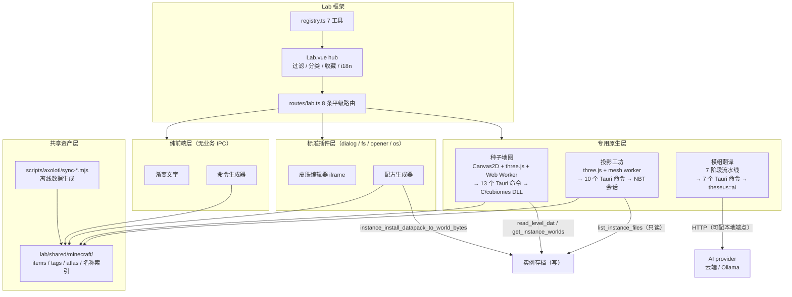

# Axolotl Launcher v1.10.5｜Axolotl Lab（实验室）子系统深度调研

> 面向二次开发的专项文档（主报告的加强补充）
> 调研日期：2026-11-04　｜　源码基线：`v1.10.5` / commit `e9d1def79b35bcd2dceb20d83beb43bef0ba0182`
> 配套文档：`Axolotl-Launcher-v1.10.5-深度架构调研报告.md`（整体启动/状态/依赖/数据库）

---

## 0. 文档定位、基线与核验方法

### 0.1 为什么单独成文

Lab 不是「几个前端小工具」，而是本仓库中**技术栈最杂、原生代码最重、数据资产最大**的一块：既有纯前端生成器，也有编译进二进制的 C/cubiomes 世界生成引擎、WebGL/three.js 渲染管线、NBT 会话服务、以及约 1 万行 Rust 的 AI 翻译流水线。主报告 §3 只能概述，本文档按「能据此改代码」的粒度展开。

规模实测：

| 范围 | 数量 |
| --- | --- |
| `apps/app-frontend/src/lab/` 文件 | **265 个**（含数据资产），合计约 448,306 行 |
| Lab 页面 `src/pages/Lab*.vue` | 8 个（1 个 hub + 7 个工具），最大 `LabSeedMap.vue` 181KB |
| Lab 组件 `src/components/lab/` | **44 个文件**：39 个 .vue + 4 个 .spec.ts + 1 个 .ts |
| Lab 专用 Rust 壳命令文件 | `seed_map.rs` 263 行、`schematic_preview.rs` 2489 行、`mod_translation.rs` 881 行 |
| Lab 专用 Rust 实现 | `apps/app/src/seed_map/`（含 4 个 C 文件）约 4,700 行 + `apps/app/src/mod_translation/` 11 个 .rs 约 10,550 行 |
| 注册工具 | **7 个**（官网仅宣传 3 个；Lab 首页实际显示 6 个，见 §1.4） |

### 0.2 路径约定

下文所有 `路径:行号` 均相对仓库根 `Axolotl-v1.10.5/`，并对高频目录使用缩写：

| 缩写 | 完整路径 |
| --- | --- |
| `FE/` | `apps/app-frontend/src/` |
| `RS/` | `apps/app/src/` |
| `LIB/` | `packages/app-lib/src/` |
| `SC/` | `scripts/axolotl/` |
| `BR` | `apps/app/build.rs` |

### 0.3 核验方法

1. 四路专项并行调研（种子地图 / 投影工坊 / 模组翻译 / 其余四工具与框架），每路要求给出 `文件:行号`；
2. 本报告对**关键结构性结论逐条回查源码**：`registry.ts`、`routes/lab.ts`、`Lab.vue:41-42`、引擎 ABI 校验、FFI 宏、AI 调用点、事件名、权限清单、localStorage 键、第三方声明；
3. 对官方/第三方宣传口径做**源码对照**，差异单列（§1.4、§5.9）；
4. 所有未能逐行确认的部分列入 §12.3，不作推测性填充。

---

## 1. 子系统总览

### 1.1 七个工具的全景表

注册表：`FE/lab/registry.ts:21-78`；路由：`FE/routes/lab.ts:9-82`。

| # | id | 分类 | 路由 | 页面 | 前端逻辑 | 后端形态 | 是否纯本地 |
| --- | --- | --- | --- | --- | --- | --- | --- |
| 1 | `skin-editor` | creation | `/lab/skin-editor` | `FE/pages/LabSkinEditor.vue` (7KB) | `FE/components/lab/skin-editor/skin-editor-theme.ts` | 自定义协议 `axolotl-skin://` + Blockbench 子模块 | 是 |
| 2 | `gradient-text` | creation | `/lab/gradient-text` | `LabGradientText.vue` (50KB) | `FE/lab/gradient-text/` | 无（仅标准 Tauri 插件） | 是 |
| 3 | `seed-map` | world | `/lab/seed-map` | `LabSeedMap.vue` (182KB) | `FE/lab/seed-map/` (约 40 文件) | 专用 Rust 插件 + **C/cubiomes 引擎** | 是 |
| 4 | `schematic-preview` | creation | `/lab/schematic-preview` | `LabSchematicPreview.vue` (114KB) | `FE/lab/schematic-preview/` | 专用 Rust 插件（NBT 会话服务） | 是 |
| 5 | `mod-translation` | maintenance | `/lab/mod-translation` | `LabModTranslation.vue` (16KB) | `FE/lab/mod-translation/` | 专用 Rust 插件 + `theseus::ai` | **否**（翻译走 AI HTTP，见 §5.9） |
| 6 | `recipe-generator` | creation | `/lab/recipe-generator` | `LabRecipeGenerator.vue` (89KB) | `FE/lab/recipe-generator/` | 复用 `instance` / `worlds` 插件 | 是 |
| 7 | `command-generator` | creation | `/lab/command-generator` | `LabCommandGenerator.vue` (39KB) | `FE/lab/command-generator/` | 无（纯前端） | 是 |

> 分类由 `LabToolDefinition.category: 'creation' | 'maintenance' | 'world'`（`registry.ts:14`）定义；实际分布 creation×5、maintenance×1、world×1。

### 1.2 分层与耦合模型



**关键结论**：Lab 与主体应用几乎没有数据库耦合。除模组翻译读取 `app.db` 的 `ai_settings/ai_provider_configs/ai_provider_models` 外，其余工具状态全部在 `localStorage` 或 Rust 进程内会话中；与实例的交互只有三条路径（读 level.dat、列 schematic 文件、写数据包到存档）。这对二次开发是好消息：改 Lab 不易污染主库。

### 1.3 与实例/主程序的数据边界

| 工具 | 读实例 | 写实例 | 读写 app.db | 写用户磁盘 |
| --- | --- | --- | --- | --- |
| 种子地图 | `seed_map_read_level_dat`、`get_instance_worlds` | 否 | 否 | 否（仅 localStorage） |
| 投影工坊 | `schematic_preview_list_instance_files` | 否（导出由用户选路径另存） | 否 | 导出文件 / PNG / CSV |
| 模组翻译 | 否（独立 JAR 路径） | 否 | 读 AI 配置；凭据在 keyring | 输出 `*-zh_cn.jar` |
| 配方生成器 | `instance_list`、`get_instance_worlds` | **是**：`instance_install_datapack_to_world_bytes` | 否 | 数据包 zip |
| 皮肤编辑器 | 否 | 否 | 否 | 导出 PNG |
| 渐变文字 / 命令生成器 | 否 | 否 | 否 | 可选导出文件 |

### 1.4 宣传口径与源码的三个差异（重要）

1. **官网只列 3 个工具**（`axlmc.org`：「gradient text generator、Java Edition seed map、3D schematic workshop」），源码注册表是 **7 个**。
2. **Lab 首页实际只显示 6 个**：`FE/pages/Lab.vue:41-42` 明确 `availableTools = labTools.filter(tool => tool.id !== 'mod-translation')`，注释为「Temporarily hide the mod translation entry while retaining its route and implementation」。即**模组翻译的路由、页面、后端全部保留，仅从 hub 隐藏**；直接访问 `/lab/mod-translation` 可用。二次开发若找不到入口，这是原因。
3. **「全部本地运行、无需外部网站或账号」并非全量成立**：6 个工具确实纯本地；但模组翻译的翻译阶段必须调用 `theseus::ai::complete_text`（`RS/mod_translation/translate.rs:193-210`），默认 provider 为云端 HTTPS 端点，只有把 provider 配成本地 Ollama（`http://127.0.0.1:11434`）才纯本地。详见 §5.9。

---

## 2. 公共框架与共享层

### 2.1 注册表与工具定义

`FE/lab/registry.ts:12-19`：

```ts
export type LabToolDefinition = {
    id: string
    category: 'creation' | 'maintenance' | 'world'
    route: string
    icon: Component
    title: string
    description: string
}
```

图标来自 `@modrinth/assets`（`:1-9`）；`labTools`（`:21-78`）为 `readonly` 数组；`getLabTool(id)`（`:80-82`）为查找函数。**title/description 是英文兜底**，hub 会用 i18n 覆盖（`Lab.vue:181-201`）。

### 2.2 Hub 页面 `FE/pages/Lab.vue`

| 行号 | 职责 |
| --- | --- |
| `:33` | 引入 `labTools` |
| **`:41-42`** | 过滤 `mod-translation`（见 §1.4） |
| `:43-51` | `toolCoverImages` 七张封面映射（仍含被隐藏工具的封面） |
| `:53-130` | `defineMessages` 定义全部 `app.lab.*` i18n 文案（分类标签、工具名与描述） |
| `:132-137` | 分类筛选、收藏筛选，持久化于 `FE/helpers/lab-preferences` |
| `:149-172` | `visibleTools`：分类 + 收藏 + 搜索，收藏置顶 |
| `:181-201` | 用 i18n 结果覆盖 registry 的英文 title/description |
| `:281-362` | 卡片渲染（封面、`TagItem` 分类徽标、Enter 按钮） |

### 2.3 路由

`FE/routes/lab.ts:5-8` 注释说明：**hub 页面没有 `RouterView` 出口**，所以 7 个工具是同级路由记录，而非嵌套路由。共 8 条：

```
/lab                     → pages/Lab.vue              (name: Lab)
/lab/skin-editor         → pages/LabSkinEditor.vue
/lab/gradient-text       → pages/LabGradientText.vue
/lab/seed-map            → pages/LabSeedMap.vue
/lab/schematic-preview   → pages/LabSchematicPreview.vue
/lab/mod-translation     → pages/LabModTranslation.vue
/lab/recipe-generator    → pages/LabRecipeGenerator.vue
/lab/command-generator   → pages/LabCommandGenerator.vue
```

全部 `() => import(...)` 懒加载；每条带 `meta.breadcrumb` 与 `meta.discordActivity`（`:14-17` 等）。路由由 `FE/routes/index.ts` 与其他域模块拼接（主报告 §3.2）。

### 2.4 共享 Minecraft 数据层 `FE/lab/shared/minecraft/`

| 文件 | 作用 |
| --- | --- |
| `assets/items/*.json`（**20 个版本**，1.12 → 26.3） | 各版本物品清单；最大 `26.3.json` 8,296 行 |
| `assets/tags/*.json`（**18 个版本**） | 原版标签（含递归展开），最大 `26.3.json` 3,468 行 |
| `assets/texture-atlas.json` / `.png` | 物品图集与坐标（16,670 行 JSON） |
| `assets/vanilla/item-name-index.json` | en_us / zh_cn 物品名（3,684 行） |
| `assets/vanilla/potion-items.json` / `potions.json` | 药水数据，供酿造配方使用 |
| `sources.json` | 五个数据源与固定 commit/npm 版本（`:1-42`） |
| `resources.ts` | `import.meta.glob` 动态加载 items/tags，带缓存（`:44-98`） |
| `item-images.ts` / `item-names.ts` / `versions.ts` / `types.ts` | 图集裁切、名称解析、`LATEST_JAVA_VERSION='26.3'` 与版本比较、类型 |
| `README.md` / `THIRD_PARTY_NOTICES.md` | 说明「从 recipe-generator 上移，由 seed-map / command-generator 共用」；许可证声明 |

**许可证来源（已核验）**：`THIRD_PARTY_NOTICES.md:3-5` 列出 destruc7i0n/crafting（MIT，commit `e6c71dd`）、destruc7i0n/minecraft-textures（**npm 26.2.1，GPL-3.0**）、Mojang 免责声明；`sources.json:16` 却记 **npm 26.3.0**，另含 misode/mcmeta 26.3 注册表与 InventivetalentDev/minecraft-assets 本地化。**两处版本号不一致（26.2.1 vs 26.3.0）**，二次开发做合规审查时需以实际打包资源为准，建议顺手修正声明。

### 2.5 静态资源生成脚本（离线数据管线）

| 脚本 | 产出 | 关键行 |
| --- | --- | --- |
| `SC/sync-seed-map-clients.mjs` | 从 Mojang piston-meta 下载官方 client.jar 并校验 sha1，再调模板脚本、生成 Rust `template_resources.rs` | `:43-88`（下载）、`:109-150`（导入与别名）、`:151-164`（生成 Rust `include_bytes!`） |
| `SC/sync-seed-map-templates.mjs` | 前端 `structures.json.gz`、`ancient-city-layout.json.gz`、`sources.json`、`catalog.json`；Rust 侧 `ancient-city-blocks.json.gz` + layout | `:20-190`（解析 client.jar 的 .nbt/blockstates/models）、`:289-300`、`:301-395`、`:396-469` |
| `SC/seed-map-texture-colors.mjs` | 贴图平均色 | 被上一脚本 `:9` 引用 |
| `SC/sync-schematic-resources.mjs` | 投影工坊 `assets/vanilla/` 的 4 个 JSON + 图集 PNG，固定 misode/mcmeta commit，校验 `EXPECTED_VERSION='26.3'` | `:3-17`、`:58-84`、`:123-132` |
| `SC/sync-recipe-item-names.mjs` | `assets/vanilla/item-name-index.json`（en_us / zh_cn） | `:3-15`、`:33-69` |
| `SC/sync-blockbench-skin-editor.mjs` | `apps/app/resources/blockbench-skin/`，并 gzip `skin.bundle.js` | `:9-34` |

**核验结论**：`assets/items/*.json`、`assets/tags/*.json`、`texture-atlas.json/png`、`potion-items.json`、`potions.json`、`block-name-index.json`（投影工坊）在仓库内**未找到生成脚本**——`sources.json` 只记录来源，疑为外部流程产出（§12.3 标注）。这类「只有产物没有生成器」的数据是二次开发的主要维护风险。

### 2.6 本地持久化键清单（实测 grep 汇总）

| 键 | 用途 | 定义 |
| --- | --- | --- |
| `axolotl.lab.gradient-text.v1` | 渐变文字文档/配色/预设 | `FE/lab/gradient-text/gradient-storage.ts:31` |
| `axolotl.lab.recipe-generator.v1` | 配方项目（含迁移） | `FE/lab/recipe-generator/project.ts:9` |
| `axolotl.lab.seed-map.v1` | 种子地图工作区 schema v4 | `FE/lab/seed-map/workspace.ts:45` |
| `axolotl.lab.seed-map.history.v1` | 历史记录（上限 60） | `FE/lab/seed-map/history.ts:32-33` |
| `axolotl:command-generator:user-presets` | 用户命令预设 | `FE/lab/command-generator/presets.ts:26` |
| `axolotl:lab:schematic-preview:recent:v1` | 最近打开（上限 5） | `FE/lab/schematic-preview/storage.ts:3-4,44-54` |

另有 `FE/helpers/lab-preferences`（分类/收藏）使用自己的键。**没有任何 Lab 工具把 UI 状态写进 app.db**。

### 2.7 Tauri 插件注册与权限（改命令必看）

运行时注册：`RS/main.rs:870-910` 中的 `api::seed_map::init()`（`:889`）、`api::schematic_preview::init()`（`:890`）、`api::mod_translation::init()`（`:882`）、`api::ai::init()`（`:871`）、`api::translation::init()`（`:894`）、`api::worlds::init()`（`:906`）、`api::minecraft_skins::init()`（`:881`）。

构建期命令清单（**必须手工同步**，见主报告 §3.1）：`BR:601`（minecraft-skins）、`:861`（seed-map）、`:883`（schematic-preview）、`:931`（ai）、`:953`（translation）、`:1064`（worlds）、`:1190`（mod-translation）。

窗口权限：`RS/capabilities/plugins.json` 中 `seed-map:default`（约 `:157`）、`schematic-preview:default`、`mod-translation:default`、`ai:default`、`translation:default`、`worlds:default`、`minecraft-skins:default` 等均授予 `main` 窗口。前端命名统一为 `invoke('plugin:<插件>|<命令>')`，插件名用连字符（如 `seed-map`），Rust 模块名用下划线（如 `seed_map.rs`），**改名时两套都要改**。

---

## 3. 种子地图（Seed map）— 技术最重的工具

### 3.1 能力与文件地图

能力：按种子/MC 版本/维度离线渲染生物群系图、结构位置、出生点、矿脉分布、地下 3D 体素、古城布局与战利品，支持区域分析、标记点与分享链接。

| 层 | 文件 |
| --- | --- |
| 页面 | `FE/pages/LabSeedMap.vue`（181KB） |
| 前端逻辑 | `FE/lab/seed-map/`：`backend.ts`(318)、`advanced.ts`(94)、`underground.ts`(144)、`tile-layer.ts`(279)、`layout-scene.ts`(406)、`meshing` 相关 `structure-blocks.ts`(333)、`ores.ts`(348)、`ore-layer.ts`(296)、`biomes.ts`(377)、`workspace.ts`(332)、`history.ts`(185)、`area-analysis.ts`(383)、`underground-mesh.ts`、`marker-rendering.ts`、`structure-labels.ts`、`visuals.ts`、`features.ts` 等 |
| Worker | `structure-block-worker.ts`(48)、`underground-worker.ts`(23) |
| 组件 | `FE/components/lab/seed-map/`：`SeedMapAreaAnalysis.vue`、`SeedMapBiomePicker.vue`、`SeedMapLayoutPreview.vue`、`SeedMapUndergroundPreview.vue`、`SeedMapStructureDetails.vue`、`SeedMapWorldImportModal.vue` 等 |
| Rust 壳 | `RS/api/seed_map.rs`(263) |
| Rust 实现 | `RS/seed_map/mod.rs`(1350)、`details.rs`(879)、`underground.rs`(552)、`ores.rs`(242)、`bridge.rs`(160)、`template_resources.rs`(123，脚本生成) |
| C 引擎 | `RS/seed_map/cubiomes_bridge.c`(851)、`cubiomes_details.c`(352)、`underground_volume.c`(199)、`ancient_city_layout.c`(314) + 头；外部子模块 `apps/app/vendor/cubiomes` |
| 数据 | `FE/lab/seed-map/assets/versions/`（**39 个版本目录**）+ `catalog.json`(21,656 行)；`RS/seed_map/assets/versions/`（**15 个含古城版本**） |

### 3.2 完整 Tauri 命令表（13 个）

插件 `seed-map`，注册于 `RS/api/seed_map.rs:9-27`；构建期清单 `BR:860-881`。

| 命令 | 前端调用 | 入参 → 返回 | Rust → 原生 |
| --- | --- | --- | --- |
| `seed_map_profiles` | `backend.ts:186` | 无 → `SeedMapVersionProfile[]` | `:30` → `mod.rs:259` 遍历 `JAVA_VERSIONS` 调 capability |
| `seed_map_render_tile` | `backend.ts:218` | `TileRequest{seed,edition,version,dimension,x,z,scale,width,height,elevation=128,terrain,contours,highlightBiomes}` → RGBA `ArrayBuffer` → `ImageData`/`createImageBitmap`（`:225-236`） | `:35-44` `spawn_blocking` → `mod.rs:330-380` → `cubiomes_bridge.c:427` |
| `seed_map_find_features` | `backend.ts:242`；页面 `:1829`；`area-analysis.ts:248` | `FeatureQuery{minX,minZ,maxX,maxZ,featureMask}` → 特征数组（`:255-261` 映射） | `:47-55` → `mod.rs:383-399`（4096 容量）→ `cubiomes_bridge.c:582` |
| `seed_map_spawn` | `backend.ts:269` | `{seed,edition,version}` → `{x,z,approximate}` | `:58-68` → `mod.rs:457` → C `:685` |
| `seed_map_biome_at` | `backend.ts:285`；页面 `:2264` | `{seed,edition,version,dimension,x,y,z}` → biome id | `:71-85` → `mod.rs:433-450`（y clamp -64..319）→ C `:702` |
| `seed_map_scan_ores` | `backend.ts:307`；`ore-layer.ts:125`；`area-analysis.ts:118` | `OreScanRequest{ores[],chunks[]}` + `requestId` → `OreScanChunk[]` | `:150-168` → `ores.rs:127-218`（budget 4096、去重、`status:"terrain_unverified"`）→ C `:801/806` |
| `seed_map_cancel_ore_scan` | `backend.ts:312` | `{requestId}` → () | `:173-175` → `OreScans` HashMap + 早到取消表 + 30s TTL（`:95,133-147`） |
| `seed_map_read_level_dat` | `backend.ts:317` | `{path}` → `{seed,version?,dataVersion?}` | `:202-210` → `mod.rs:504-575`（见 §3.6） |
| `seed_map_structure_details` | `advanced.ts:89` | `StructureQuery{x,z,featureMask,includeBlocks}` → `SeedMapStructureDetails` | `:213-221` → `details.rs:363-499`（古城分支 `:389-478`）→ `cubiomes_details.c:86` |
| `seed_map_container_loot` | `advanced.ts:93` | `{query,container}` → `SeedMapLoot` | `:224-233` → `details.rs:297` / `cubiomes_details.c:212` |
| `seed_map_underground_tile` | **前端无调用** | `UndergroundRequest{tile,layers}` → RGBA | `:236-245` → `details.rs:501-563` → `cubiomes_details.c:274` |
| `seed_map_underground_volume` | `underground.ts:136` | `{request, id, chunk:true}` → `ArrayBuffer`（16 字节头，schema 1/2/3，`:98-132` 解码） | `:248-258` → `underground.rs:76,268` → `underground_volume.c:114` |
| `seed_map_cancel_underground` | `underground.ts:143` | `{id}` → () | `:261-263` → `underground.rs:42-50` |

> **遗留接口**：`seed_map_underground_tile` 在 Rust 注册并生成 ACL，但前端全仓检索无调用；地下预览已改用 `underground_volume` 的 3D 体素路径。二次开发可考虑清理或复用。

### 3.3 原生引擎：cubiomes 的构建与 FFI

**构建**（`BR:176-282`）：4 个仓库内 C 文件（`:195-200`）+ `collect_engine_sources` 递归收集 `vendor/cubiomes` 的 features / loot / loot_tables / barrels / chests / trial_chambers / cjson（`:146-174`）；生成兼容头 `cubiomes-loot-functions.h`（`:179-194`）。

- **非 Windows**：`cc::Build` 编译静态库 `axolotl-cubiomes`，链接 `m`（`:269-280`）。
- **Windows**：`AXOLOTL_CUBIOMES_CC`（默认 gcc，`:212-213`）用 MinGW 产出 `axolotl-cubiomes.dll`，参数为 `-shared -O3 -std=gnu11 -fwrapv -static-libgcc --export-all-symbols --no-insert-timestamp --image-base=0x180000000`（`:234-257`；注释说明固定 image base 是为保持 DLL 字节稳定、避免触发 Tauri 重打包）。产物复制到 `resources/seed-map/`（`:258-264`），并写 `AXOLOTL_CUBIOMES_BUILD_DLL` 供 debug 加载（`:265-268`）。架构限 x86_64/aarch64（`:217-233`）。

**FFI 双形态**（`RS/seed_map/bridge.rs:88-99` 已核验原文）：宏 `engine_function!` 在 `#[cfg(not(windows))]` 下展开为 `unsafe extern "C"` 静态链接声明；在 Windows 下展开为用 `libloading::Library` 按符号名动态取址的 Rust 包装函数，找不到符号时返回预设失败值。

**ABI 校验**（`bridge.rs:28-40` 已核验）：从 `resources/seed-map/axolotl-cubiomes.dll` 加载（`:18`），要求 `axolotl_seed_map_abi_version() == 2` 且 `axolotl_seed_map_engine_revision() == 0xa49d5bc5b709e6e2`，并逐一探测 14 个符号（`:37-65`）。C 侧定义在 `cubiomes_bridge.c:137`。extern 声明全集 `bridge.rs:101-160`，C 声明 `cubiomes_bridge.h:19-119`。

> **易踩坑（本报告精确化）**：引擎 revision 存在**两种形式**——C 侧是 `u64 0xa49d5bc5b709e6e2`（`cubiomes_bridge.c:137`，ABI guard，`bridge.rs:34` 校验）；Rust `mod.rs:318` 与前端 `backend.ts:8` 是 40 位十六进制串 `a49d5bc5b709e6e28b5a74daddb3efb382fba7bb`（其**前 16 位正是**上述 u64），用于 profile 与前端缓存键（`ore-layer.ts:66`）。换引擎时**四处都要同步**：C 的 u64、Rust 的完整串、前端常量、以及 `cubiomes_bridge.c` 的版本映射表。

**版本映射**：Rust 版本码 `major*10000+minor*100+patch`（`mod.rs:115-119`），`JAVA_VERSIONS` 表 `:120-177`（26.3 → b1.7 含别名），C 侧 `axolotl_seed_map_java_version` 把码映射为 `MC_*`（`cubiomes_bridge.c:139-194`）。`capability(mc,kind,value)`（`:831-851`）分流 0=群系存在、1=结构掩码、2=矿种、3=地下层，被 `mod.rs:283-317` 用于生成 profile。

**计算归属**：群系/瓦片 `cubiomes_bridge.c:427-479`（`setupGenerator`/`applySeed`/`biomesToImage`）；结构 `:582-639`；出生点 `:685-700`；单点群系 `:702-714`；矿脉 `:733-800`；结构详情/战利品/地下瓦片 `cubiomes_details.c:86/212/274`；古城 jigsaw `ancient_city_layout.c:251`；地下体素 `underground_volume.c:114`。

**取消机制**（两套）：
- 矿脉：前端生成随机 `requestId`（`backend.ts:306`），`OreScan::register`/`Drop`（`api/seed_map.rs:102-123`），`extern "C" fn(u64)->i32` 回调 `ore_scan_canceled`（`:127-131`）经 `ores.rs:173-185` 注入 C 循环（`cubiomes_bridge.c:806-809`）；Rust 每矿种前后检查返回 `Interrupted`。
- 地下：`ACTIVE_REQUEST`/`CANCELED_REQUEST` 两个 `AtomicU64`（`underground.rs:17-18`），`begin/cancel/is_canceled`（`:38-67`）注入 `axolotl_seed_map_underground_chunk`（`:288-300`）。`GENERATOR: Mutex<()>`（`underground.rs:19`）与 `STRUCTURE_COMPUTATION: Mutex<()>`（`details.rs:13`）串行化原生计算。

所有重计算均通过 `tauri::async_runtime::spawn_blocking`（`api/seed_map.rs:38/50/63/80/155/205/216/228/239/252`），避免阻塞 UI。

### 3.4 渲染管线

**主地图 = Canvas 2D**（`LabSeedMap.vue:1457` 取 `getContext('2d')`，`:1474-1479` `imageSmoothingEnabled=false` + `drawImage`），瓦片位图由 Rust 产出 RGBA 字节。

**瓦片层** `FE/lab/seed-map/tile-layer.ts`：

- `TILE_SCALES=[1,4,16,64,256]`、256px 瓦片（`:19-28`），`seedMapPreviewLevel` 给 64px 低清预览（`:30-34`），LRU `CACHE_BYTES=32MB`（`:20`）。
- `seedMapTileContextKey` 把 seed/edition/version/dimension/elevation/terrain/contours/highlightBiomes 序列化（`:36-47`），`tileKey = context|scale|pixels|x|z`（`:49-51`）；`cells()` 按 `span=scale*pixels` 切格（`:53-70`）。
- `refresh()` 按「预览级 → 当前级 → padding 级」三层计划并按到中心距离排序（`:127-168`）；`pump()` 并发上限 `min(4, concurrency)`（`:198-207`）；`run()` 用 context/epoch 丢弃陈旧结果并关闭旧 bitmap（`:209-249`）；`prune()` 分级淘汰（`:170-196`）；`drawable()` 目标级优先、粗 scale 垫底（`:251-260`）。
- 并发度 `seedMapTileConcurrency`（`backend.ts:193-200`）按 CPU 核数给 2–8，scale≤1 时 ≤4。

**群系着色在 C 侧**：`initBiomeColors` + `biomesToImage`（`cubiomes_bridge.c:477-479`）；`highlight_mask` 把非目标群系按主世界 ×77/256 淡化（`:481-499`），mask 由 `mod.rs:334-345` 构造。前端 `biomes.ts:45+` 的 `SEED_MAP_BIOMES` 只供选择器与悬浮提示，**不参与瓦片底色**。

**3D 预览 = three.js**：依赖 `three@^0.185.1`、`@types/three`、`deepslate@^0.26.2`（解 NBT）、`fflate@^0.8.3`（解 gz）——见 `apps/app-frontend/package.json:40,48,49,60`。`layout-scene.ts:1` 引入 three，`:72` `WebGLRenderer`、`:90` `InstancedMesh`、`:130` `OrbitControls`、`:126` 光照、`:213-218` BufferGeometry 挂 position/color。`underground-mesh.ts:94` 产出 `SchematicMeshData`，**复用投影工坊的 worker 类型**（`underground.ts:3`）。

**两个 Worker 的消息协议**：

| Worker | 入 | 出 |
| --- | --- | --- |
| `structure-block-worker.ts` | `StructureBlocksRequest{version,pieces,mode,sparseBlocks}`；`:15-18` 用 `import.meta.glob('./assets/versions/*/structures.json.gz',{query:'?url'})` 动态载入，`:21-29` fetch + `gunzipSync`，`:30` 校验 `pack.version` | `mode==='chests'` → `{type:'chests',chests}`（`:31-34`）；否则动态 import `structure-block-mesh` 产出 `{type:'ready',result}` 并 transfer `positions/colors.buffer`（`:36-41`）；异常 `{type:'error',message}`（`:42-47`） |
| `underground-worker.ts` | `{type:'init',textureUvs}` 缓存 UV（`:10-13`）；`{type:'mesh', ...UndergroundMeshRequest}` | `buildUndergroundMesh` → `postMessage({mesh}, buffers)` 零拷贝（`:14-19`）；失败 `{error}`（`:20-22`） |

### 3.5 数据资源与版本同步

前端 `assets/versions/` **39 个目录**（1.0 → 26.3、b1.7/b1.8，个别别名由 `catalog.json` 的 `resourceVersion` 映射而非独立目录），典型 `1.21.1/` 含 `sources.json`、`structures.json.gz`、`ancient-city-layout.json.gz`；Rust 侧 **15 个**含古城版本目录，含 `ancient-city-blocks.json.gz` + `ancient-city-layout.json.gz`。

| 文件 | 内容 | 生成位置 |
| --- | --- | --- |
| `structures.json.gz` | client.jar 内 `.nbt` 结构模板 + blockstates/models + 贴图平均色；字段 `schemaVersion/version/dataVersion/templates/resources/textureColors` | `SC/sync-seed-map-templates.mjs:20-32,72-190,289-300` |
| `ancient-city-layout.json.gz` | 古城 structure / template_pool / 模板 / jigsaw 连接器；**同时写前端与 Rust 两份** | 同脚本 `:301-369` |
| `ancient-city-blocks.json.gz` | 古城方块模板 + `lootTables`，仅 Rust 侧 | `:370-395` |
| `sources.json` | jarSha256 / assetSha256 / 各模板 sha256 / dataVersion / placementRules / copyright | `:396-438` |
| `catalog.json` | 全局索引 `{schemaVersion:1,versions:{ver:{dataVersion,structures[],templates{size,paletteCount}}\|{resourceVersion:alias}}}` | `:439-469` |

**两侧数据确有重复**，靠三件事保持一致：① 同一脚本一次写出两侧（`:300/362/369/395`）；② `catalog.json` 的 `resourceVersion` 别名（前端 `structure-blocks.ts:81-84,111-112` 与 worker `:15-18` 消费）；③ 四处引擎 revision 常量一致（§3.3）。Rust 侧 gz 由 `template_resources.rs` 的 `include_bytes!` 编进二进制，`details.rs:47/85` 用 `flate2` 解压；前端 gz 由 Vite `import.meta.glob` 打包，**运行时完全离线**，只有资源生成脚本联网（`SC/sync-seed-map-clients.mjs:43`）。

### 3.6 状态与本地持久化

`workspace.ts`：键 `axolotl.lab.seed-map.v1`（`:45`），schema `version:4`（`:15-41`，含 seed/edition/gameVersion/dimension/displayMode/undergroundLayers/Y/center/zoom/elevation/各开关/visibleFeatures/selectedOres/oreYMin-Max/**markers**/completedFeatures/completedOres）；`load/save`（`:89-108`）；`sanitizeSeedMapWorkspace`（`:110-196`，逐字段白名单与范围校验，`sanitizeMarkers` 限 1000 条、颜色正则、坐标取整 `:306-332`）；`SEED_MAP_SCALES=[1,4,16,64,256]`、`MIN_ZOOM=-2`、固定高度切片 `[128,16,-32]`（`:47-50`）；分享链接 `createShareQuery/applyShareQuery`（`:198-245`）。

页面 `LabSeedMap.vue:187` 以 `reactive(applyShareQuery(route.query, loadSeedMapWorkspace()))` 初始化；deep watch 350ms 防抖保存（`:950-954`）；关键操作立即保存（`:1213`）。`history.ts` 上限 60 条，同 seed 合并（`:59-90`），`updateSeedMapHistoryProgress`（`:96-109`）。

**从实例读种子**：`mod.rs:504-531` 用 `quartz_nbt` 读 `level.dat`，`read_nbt_any_compression` 依次尝试 Gz / Uncompressed / Zlib（`:556-575`），取 `Data.WorldGenSettings.seed`（`extract_world_seed:577`）；若为拆分世界种子再读同目录 `data/minecraft/world_gen_settings.dat`（`:538-554`）；版本由 `Version.Name` 或 `DataVersion` 映射（`:709-730`）。导入弹窗 `SeedMapWorldImportModal.vue` 用 `instance_list` + `get_instance_worlds` 列出存档，拼路径 `${instancePath}/saves/${world.path}/level.dat` 后调 `readSeedMapLevelDat`（`:127-134`）。

**降级**：`getSeedMapProfiles` 失败时前端用 `fallbackSeedMapProfiles`（`backend.ts:158-176`）生成 `available:false` 的 profile，UI 仍可用——DLL 缺失不会导致启动器崩溃。

### 3.7 算法约束与性能

- 缩放：`scale = 4 ** zoom`（`LabSeedMap.vue:629`），zoom clamp `[-2,4]` 保留 3 位小数（`workspace.ts:167-170`）；瓦片 `span = scale*256`；Rust 用 `div_euclid(scale)` 换算块坐标（`mod.rs:654-656`）。
- 种子解析：`parse_seed`（`mod.rs:658-664`）数字按 i64，否则按 Java `String.hashCode`（UTF-16 ×31 累加，`:666-670`）。
- 校验：`validate_tile_request`（`:629-651`）限 scale∈{1,4,16,64,256}、宽高 1..256、highlight≤256；地下瓦片另限 width/height 为 16 的倍数且 ≤64（`details.rs:517-529`）；结构查询要求 `feature_mask.count_ones()==1`（`details.rs:370`）。区块坐标上限 ±1,875,000（`ores.rs:146`），世界边界 ±30,000,000（`underground.rs:107-120`）。
- 性能：32MB 瓦片 LRU + 低清预览 + context/epoch 失效；worker transferable 零拷贝；地下 3D `UNDERGROUND_RADIUS=12`、512MB 内存预算、按距离队列淘汰（`underground.ts:37-38,42-82`）；`InstancedMesh` 批量绘制。
- **扩展点**：加/改命令 → `api/seed_map.rs:11-25` + `BR:860-881` + 前端 `backend.ts`/`advanced.ts`/`underground.ts`；加 MC 版本 → `mod.rs:120-177`、`cubiomes_bridge.c:139-194`、`backend.ts:84-141`，并重跑两个 `sync-seed-map-*` 脚本；换引擎 → 同步四处 revision 常量（§3.3）。

---

## 4. 投影工坊（Schematic workshop）

### 4.1 文件地图与命令表（10 个）

页面 `FE/pages/LabSchematicPreview.vue`(114KB)；逻辑 `FE/lab/schematic-preview/`（`scene.ts` 1189、`meshing.ts` 556、`mesh-worker.ts` 393、`editing.ts` 282、`resources.ts` 250、`builtin-resources.ts` 154、`block-preview.ts` 261、`block-geometry.ts`、`storage.ts`、`instance-files.ts`、`assets/vanilla/` 六件）；组件 `FE/components/lab/schematic-preview/` 4 个；Rust `RS/api/schematic_preview.rs`(2489)。插件 `schematic-preview`，注册 `:226-241`，构建期清单 `BR:883+`。

| 命令 | 入参 → 返回 | Rust 行号 |
| --- | --- | --- |
| `schematic_preview_open` | `(source, requestId)` → `PreviewManifest` | `:243-280` |
| `schematic_preview_list_instance_files` | `(instanceId)` → `Vec<InstanceSchematicFile>` | `:282-295` |
| `schematic_preview_read_chunk` | `(sessionId, regionId, position)` → `Response`（`SPC1` + 4096×u32 LE） | `:296-320`；前端 `backend.ts:107-136` 校验魔数 |
| `schematic_preview_block_info` | 同上 → `Option<PreviewBlockState>` | `:321-343` |
| `schematic_preview_apply_edits` | `(sessionId, edits[], targetState?)` → `PreviewEditResult{changedChunks,appliedPaletteIndices}` | `:344-468` |
| `schematic_preview_export_sponge` / `_litematic` | `(sessionId)` → `Response<Vec<u8>>` | `:470-485` → `:1609-1684` / `:1487-1607` |
| `schematic_preview_transform` | `(sessionId, transform)` → 新 `PreviewManifest` | `:486-506` → `:1272-1434` |
| `schematic_preview_cancel` | `(requestId)` → () | `:507-517` |
| `schematic_preview_close` | `(sessionId)` → () | `:519-526` |

### 4.2 会话模型与格式解析

- **source 三态**（`RS/api/schematic_preview.rs:24-42`，serde `tag=kind`）：`external | instance | instance_file`。`resolve_source`（`:528-591`）对 instance 路径做 canonicalize 防目录穿越（`:552-565`）。
- **会话**：`SessionBuilder::finish` 用 `Uuid::new_v4()`（`:1116`）；全局 `SESSIONS: OnceLock<Mutex<VecDeque<Arc<PreviewSession>>>>`（`:213-214`），open 时 `push_front` + **`truncate(2)`**（`:276-278`）= 最多 2 个 LRU 会话；`close` 用 retain 移除（`:520-526`）；前端打开新文件/卸载时关闭（`LabSchematicPreview.vue:625-633,1546`）。
- **read_chunk 不是字节流**：返回 8 字节头 + 4096 个 LE uint32（一个 16³ chunk 的 palette 索引），缺失 chunk 补 0（`:308-318`）；描述符来自 `manifest.regions[].chunks[]`（`:105-116`），前端据此建任务队列并去重缓存（`LabSchematicPreview.vue:697-712,833-852`）。
- **格式**：UI/实例列表只接受 `litematic|schem`（页面 `:588`、Rust `:1950`）；`:613-617` **明确拒绝 Legacy MCEdit `.schematic`**；按 NBT 根是否含 `Regions` 分派 litematic / sponge（`:625-641`）。Litematic `Version 4..=7`（`:680-684`），Sponge `Version 2|3`（`:813-820`）。`.nbt` 无独立分支（未核实是否为正式支持格式）。
- **依赖**：`quartz_nbt` + `flate2::read::GzDecoder`（`apps/app/Cargo.toml:18,30`）。`read_root`（`:653-670`）按 gzip magic 解压，`.take(512MiB+1)` 防爆，统一 `Flavor::Uncompressed` 读取；导出用 `Flavor::GzCompressed`（`:1603,1680`）。
- **内存**：常量 `:16-22`（chunk 16³、文件 ≤256MiB、解压 ≤512MiB、≤1.28e8 块、palette ≤1,048,576、编辑 ≤250,000）；`std::fs::read` 一次全读（`:606`），解析后构建**稀疏** `HashMap<[i32;3], PreviewChunk>`，每块 `Arc<Vec<u32>>`（`:194-211,1152-1168`），会话 clone 时 `Arc::make_mut` 写时复制（`:1167,1191,1211`）。
- **取消**：`REQUEST_CANCELLATIONS: HashMap<requestId, Arc<AtomicBool>>`（`:215-217`），open 插入（`:248-252`），`ensure_not_cancelled`（`:644-650`）每 4096 块检查（`:765-767,904-906`）。仅 open 可取消；apply_edits/export/transform 为同步命令。

### 4.3 Rust 侧算法

- **palette**：`PreviewBlockState{name, properties: BTreeMap}`（`:44-49`），`key()` 排序拼接（`:59-70`），air 判定 6 种（`:72-82`），air 固定索引 0（`SessionBuilder::new :976-983`），去重索引（`:985-994`）。Litematic 局部 palette → 全局映射（`:723-739`）；Sponge `Palette` compound → vec（`:853-885`）。
- **区块索引**：`y*256 + z*16 + x`（`:335,1156`），只存非空气块（`:773-782,914-927`）。Litematic `BlockStates` 位宽 `bits=max(2, clog2(n-1))`（`:743-750`），`unpack_litematic_value` 处理跨 long 边界（`:1809-1821`），负尺寸用 `signed_region_bounds`（`:1857-1875`）；Sponge 走 VarInt（`:907,1831-1844`）。
- **apply_edits**（`:345-468`）：上限 25 万（`:350`）；clone 会话（`:364`）；越界与 palette 校验（`:418-447`）；传 `targetState` 时 `replacement_state` 保留目标支持的原属性（`:85-96,390-414`）；air 归 0（`:427-433`）；`set_block` 维护 `non_air_blocks`（`:1180-1213`）；`refresh_manifest` 重算统计（`:1217-1270`）。
- **transform**（`:1272-1434`）：仅 4 种——顺/逆时针旋转（绕 Y）、`mirror_x`、`mirror_z`（`backend.ts:84-85`、Rust `:185-192`）；`transform_position` 用包围盒映射 x/z，y 不变（`:1415-1424`）。**代码只复制 palette_index（`:1285-1305`），未对方块朝向/属性做旋转重映射**（未核实是否有意如此）。
- **导出差异**：Litematic（`:1487-1607`）多 region、每区独立局部 palette + `BlockStates` LongArray 位打包（`:1471-1485`），`Version 6/SubVersion 1`，Metadata 含 TimeCreated/Modified/TotalBlocks/TotalVolume/EnclosingSize（`:1554-1597`）；Sponge v3（`:1609-1684`）单一 `Schematic` compound、全局 `Palette`、`BlockData` 为 VarInt ByteArray（`:1620-1648`）、尺寸 ≤32767（`:1611-1619`）、带 `Offset`（`:1670`）。**实体与 TileEntities 丢失**：litematic 导出写空列表（`:1547-1550`），Sponge 完全不写。

### 4.4 three.js 渲染与网格化

`FE/lab/schematic-preview/scene.ts`：`PerspectiveCamera(50,1,0.05,10000)` / `OrthographicCamera`（`:56-64`），Ambient 0.8 + Hemisphere 0.6 + 主 Directional 4 + 补光 0.3（`:150-157`），`WebGLRenderer` antialias/preserveDrawingBuffer、ACESFilmic exposure 1.5、pixelRatio ≤2（`:135-146`）。材质 `MeshLambertMaterial`（`:730-746`）配图集 `map`、`vertexColors`、`alphaTest 0.08`，半透明 `opacity .68/depthWrite false`。`Raycaster` 拾取（`:67,324-329`），自定义 `blockPosition` attribute 支持爆炸视图（`:762,776-791`），层裁剪 `setLayerRange`（`:346,816-827`）。

`block-geometry.ts:19-74` 用 deepslate `BlockDefinition/BlockModel.fromJson` + `flatten` 输出 mesh；`meshing.ts:407-419` 的 `shouldCullSchematicFace` 结合遮挡名单（`:56-106`）、透明名单（`:45-54`）、无缝玻璃配对（`:389-392`）；跨 chunk 用 6 张 16×16 `neighborFaces`（`:429-475`）。UV 由 `atlasProvider.getTextureUV` 查表（`mesh-worker.ts:81-84`），图集 `NearestFilter/flipY=false`（`resources.ts:173-181`）。每 chunk 输出 opaque/translucent 两套 typed array 与 `missing`（`mesh-worker.ts:41-61,363-378`）；无模型时回退哈希着色立方体（`:150-229,328-332`）。

**worker 协议**（`mesh-worker.ts:21-61`）：`init{epoch,palette,resources,seamlessGlass}` → `ready{warnings}`；`mesh{epoch,jobId,regionId,chunkPosition,blocks,neighborFaces}` → `mesh{opaque,translucent,missing}`；`error`。epoch 过期丢弃（`:256,381-393`），Transferable 零拷贝回传（`:104-112,375-378`）。**worker 只做 CPU 建网格，WebGL 在主线程**（`scene.ts:135`），未发现 OffscreenCanvas 渲染。

`block-preview.ts` 是 **2D Canvas 等轴测**预览（非 WebGL）：`previewTriangles`（`:102-148`）取 quads → 投影（`:73-82`）→ 深度排序（`:214`）→ `affineTransform` 把图集 UV 仿射映射进三角形并着色（`:150-178,222-257`）。

### 4.5 资源体系与版本

六个内置文件（`builtin-resources.ts:1-4`、`builtin-textures.ts:1-2`）：`block-state-index.json`（58,036 行）、`block-model-index.json`（90,498 行）、`block-property-defaults.json`、`block-name-index.json`（en_us/zh_cn）、`texture-layout.json`（17,246 行）、`texture-atlas.png`（2048×2128）。

加载：`loadBuiltinAtlas` fetch `?url` → `createImageBitmap` → 绘入 canvas（`builtin-textures.ts:39-48`）；`loadBuiltinBlockResources(version,palette)` 只挑 palette 命中的定义并递归补 parent 模型（`builtin-resources.ts:79-130`）；`createSchematicResources`（`resources.ts:207-250`）产出 workerResources / previewResources / blockNames / `CanvasTexture`(SRGB)。

**用户自定义资源包：未发现注入入口**——`resources.ts:212` 仅动态 import 内置资源；`storage.ts` 只存最近记录；方块选择器只接受内置列表。资源是**单一固定快照**：`sync-schematic-resources.mjs:5,80-84` 硬校验 `EXPECTED_VERSION='26.3'`，而 `builtin-resources.ts:79-80` 的 `_version` 参数实际未使用，即 `minecraftVersionFromDataVersion`（`resources.ts:183-205`）只影响显示，不切换资源。

### 4.6 编辑、实例集成与限制

- `SchematicInstancePickerModal.vue` 用 `instance_list` 过滤 `install_stage==='installed'` 并按 last_played 排序（`:190-197`），调 `listInstanceSchematics`（`:165`），文件树 + 虚拟滚动（`:121-127`），emit `{kind:'instance',instanceId,relativePath}`（`:239-247`）。`instance_file` 来自路由 `?instance=&path=`（页面 `:1522-1530`）。
- **无原地覆盖**：编辑只驻留 Rust 会话；导出一律通过 `save()` 对话框由用户选路径再 `writeFile`（页面 `:1325-1351`）；Rust 命令表**无任何写文件命令**。另有材料 CSV/JSON（`:1282-1323`）与 PNG 截图（`:1353-1371`，`scene.ts:675`）。
- 撤销：`editHistory`/`redoHistory`（页面 `:199-200`），上限 50（`:1100,1176`），block 记录 `before` palette index（`:161,1079`），undo 重放（`:1116-1129`）；transform 用 `inverseTransform` 逆变换（`:1131-1155`）；Ctrl+Z/Y（`:1471-1477`）。
- 校验：`MAX_SCHEMATIC_SELECTION=250_000`（`editing.ts:22,133-141`）+ Rust 25 万上限 + 越界 + palette 合法性 + `isCurrentSession` 会话一致性（页面 `:246-248`）。
- 性能：worker 数 `max(1,min(4,hardwareConcurrency-2))`（页面 `:717-724`），pump 队列按距原点排序（`:707-711`），chunk 读 Promise 去重（`:833-852`），三层 epoch 丢弃过期结果；**无 LOD**，替代为可见性过滤、层裁剪、region 显隐、爆炸视图。
- 其他限制：遮挡/透明判定是**名称启发式**而非真实方块属性（`meshing.ts:45-106`）；模组方块无模型即回退哈希色立方体；实体/TileEntities 导出丢失；Sponge 导出尺寸 ≤32767。

---

## 5. 模组翻译（Mod translation）— 与「本地运行」口径冲突

### 5.1 文件地图与规模

| 层 | 文件（行数） |
| --- | --- |
| 页面/组件 | `FE/pages/LabModTranslation.vue`(16KB)、`FE/components/lab/mod-translation/` 9 个 .vue、`FE/store/modTranslation.ts` |
| 前端逻辑 | `FE/lab/mod-translation/`：`backend.ts`(89)、`i18n.ts`(221)、`job-state.ts`(172)、`timeline.ts`(63)、`types.ts`(176) |
| Rust 壳 | `RS/api/mod_translation.rs`(881) |
| Rust 实现 | `RS/mod_translation/`：`translate.rs`(2673)、`analyze.rs`(1978)、`repair.rs`(1073)、`writeback.rs`(897)、`jar.rs`(805)、`quality.rs`(725)、`ledger.rs`(428)、`resume.rs`(395)、`mod_name.rs`(319)、`memory.rs`(181)、`error.rs`(157)、`mod.rs`(11) |
| 依赖 | `LIB/api/ai.rs`（约 3000 行，10 种协议）、`LIB/api/translation.rs`（独立子系统，**本工具不用**） |

### 5.2 状态机与事件

- 三态 `running|completed|failed`（`FE/lab/mod-translation/types.ts:5`）；**七阶段** `prepare→research→language→repair→class→validation→packaging`（`types.ts:1-2`、`job-state.ts:10-18`），与 Rust `Phase::as_str` 一一对应（`RS/mod_translation/translate.rs:96-118`）。
- **进度通道是 Tauri 全局事件，不是 Channel**：常量 `TASK_EVENT = "mod-translation-task-event"`（`RS/api/mod_translation.rs:20` ↔ `FE/lab/mod-translation/backend.ts:13`，已核验）；后端 `app.emit(TASK_EVENT, event)`（`api:683-685`），前端 `listen<T>()`（`backend.ts:85-89`）。事件含单调递增 `sequence`（`api:640`），store `applyTaskEvent` 做去重、乱序缓存与连续重放（`FE/store/modTranslation.ts:114-140`、`job-state.ts:117-151`）；阶段不回退（`job-state.ts:47-57`），百分比按 `weightVerified/weightTotal` 计算、未完成封顶 99、completed 强制 100（`:38-45,113,134`）。
- 挂载时 `listen + list_tasks → restoreSnapshots`（`store/modTranslation.ts:27-42,99-101`）；`timeline.ts:3-63` 把进度/活动映射为按 repair pass 分组的时间线；`ModTranslationTaskTimeline.vue:27` 消费。

### 5.3 命令表（7 个）

插件 `mod-translation`，注册 `RS/api/mod_translation.rs:101-113`，构建期清单 `BR:1190+`。

| 命令 | 入参 → 返回 | 行号 |
| --- | --- | --- |
| `mod_translation_analyze` | `inputPath, requestId?` → `ModTranslationAnalysis{analysisId,inputHash, ...AnalysisSummary}` | `:238-380`（摘要 `analyze.rs:1558-1574`） |
| `mod_translation_translate` | `inputPath, outputPath, providerId, modelId, analysisId?, inputHash?, options?` → `TaskSnapshot` | `:382-495` |
| `mod_translation_cancel` | `taskId` → () | `:497-506` |
| `mod_translation_cancel_analysis` | `requestId` → () | `:510-533` |
| `mod_translation_list_tasks` | 无 → `Vec<TaskSnapshot>`（按 startedAt 倒序） | `:536-548` |
| `mod_translation_get_task` | `taskId` → `Option<TaskSnapshot>` | `:550-558` |
| `mod_translation_dismiss_task` | `taskId` → ()（running 时拒绝） | `:561-575` |

`ModTranslationOptions`（`:115-130`）经 clamp 转 `TranslateOptions`（`:161-175`、`translate.rs:63-93`）；`validate_ai_config`（`:341-379`）校验 AI 开关/provider/model；输出必须是**不存在的合法绝对路径**（`:398-403`）；工作区 `caches_dir()/mod-translation`（`:19,227-230`）。默认输出名 `inputPath.replace(/\.jar$/i,'-zh_cn.jar')`（`FE/store/modTranslation.ts:77`）。

### 5.4 JAR 分析与文本抽取

`jar.rs:207-389 extract_archive`：`zip::ZipArchive`，防爆上限 1.2GB / 20 万条目 / 2GB 解压 / 压缩比 200（`:22-42`）；`PathPolicy` 反目录穿越、Windows 保留名、符号链接（`:85-190,309-314`），不可移植路径映射到 `.mod-translator-archive-files/`（`:151-161,323-331`）；签名检测 `META-INF/*.SF|.RSA|.DSA|.EC`（`:110-122,315-317`）；`ArchiveManifest` 记录原始名 ↔ 工作区名（`:44-54,377-383`）。

`analyze.rs`：
- 元数据 `detect_metadata:228-316` 读 `fabric.mod.json`（id/name/version/depends.minecraft）、`META-INF/neoforge.mods.toml` / `mods.toml`（正则抽 modId/displayName/version，`:318-343`）；**`mcmod.info` 未实现**；NBT/SNBT 不解析，`.nbt` 仅作为排除扩展名（`:373,1136`）。
- 三类语言源（`LanguageKind`，`:42-48`）：① `assets/<ns>/lang/en_us.{json,lang,properties}` → `zh_cn` 同名（`find_standard_language_sources:430-499`）；② 路径含 `en_us` 段的 JSON，用 JSON Pointer 展平可译串（`flatten_structured_text:391-428,521-584`）；③ 本地化 `.txt/.md` 逐行（`discover_localized_text_sources:586-656`）。可译判定 `looks_like_player_text:345-389`（排除 URL、命名空间 ID、路径、纯格式串）。
- class 常量池**手写解析**（`:843-947,1184-1230`）、分类排除（`:949-1115,1248-1311`）、`replace_class_utf8:1321-1360`。
- **编码**：全目录**无 `chardetng`/`encoding_rs`**，统一 `std::fs::read_to_string` 假设 UTF-8（如 `:231,461,540,607`）；仅 `FreeTextSnapshot` 保留 BOM/EOL/尾换行（`writeback.rs:21-63,775-804`）。GBK 等非 UTF-8 模组未处理。
- 产出 `JarInspection`（`:122-139`）、`AnalysisSummary`（`:1576-1647`）、按 40/16 分批的 token/次数报价 `Quote`（`:159-199`）；工作区为 `tempfile job-*`（`:1436-1443`）。

### 5.5 翻译引擎与外部网络

**唯一后端**：`RS/mod_translation/translate.rs:193-210` 的 `complete_text` → `theseus::ai::complete_text(AiTextRequest{mode: Translation, response_format: JsonObject})`（已核验 `:200` 原文）。全目录**不引用** `theseus::translation`；`RS/api/translation.rs` 与 `LIB/api/translation.rs` 是另一套通用翻译命令（`translation_settings` / `translation_cache` 表），与 Lab 模组翻译无关。

凭据与配置：`LIB/api/ai.rs` 支持 **10 种协议**（`:65-78`），provider 目录来自 LobeHub（`:26,181+`），`complete_text` 按协议分发（`:2989-3032`）；`AI_TRANSLATION_CLIENT` 是 90 秒超时的 reqwest 客户端（`:47-53`），`text_client` 在 Translation 模式选中它（`:931-936`）。凭据存**系统 keyring**（`:14,27-33,1338-1356,1399-1445`），provider / model 配置落 `app.db` 的 `ai_settings`/`ai_provider_configs`/`ai_provider_models`（`LIB/state/documents/ai.rs`），`validate_ai_config` 读 `theseus::ai::get_state()`。

**主流程** `run_translation_task:1664-2243`：prepare（hash/解包/恢复）→ 拒绝 signed 与 unknown 资源（`:1817-1850`）→ 构建 `WorkGraph`（`:1859-1908`）→ AI 生成模组名（`generate_mod_name:1604-1661`）→ 快通道 `Route::Fast`（`:2010-2031`）→ 深通道 `Route::Deep`（`:2032-2065`）→ 质量修复最多 3 轮（`:2067-2081,1164-1245`）→ class 路线（`:2083-2097,1291-1484`）→ 硬验收 `verify_harness`（`:2099-2144,462-586`）→ `run_repair_passes`（`:2109-2133`）→ 打包（`:2154-2165`）。

**分批/重试/prompt**：批大小 40/24/16，质量轮 3，单条最多 6 次（`translate.rs:40-45`）；`run_language_route:765-1069` 串行 `while offset`（`:840-1064`）——**`TranslateOptions.concurrency` 仅定义未使用，批次无并发**。system prompt `TRANSLATION_SYSTEM_PROMPT:212-220`（保留 protectedTokens、注入 knownTranslations 与 qualityFeedback），user 为 JSON（`:1117-1125`），响应严格解析 `{"translations":[...]}`（`:238-294`）。class 判定用独立 prompt（`:222-226,1322-1346`）。占位符保护 7 类正则（`quality.rs:10-18`）、`extract/validate/normalize`（`:29-73`）。缓存 = `TranslationMemory`，SHA256(modIds+namespace+source)（`memory.rs:55-68`），落盘 `translation-memory-v1.json`（`:111-181`）；`known_translations` 取已有译文前 80 条（`:832-837`）。重试 Fast 2 / Deep 3 次（`:784`）、失败批折半（`:940-943`）、配置错误立即失败（`is_config_failure:49-59`）。

### 5.6 质量、修复、续跑与写回

- `quality.rs`：`audit_invariants:94-137`（缺译/占位符不符/额外键/无中文 = Error）、`audit_semantic:257-462`（`OFFICIAL_TERMS` 官方术语表 `:146-242`、材料族/语序、同原文多译法 Warning）。
- `repair.rs`：最多 4 轮、每批 24（`:28-29`）；AI 只能返回受约束动作 `translate / keep_source / resolve_class`（`:70-90,349-367`），`validate_response:479-604`、`apply_actions:605-772`；问题指纹连续两轮不变即熔断（`:169-191`）。
- `ledger.rs`：`WorkGraph` 状态 `Pending/Claimed/Submitted/Verified/Superseded`（`:18-26`）、权重进度（`:228-242`）、`TaskMemory` 与 `ClassDecisionLedger`（`:263-401`）。
- `resume.rs`：`ResumeMarker`（`:15-22`）、`Checkpoint` v5（`:81-115`）、原子写 `.tmp` + rename（`:125-143`）、`find_resumable_workspace` 按 `input_hash + resume_identity` 选最新 `job-*`（`:25-57`）、`prepare_resumed_inspection`（`:166-184`）从磁盘 `zh_cn` 合并已译条目。
- `mod_name.rs`：决策链「内嵌中文 → AI 推荐 → KNOWN_NAMES → 逐词直译 → 文件名 → displayName → modId」（`resolve_mod_name:202-259`）。
- **写回**：`writeback.rs` 只负责语言目标文件序列化（`serialize_language_target:675-713`，结构化 JSON 用自研 `JsonValue` + Pointer 回填；`key=value`；FreeText 保 BOM/EOL）；`translate.rs:597-716` 临时文件 → 复验 → `atomic_replace_file` 带 `.mod-translation-backup` 回滚。`jar.rs:474-584 package_archive` 按 manifest 原样写回全部原始条目（含签名文件）、追加 `zh_cn`、排除内部文件、Deflated、先写 `.jar.partial` 再 rename。**但带签名模组在编排层提前拒绝**（`translate.rs:1817-1822,2156-2161`，错误码 `SIGNED_MOD_REFUSED`），因此不会产出带签名的产物。输出为同目录新 `*-zh_cn.jar`，**原 JAR 不修改**，也未见写入实例 mods 目录的代码。

### 5.7 取消、并发、持久化（重要限制）

- 取消：`TaskHandle.cancel: AtomicBool`（`api/mod_translation.rs:24-30`），各循环 `ensure_not_cancelled`（`translate.rs:2276-2285`）；分析按 `requestId` 取消（`api:64-87,509-533`），前端 `abortable` 包装（`backend.ts:19-37`）。
- 并发锁：`ACTIVE_LOCKS` 以 `output:<规范化路径>` 与 `checkpoint:<inputHash>` 为键（`:415-419,782-803`），同输出/同 JAR 拒绝第二个任务。
- **全部任务状态在内存**：`TASKS / ANALYSES / ANALYSIS_REQUESTS / ACTIVE_LOCKS` 都是 `OnceLock<Mutex<HashMap>>`（`:40-47`），`TaskSnapshot` 不落数据库。重启后 `list_tasks` 为空、进度丢失、**不会自动续跑**；但工作区 `job-*` 与 `.mod-translator-resume.json` / `.mod-translator-checkpoint.json` 落盘（`resume.rs:12-13`、`translate.rs:1722-1780`），**对同一 JAR 重新发起 translate** 会因 `input_hash` + identity `mod-translator-v3`（`:1677`）命中续跑。分析缓存 TTL 30 分钟（`:21,764-780`），重启即失效。
- 错误码 21 个（`error.rs:8-57`），`ensure_terminal_error`（`api:688-716`）、`parse_failure`（`:718-731`）。

### 5.8 `i18n.ts` 的性质

`FE/lab/mod-translation/i18n.ts:15-207` 用 `defineMessages` 定义 `app.lab.mod-translation.*` 的**UI 自身英文文案**（`:16-19` 即 "Mod translation"），含七阶段标签（`:151-178`）与 `modTranslationPhaseSteps:209-221`。**不是被翻译内容**；被翻译的是 JAR 内 `en_us.*` 字符串。后端发出的中文报告文本（如 `translate.rs:1801`）为硬编码中文，不经此 i18n。

### 5.9 「本地运行」口径的精确定论

| 阶段 | 是否联网 | 依据 |
| --- | --- | --- |
| 选择/分析 JAR | **纯本地** | `jar.rs` / `analyze.rs` 只读 ZIP；前端文案 `i18n.ts:57-61` 明示 "Local inspection… No AI tokens" |
| 翻译/质量修复/模组名/class 判定 | **必然发起 AI HTTP** | `translate.rs:193-210` 唯一入口 → `LIB/api/ai.rs:2989-3032` 按协议分发 → reqwest；默认 provider 多为 `https://` 云端 |
| 写回/打包 | **纯本地** | `writeback.rs` / `jar.rs` 纯文件操作 |

因此「无需外部网站或账号」只在**把 AI provider 配置成本地端点**（如 Ollama `http://127.0.0.1:11434`，`LIB/api/ai.rs:537-540`）时成立；默认云端配置下需要 API key 与网络。二次开发若承诺离线，必须替换 `complete_text` 或内置本地模型。

### 5.10 扩展点

- 加翻译后端：改 `LIB/api/ai.rs` 的协议表与分发（**不要**改 `RS/mod_translation/` 里的调用点，其注释 `translate.rs:193` 明确「只走 theseus::ai::complete_text，禁止另起炉灶」）。
- 改阶段/进度：同步 `types.ts:1-2`、`job-state.ts:10-18`、`translate.rs:96-118`、`i18n.ts:151-178` 与 `modTranslationPhaseSteps`。
- 改任务持久化：把 `api/mod_translation.rs:40-47` 的四个内存表换成数据库集合（需遵循主报告 §5.2 的 store 双半层约束）。
- 加非 UTF-8 支持：在 `analyze.rs` 读文件处引入编码检测（当前全 UTF-8 假设）。

---

## 6. 渐变文字生成器（Gradient text generator）

**文件地图**：`FE/lab/gradient-text/gradient-text.ts`(769)、`gradient-storage.ts`(137)、`gradient-text.test.ts`(112)、`gradient-storage.test.ts`(64)；页面 `FE/pages/LabGradientText.vue`(50KB)。**无 Rust 实现**。

**数据模型**：文档为 `lines: GradientTextRun[][]`，run = `{text, formats}`，5 种布尔格式（bold / italic / underlined / strikethrough / obfuscated），见 `gradient-text.ts:1-12`。

**算法链**：

| 步骤 | 位置 | 说明 |
| --- | --- | --- |
| 颜色归一化 | `:210-221` | 3/6 位 `#hex` 归一化为大写 6 位 |
| 解析 | `:223-242` | 除 hex 外支持 `rgb()`；`:244-250` 随机配色 |
| 阴影色 | `:252-296` | 用 HSL 计算 Minecraft 文字阴影色 |
| **插值** | `:298-321` | 多色 RGB 线性插值：`position=index/(count-1)`，逐通道 `Math.round(start+(end-start)*progress)` |
| 字符分配 | `:323-356` | 只按**非空白字符**数取梯度，空白 `color=null`，行间保留换行符 |

**19 种输出格式**：`GradientFormatId`（`:14-33`）与适配器表 `gradientFormatAdapters`（`:69-190`，每项含 `mimeType`/`extension`/`supportsVanillaCharacter`/`supportsSimplify`）——vanilla(`§#RRGGBB`)、vanilla-compatible(`§x§R§R§G§G§B§B`)、standard、CMI(`{#..}`)、MiniMessage(`<#..>` / `<gradient:..>`)、MineDown、SNBT、TrChat、TabooLib、RoseGarden、Chat Colors、MOTD(`\u00A7x`)、BBCode、JSON text component、HTML、CSV、Terraria 等。生成入口 `generateGradientOutput:358-478`；`§x` 序列 `:580-593`、MOTD `:595-606`、格式码 `:608-625`、`simplifyGradients` 压缩为首尾两色 `:627-666`、JSON 组件 `:679-686`、SNBT `:688-697`、HTML/CSV `:699-735`。**无独立 tellraw 适配器**——JSON text component 即 tellraw 可用文本。

**状态与持久化**：`gradient-storage.ts:19-27` 的 state 含 document / colors / adapterId / vanillaCharacter / simplifyGradients / presets；键 `axolotl.lab.gradient-text.v1`（`:31`）；`load/save`（`:45-66`，`:135-137` 用 `window.localStorage`）；预设导入导出只序列化 `{name, colors}`（`:68-102`）；全量 `sanitize`（`:104-133`）。页面 `LabGradientText.vue:254-263` watch 自动持久化。

**IPC**：**全目录无 `invoke()`**。页面 `:26-27` 使用标准插件 `@tauri-apps/plugin-dialog` 的 `open/save` 与 `plugin-fs` 的 `readTextFile/writeTextFile`；`:472-479` `navigator.clipboard.writeText` 复制；`:481-489` 输出到文件；`:498-534` 预设导入/导出/模板。

**扩展点**：新增格式只需在 `gradientFormatAdapters` 加一项并在 `generateGradientOutput` 加分派；注意 `supportsVanillaCharacter` / `supportsSimplify` 决定 UI 是否显示两个开关。

---

## 7. 命令生成器（Command generator）

**文件地图**：`FE/lab/command-generator/`——`generator.ts`(202)、`loader.ts`(150)、`nbt-tree.ts`(205)、`presets.ts`(92)、`command-guides.ts`(186)、`commands/{registry.ts 104, types.ts 144}`、`data/`（manifest + 9 个版本 JSON，最大 `v1.16.json` 3,334 行、`v1.21.json` 1,113 行）；页面 `LabCommandGenerator.vue`(39KB)；组件 `FE/components/lab/command-generator/` 7 个 .vue。**无 Rust 实现**。

**语法数据模型**（`commands/types.ts`）：26 种 `ArgumentType`（`:1-27`）；`CommandArgument` 含 `when/unless` 条件显隐、`literal` 固定语法、`booleanKeyword`、`attachToPrevious`、`nbtKind`、`presets`、`coordinatesDimensions`（`:36-75`）；execute 子命令链 `:77-90`；`CommandDefinition` 含 category / permissionLevel / sinceVersion / chainCategories（`:92-104`）；`BaseDataFile`(commands) 与 `PatchDataFile`(base/added/removed/patched/chainPatches)（`:109-133`）。

**版本数据加载与合并**：`data/manifest.json:2-49` 默认 `1.21`，9 个版本 `1.16 → 26.3`；`v1.16.json:1-4` 是 base，`v1.17.json:1-4` 起为 patch（`"base":"1.16"`），`v26.3.json` 带 `sources` Wiki 链接。`loader.ts`：`import ... with {type:'json'}` 静态注册 9 个 JSON（`:8-29`）、`loadManifest`（`:34-40`）、版本解析与缓存 + `'base' in data` 判定（`:42-60`）、按 `sinceVersion` 用 `localeCompare(...,{numeric:true})` 过滤链子命令（`:62-80`）、`resolvePatch` 递归带循环检测（`:82-90`）、`applyPatch` 按 removed → patched → added → chainPatches 顺序合并（`:92-133`）、`mergeCommand` 保留 base 的 arguments（`:135-145`）。`commands/registry.ts:10-18` 建索引、`:20-22` 切版本、`:29-44` 响应式列表与分类、`:46-94` i18n 与权限键、`:96-104` 搜索。

**NBT 树编辑器**：`nbt-tree.ts:1-2` 依赖 `deepslate/nbt` 的 `NbtTag`/`StringReader`；`NbtTagNode`（`:4-13`）；`serializeNbt/serializeNbtValue` 按类型加 `b/s/L/f/d` 后缀（`:32-74`）；`parseNbt` 兼容 `[name=value,...]` 组件语法与复合根（`:106-135`）；`mergeItemNbt` 保留非托管标签（`:144-171`）；`createItemNbtTree` 生成 legacy(display/Enchantments/Unbreakable) 与 components(custom_name/lore/enchantments/unbreakable)/inline 模板（`:173-205`）。UI 为递归节点 `CommandGeneratorNbtNode.vue:95-177` 等。

**命令拼装**：`generator.ts` 的 `getActiveArguments`（`:4-20`，处理 when/unless）、`formatArgument`（`:22-32`，message 转义、nbt 原样）、`orderArguments`（`:47-71`，把 nbt 移到最后一个 item/block 之后）、`buildCommand`（`:73-127`，literal、booleanKeyword、`parts.join(' ')`）、校验（`:129-189`）、默认值（`:191-202`）。execute 链 `CommandGeneratorExecuteChain.vue:192-225` 以 `sub.template` + 参数替换拼装，页面 `:446-459` 输出 `/execute ${chain}`；`:481-492` 复制到剪贴板。物品选择器复用共享层 item-name-index（`:134 loadVersionResources(version)`）。

**状态**：预设 `presets.ts:26` 键 `axolotl:command-generator:user-presets`，`:28-92` CRUD/应用；`command-guides.ts:8-169` 为静态指南。

**IPC**：**全目录无 `invoke()`**，仅页面 `:20` 用 `plugin-opener` 的 `openUrl` 打开 Wiki。属于纯前端工具。

**扩展点**：加 MC 版本 = 新增 `data/vX.Y.json`（patch 或 base）并更新 `manifest.json`；加命令 = 改对应版本 JSON 的 `commands` 或 patch 的 `added`；加参数类型 = 扩 `types.ts` 的 `ArgumentType` + `CommandGeneratorArgument.vue` 的渲染分支 + `generator.ts` 的 `formatArgument`。

---

## 8. 配方生成器（Recipe generator）

**文件地图**：`FE/lab/recipe-generator/` 21 个文件，核心 `recipe-engine.ts`(458)、`naming.ts`(233)、`preview-export.ts`(209)、`datapack.ts`(172)、`validation.ts`(180)、`versions.ts`(192)、`recipe-layouts.ts`(148)、`project.ts`(118)、`types.ts`(112)、`formatter.ts`(70)、`display.ts`、`identifier.ts`、`instance-export.ts`(30)、`slot-context.ts`、`messages.ts`、`assets/datapack.png`；页面 `LabRecipeGenerator.vue`(89KB)；组件 `FE/components/lab/recipe-generator/` 9 个 .vue。

**十种配方类型**（`types.ts:5-16`）：`crafting / smelting / blasting / smoking / campfire_cooking / stonecutter / smithing / smithing_trim / smithing_transform / brewing`；槽位与 4 类 `SlotValue`(item / custom_item / vanilla_tag / custom_tag)（`:17-44`）。版本门槛 `versions.ts:14-25`（brewing ≥26.3、smithing 1.16–1.18、trim/transform ≥1.19）、`ALL`（`:27-38`）、category/notification/trimPattern（`:66-110`）、默认烹饪时间与槽位映射（`:124-192`）。

**JSON 生成**：`recipe-engine.ts:374-401` `generateJavaRecipe` 分派；Dinnerbone 键名规则（`:35-44,87-107`）、`assignCraftingKeys`/`buildPattern` 有序/无序/2×2/裁剪空白（`:119-195`）、合成（`:205-263`）、熔炼类（`:265-297`）、切石（`:299-323`）、锻造（`:325-372`）、酿造 `minecraft:brewing` + `potion_contents`（`:414-458`）。`formatter.ts:24-70` 按版本切换 typeName（1.14 起 `minecraft:` 前缀）、ingredient（1.21.2 起字符串 / `#tag`）、result（1.20 起 `id` 替 `item`）。

**数据包与导出**：`datapack.ts:66-74` 生成 `pack.mcmeta`（`pack_format` 或 `min/max_format`）；`:76-104` `createDatapackFiles` 输出 `pack.png`(base64)、`data/crafting/<recipeDir>/*.json`、`data/<ns>/<tagDir>/*.json`；`:106-118` 用 `fflate.zipSync` 成 Blob；`:133-143` 浏览器下载；`:146-168` `save()` + `writeTextFile`/`writeFile`。

**唯一的写入实例路径**（`instance-export.ts:16-30`）：

```ts
invoke<string>('plugin:instance|instance_install_datapack_to_world_bytes',
    { instanceId, worldPath, fileName, bytes })
```

页面 `:1262-1272` 调用、`:1899` 绑定 `:on-install`；`InstanceExportModal.vue` 用 `instance_list`（`FE/helpers/instance.ts:655`）与 `get_instance_worlds`（`FE/helpers/worlds.ts:133`）选择目标。**这是 Lab 中唯一写实例的命令**。

**数据与交互**：共享层 `FE/lab/shared/minecraft/resources.ts:44-92` 用 `import.meta.glob` 动态加载 `assets/items/*.json` / `assets/tags/*.json`（页面 `:717` 调用）。拖拽使用私有 MIME `application/x-axolotl-recipe-slot`（`ItemPalette.vue:40,166-172`、`TagPalette.vue:38,119-124`、`RecipeSlotCell.vue:13,118-120`、`RecipeSlotDragLayer.vue:125` 的 `axolotl-recipe-slot-drop` 事件、页面 `:894-927` 热点 drop）。视觉预览为 `recipe-layouts.ts` + 六张 UI 底图 + `TEXTURE_ATLAS` 画布合成 PNG（页面 `:1122-1189`），`:1191-1200` 用 `ClipboardItem` 复制图片。项目持久化 `project.ts:9`（键 `axolotl.lab.recipe-generator.v1`）、`:22-118` 默认值/迁移/版本切换。

**扩展点**：加配方类型需改 `types.ts` 的联合类型、`recipe-engine.ts` 的分派与生成函数、`versions.ts` 的门槛、`recipe-layouts.ts` 的槽位布局与页面 UI；加版本数据参照共享层脚本（注意 §2.5 中「只有产物没有生成器」的风险）。

---

## 9. 皮肤编辑器（Skin editor）

**这是 Lab 中唯一通过自定义 URI 协议加载外部前端资源的工具**，页面本身很小（7KB），主体是 `third-party/blockbench` 子模块构建的 Blockbench 皮肤编辑器。

**iframe 嵌入**（`FE/pages/LabSkinEditor.vue`）：

| 环境 | URL | 行号 |
| --- | --- | --- |
| DEV | `/__blockbench_skin__/index.html?embed=skin&lang=..` | `:46-56` |
| 生产 Windows | `http://axolotl-skin.localhost` | `:46-56` |
| 生产 其他平台 | `axolotl-skin://localhost` | `:46-56` |

`:196-209` iframe 带 `allow="clipboard-read; clipboard-write"`；`:63-79` 15 秒加载超时；`:95-104` `postMessage` 下发主题；`:106-120` 严格校验 `event.source === frame.contentWindow` 与消息类型。主题映射 `FE/components/lab/skin-editor/skin-editor-theme.ts:17-41`（CSS 变量）、`:65-73` 探针解析 `color-mix()`、`:75-87` `createSkinEditorTheme`；页面 `:146-152` 用 `MutationObserver` 同步明暗。

**保存链路（关键）**：iframe 发 `{type:'axolotl-skin-export', name, dataUrl}` → 页面 `:121-132` 调 `plugin-dialog save()` → `fetch(dataUrl)` → `plugin-fs writeFile()` 写 PNG。**完全不经过 Rust 的皮肤 API，也不写 app.db**。

**Rust 自定义协议**（`RS/main.rs`，主报告 §2.1 已述）：常量 `BLOCKBENCH_SKIN_RESOURCE_DIR = "resources/blockbench-skin"`（`:45`）；`blockbench_skin_response`（`:47-120`）拒绝非 `Component::Normal` 路径、`dist/skin.bundle.js` 映射到 `.gz` 并用 `flate2::GzDecoder` 解压、按扩展名给 MIME；`is_allowed_blockbench_skin_request`（`:122-178`）要求 host ∈ {`localhost`, `axolotl-skin.localhost`}、Origin/Referer 在 6 项白名单（`:132-139`）、`is_skin_editor_referer`（`:180-198`）要求 `/index.html?embed=skin`；`:166-174` 对 WKWebView 缺 Origin/Referer 的 iframe 子资源放行；`:725-744` 注册 `register_uri_scheme_protocol("axolotl-skin", ...)`，不合规返回 403。`RS/tauri.conf.json:119,130` 两套 CSP 的 `frame-src` 均含双协议白名单。

**构建**：`BR:79 build_blockbench_skin_editor()`（由 `:312` 调用）；`:100-107` `AXOLOTL_SKIP_BLOCKBENCH_BUILD` 可跳过；`:109-113` 校验 `third-party/blockbench` 子模块存在，否则断言失败；`:122-137` `npm ci` + `npm run build-skin`；`:138-143` 调 `SC/sync-blockbench-skin-editor.mjs:9-34` 同步 assets/css/font/index.html 并 gzip `skin.bundle.js` 到 `apps/app/resources/blockbench-skin/dist/skin.bundle.js.gz`。资源目录由 `tauri.conf.json:15` 与 `tauri.windows.conf.json:4` 声明打包。

**与 `RS/api/minecraft_skins.rs` 的关系（易误读）**：该文件是插件 `minecraft-skins` 的 12 个**账户皮肤管理**命令（`get_available_capes:30`、`get_available_skins:44`、`save_custom_skin:88`、`normalize_skin_texture:146`、`get_dragged_skin_data:164` 等），服务于 `FE/pages/Skins.vue`，**Lab 编辑器不调用**；唯一关联是 `Skins.vue:1295` 的「创建皮肤」按钮 `router.push('/lab/skin-editor')`。

**扩展点与安全边界**：改编辑器需改子模块并重新构建；放宽协议白名单会扩大攻击面（`axolotl-skin://` 可直接读取打包资源），任何新增 Origin/Referer 必须同步 `main.rs:132-139`、CSP `frame-src` 与 `is_skin_editor_referer`。

---

## 10. 横向对比

### 10.1 运行时依赖矩阵

| 工具 | 专用 Rust 插件 | 原生 C | Web Worker | WebGL/three.js | 外部网络 | 写实例 | 写 app.db |
| --- | :---: | :---: | :---: | :---: | :---: | :---: | :---: |
| 种子地图 | ✔ (13 命令) | ✔ cubiomes | ✔ 2 个 | ✔ 3D 预览 | ✘ | ✘ | ✘ |
| 投影工坊 | ✔ (10 命令) | ✘ | ✔ 1 个 | ✔ 主视图 | ✘ | ✘ | ✘ |
| 模组翻译 | ✔ (7 命令) | ✘ | ✘ | ✘ | **✔ AI HTTP** | ✘ | 读 AI 配置 |
| 配方生成器 | ✘（复用 instance/worlds） | ✘ | ✘ | ✘ | ✘ | **✔** | ✘ |
| 皮肤编辑器 | ✘（自定义协议） | ✘ | ✘ | ✘（Blockbench 内部可能有） | ✘ | ✘ | ✘ |
| 渐变文字 | ✘ | ✘ | ✘ | ✘ | ✘ | ✘ | ✘ |
| 命令生成器 | ✘ | ✘ | ✘ | ✘ | ✘ | ✘ | ✘ |

### 10.2 渲染技术矩阵

| 场景 | 技术 | 位置 |
| --- | --- | --- |
| 种子地图主图 | **Canvas 2D** + Rust 生成 RGBA 瓦片 | `LabSeedMap.vue:1457,1474-1479` |
| 种子地图地下/结构布局 | three.js `InstancedMesh` + `OrbitControls` | `layout-scene.ts:72,90,130` |
| 结构平面布局 | Canvas 2D | `structure-layout.ts:151-183` |
| 投影主视图 | three.js `WebGLRenderer` + Lambert + 图集 | `scene.ts:135-157,730-746` |
| 单方块预览 | 2D Canvas 等轴测 + 仿射 UV | `block-preview.ts:73-82,150-178` |
| 配方预览 | Canvas 合成 PNG（可复制到剪贴板） | `LabRecipeGenerator.vue:1122-1200` |

### 10.3 Worker 协议与依赖库

| 库 | 版本 | 用途 |
| --- | --- | --- |
| `three` / `@types/three` | ^0.185.1 | 种子地图 3D 与投影工坊 |
| `deepslate` | ^0.26.2 | NBT 标签、方块模型解析 |
| `fflate` | ^0.8.3 | gz 解压、数据包 zip |
| `quartz_nbt` / `flate2` | 见 `apps/app/Cargo.toml:30,18` | Rust 侧 NBT 与 gzip |
| `zip` / `libloading` / `cc` | 见主报告 §6.3 | JAR 处理、Windows DLL 加载、C 编译 |

三个 Worker：`structure-block-worker.ts`（结构网格，前端 gz）、`underground-worker.ts`（地下网格）、`mesh-worker.ts`（投影建网格）。全部用 `postMessage(..., [buffers])` 的 Transferable 零拷贝，并用 epoch 丢弃过期结果。**没有任何 Worker 做 WebGL 渲染**（无 OffscreenCanvas），渲染都在主线程。

### 10.4 数据资产规模（实测）

| 资产 | 规模 |
| --- | --- |
| `FE/lab/seed-map/assets/catalog.json` | 21,656 行；39 个版本目录，含 gz 结构模板 |
| `FE/lab/schematic-preview/assets/vanilla/` | 6 件，最大 `block-model-index.json` 90,498 行、`block-state-index.json` 58,036 行 |
| `FE/lab/shared/minecraft/assets/` | items 20 个 JSON（最大 8,296 行）、tags 18 个（最大 3,468 行）、`texture-atlas.json` 16,670 行 |
| `RS/seed_map/assets/versions/` | 15 个版本，含 `ancient-city-blocks.json.gz` |
| `FE/lab/command-generator/data/` | 9 个版本 JSON（目录内共 12 个 .json，另含 manifest / advancements / effects），最大 3,334 行 |

这些 JSON 大多**只有产物、没有仓库内生成脚本**（§2.5），是体积与维护成本的主要来源。

---

## 11. 二次开发操作手册

### 11.1 新增一个 Lab 工具（完整步骤）

1. `FE/lab/registry.ts:21-78` 追加 `LabToolDefinition`（id / category / route / icon / title / description）。
2. `FE/routes/lab.ts:9-82` 追加同级懒加载路由 + `meta.breadcrumb` / `meta.discordActivity`（ hub 无 `RouterView`，**不要写成 children**）。
3. 新建 `FE/pages/Lab<Name>.vue`；逻辑放 `FE/lab/<id>/`，组件放 `FE/components/lab/<id>/`。
4. `FE/pages/Lab.vue:43-51` 追加封面映射；`:53-130` 追加 `defineMessages` 的 `app.lab.*` 文案；`:181-201` 的覆盖逻辑会自动生效；如需中文化，同步 `FE/locales/*`。
5. 若被 `Lab.vue:41-42` 的过滤条件命中，记得调整（默认只隐藏 `mod-translation`）。
6. 如需原生能力，按 §11.2 走 IPC 四层；否则用标准 Tauri 插件即可。
7. 收藏/分类筛选由 `FE/helpers/lab-preferences` 自动按 id 持久化，无需额外代码。

### 11.2 新增/改一个 Tauri 命令（四层，缺一不可）

| 层 | 具体位置 |
| --- | --- |
| ① 运行时 | `RS/api/<plugin>.rs` 的 `#[tauri::command]` + 该文件 `init()` 的 `generate_handler!` |
| ② 构建期清单 | `BR` 对应插件的 `InlinedPlugin::new().commands(&[...])`：seed-map `:860-881`、schematic-preview `:883+`、mod-translation `:1190+`、ai `:931`、translation `:953`、worlds `:1064`、minecraft-skins `:601` |
| ③ 窗口权限 | `RS/capabilities/plugins.json` 的 `<plugin>:default`（由 `AllowAllCommands` 覆盖构建期清单中的命令） |
| ④ 前端 | `invoke('plugin:<连字符插件名>|<命令>', args)` |

另需：若新增命令涉及原生计算，走 `tauri::async_runtime::spawn_blocking`；若长任务需取消，参照种子地图 `requestId + AtomicBool` 或投影工坊 `CancellationToken` 模式；参数名用 `camelCase` 与 serde 对齐。参考回归测试 `apps/app/tests/instance_command_manifest_parity.rs`。

### 11.3 新增 / 升级 Minecraft 版本数据

| 目标 | 操作 |
| --- | --- |
| 种子地图加版本 | 改 `RS/seed_map/mod.rs:120-177` 的 `JAVA_VERSIONS`、`RS/seed_map/cubiomes_bridge.c:139-194` 的 `MC_*` 映射、`FE/lab/seed-map/backend.ts:84-141` 的 profile 列表；然后运行 `SC/sync-seed-map-clients.mjs`（下载 client.jar + 生成 Rust `template_resources.rs`）与 `SC/sync-seed-map-templates.mjs`（生成前端/后端 gz 与 catalog）。**两个脚本联网且有固定 sha 校验** |
| 命令生成器加版本 | `FE/lab/command-generator/data/` 新增 `vX.Y.json`（patch 指向 base 或前一版本）+ 更新 `manifest.json:2-49` + `loader.ts:8-29` 的静态 import 表 |
| 配方/物品数据加版本 | 共享层 `FE/lab/shared/minecraft/assets/items|X.json`、`tags|X.json` + `versions.ts:55-110` 的 `LATEST_JAVA_VERSION`；**注意仓库内无生成脚本**（§2.5） |
| 投影资源升级 | `SC/sync-schematic-resources.mjs:5,80-84` 的 `EXPECTED_VERSION` 与固定 commit；资源是单一固定快照，升级需整体重建 6 个文件 |

### 11.4 换 / 升级 cubiomes 引擎

1. 更新 `apps/app/vendor/cubiomes` 子模块；
2. 同步 **四处 revision**：`RS/seed_map/cubiomes_bridge.c:137`（u64）、`RS/seed_map/bridge.rs:34`（ABI 校验值）、`RS/seed_map/mod.rs:318`（40 位串）、`FE/lab/seed-map/backend.ts:8`（前端常量，用作缓存 key 前缀 `ore-layer.ts:66`）；
3. 若 ABI 变更，同时改 `bridge.rs:28-40` 的 `abi_version` 期望值与 `:37-65` 的符号探测清单、`cubiomes_bridge.h:19-119` 的声明；
4. Windows 构建产物路径固定为 `resources/seed-map/axolotl-cubiomes.dll`（`BR:258-264`），debug 可用 `AXOLOTL_CUBIOMES_BUILD_DLL` 指向本地 DLL；
5. 重跑 §11.3 的种子地图数据脚本，因为 `structures.json.gz` 与引擎版本强绑定。

### 11.5 重建静态资源的脚本清单

```
node scripts/axolotl/sync-seed-map-clients.mjs --import <client.jar 目录>   # 需联网
node scripts/axolotl/sync-seed-map-templates.mjs ...
node scripts/axolotl/sync-schematic-resources.mjs
node scripts/axolotl/sync-recipe-item-names.mjs
node scripts/axolotl/sync-blockbench-skin-editor.mjs
```

构建期可用 `AXOLOTL_SKIP_BLOCKBENCH_BUILD=1` 跳过皮肤编辑器构建（`BR:100-107`），用 `AXOLOTL_CUBIOMES_CC` 指定 MinGW GCC（`BR:212-213`）。开发前务必按主报告 §7.1 做数据目录隔离。

### 11.6 调试与测试

- 前端单测：`vitest.config.ts` 双 project（node / playwright-chromium）；Lab 目录自带大量 `*.test.ts`（如 `gradient-text.test.ts`、`generator.test.ts`、`nbt-tree.test.ts`、`meshing.test.ts`、`job-state.test.ts`、`workspace.test.ts`）；视觉测试 `*.visual.spec.ts`（种子地图与配方生成器）。
- Rust：各实现文件内含大量 `#[cfg(test)]`（如 `schematic_preview.rs` 的会话写时复制测试）。
- 原生 DLL 缺失时前端降级（`backend.ts:158-176`），应先看 `seed_map_profiles` 返回的 `engine_revision` / `note` 与 `available` 字段。
- 模组翻译任务不落库，调试需在同一次进程内完成；重启后靠 `job-*` 工作区续跑（§5.7）。

### 11.7 风险与陷阱清单

1. **Lab 首页隐藏 `mod-translation`**（`Lab.vue:41-42`）：新增/恢复工具时先确认过滤条件。
2. **「本地运行」不等于零网络**：模组翻译走 AI HTTP（§5.9）；离线承诺需替换 provider。
3. **引擎 revision 双形式**：改一处不改其余会导致 Windows ABI 校验失败或前端缓存不失效（§3.3）。
4. **共享数据无生成脚本**：直接手改 `items/*.json` 会在下次同步时丢失或产生版本漂移（§2.5）。
5. **许可证声明版本不一致**：`THIRD_PARTY_NOTICES.md` 记 26.2.1，`sources.json` 记 26.3.0；分发前需核对（§2.4）。
6. **投影资源是固定 26.3 快照**：`builtin-resources.ts:79-80` 的 `_version` 未使用，多版本模组方块会回退哈希色（§4.5）。
7. **投影导出丢失实体 / TileEntities**，且不写回实例（§4.3、§4.6）。
8. **种子地图 `seed_map_underground_tile` 是遗留命令**，前端无调用，别误当作现行管线（§3.2）。
9. **模组翻译任务状态仅内存**：重启后 UI 进度丢失，靠同 JAR 重新发起触发续跑；带签名 JAR 被拒绝（`SIGNED_MOD_REFUSED`）。
10. **模组翻译假设 UTF-8**：GBK 等编码的语言文件会解析失败（§5.4）。
11. **皮肤编辑器自定义协议是安全边界**：改白名单必须同步 `main.rs`、CSP、构建资源三处。
12. **Lab 状态全在 localStorage**：清除浏览器数据会丢失工作区、预设、历史；未提供导出/备份（种子地图有分享链接，渐变文字/配方有预设导出，命令生成器有预设导出，其余无）。

---

## 12. 核验记录、修正与未核实项

### 12.1 已逐条回查的关键结论

| 核验项 | 结果 |
| --- | --- |
| 注册表工具数与分类 | `registry.ts:21-78` = 7 个，creation×5 / maintenance×1 / world×1 |
| 路由条数与无嵌套 | `routes/lab.ts:5-8,9-82` = 8 条平级懒加载路由 |
| Lab 首页隐藏模组翻译 | `Lab.vue:41-42` 原文已读，确认过滤 `mod-translation` |
| 引擎 ABI 校验与 revision | `bridge.rs:28-40`、`cubiomes_bridge.c:137`、`mod.rs:318`、`backend.ts:8` 全部读取；确认为 u64 与 40 位串**两种形式** |
| FFI 双形态 | `bridge.rs:88-99` 宏原文已读（非 Windows extern / Windows libloading） |
| 模组翻译唯一 AI 入口 | `translate.rs:193-210` 与 `LIB/api/ai.rs:47-53,931-936,2989-3032` 已核实 |
| 任务事件名 | `RS/api/mod_translation.rs:20` ↔ `FE/lab/mod-translation/backend.ts:13` 一致 |
| build.rs 权限清单 | `:601/861/883/931/953/1064/1190` 七个 Lab 相关插件实测 |
| localStorage 键 | 6 个键全量 grep 汇总，与专项结论一致 |
| 第三方声明 | `THIRD_PARTY_NOTICES.md` 与 `sources.json:16` 已读，确认 26.2.1 / 26.3.0 不一致 |
| 命令/会话/格式入口 | `seed_map.rs:9-27`、`schematic_preview.rs:226-241,613-617`、`mod_translation.rs:101-113` 已读 |

### 12.2 相较宣传资料与初判的修正

1. 官网列 3 个 Lab 工具 → 源码 **7 个**，hub **显示 6 个**。
2. 「全部本地运行、无需外部网站或账号」→ **仅 6 个工具成立**；模组翻译的翻译/修复/命名阶段必须调用 AI HTTP（§5.9）。
3. 「工具源码位于 `apps/app-frontend/src/lab/`」→ 只覆盖前端；种子地图有 C/cubiomes 与 Rust FFI，投影工坊与模组翻译各有 2489 / 万行级 Rust 实现。
4. 引擎 revision「四处一致」→ 精确化为**两种表示形式**（u64 ABI guard 与 40 位缓存键），不是同一个常量。
5. `update_batches.rs` 之类容易误判的模式在 Lab 中同样存在：`seed_map_underground_tile` 是注册但无前端调用的遗留命令。
6. `RS/api/translation.rs` 与 `LIB/api/translation.rs` **不是**模组翻译的后端；`RS/api/minecraft_skins.rs` **不是**皮肤编辑器的保存链路。
7. 共享层许可证声明版本号与 `sources.json` 不一致，属仓库既存问题。
8. **本文档中的全部数量以本地实测为准**（`find`/`ls`/`wc -l` 计数）：seed-map 前端版本目录 **39**、Rust 版本目录 **15**、共享层 items **20** / tags **18**、Lab 组件 **44** 个文件（39 .vue + 4 .spec.ts + 1 .ts）；专项调研初报的 44 / 18 / 22 / 22 / 41 已据此修正。命令生成器 `data/` 共 12 个 .json，其中**版本数据 9 个**（与 `manifest.json` 声明一致）。

### 12.3 明确未核实 / 边界项

1. `vendor/cubiomes` 子模块内部实现、`cubiomes_details.c` 的 `Piece` 装配细节未逐行展开。
2. 种子地图 `ore_groups` 常量表、布局预览/古城容器的完整 JSON 字段契约未逐字段比对 C 输出。
3. 投影工坊 `transform` 是否应重映射方块朝向属性（代码未做，未确认是否为有意的已知限制）。
4. 投影工坊 `block-name-index.json` 的生成脚本未找到；用户自定义资源包支持是否存在未核实。
5. `.nbt` 是否作为投影工坊的独立支持格式未核实。
6. 模组翻译的 class 常量池解析边界、`OFFICIAL_TERMS` 全表未逐条核对。
7. 模组翻译输出 JAR 是否会/应注册到实例 mods 目录（未找到相关代码）。
8. 共享层 `assets/items/*.json`、`tags/*.json`、`texture-atlas.*`、`potion-items.json`、`potions.json` 的生成流程不在仓库内。
9. 皮肤编辑器内部（Blockbench 子模块）的 3D 渲染与撤销逻辑未展开。
10. 命令生成器版本数据中的 Wiki 来源准确性未做外部校验。
11. 所有工具均未做运行时端到端验证（本报告基于 v1.10.5 静态源码）。
12. `BR` 中每个 InlinedPlugin 的完整命令名清单未逐条抄录（本文档按前端与 Rust 实际调用链给出）。

### 12.4 交付物与配套文档

| 文件 | 内容 |
| --- | --- |
| `Axolotl-Launcher-v1.10.5-Lab实验室子系统深度调研.md` | 本文档 |
| `Axolotl-Launcher-v1.10.5-深度架构调研报告.md` | 主报告：启动/状态/数据库/依赖/IPC 四层/二次开发总览 |
| `schema_v1.10.5.txt`、`build_schema_snapshot.py` | 主库最终 schema 与复现脚本 |
| `Axolotl-v1.10.5/` | 官方 v1.10.5 源码浅克隆（未修改） |

---

## 附录 A：Lab 相关 Tauri 命令全集（按插件）

```
plugin:seed-map|        seed_map_profiles, seed_map_render_tile, seed_map_find_features,
                        seed_map_spawn, seed_map_biome_at, seed_map_scan_ores,
                        seed_map_cancel_ore_scan, seed_map_read_level_dat,
                        seed_map_structure_details, seed_map_container_loot,
                        seed_map_underground_tile (遗留), seed_map_underground_volume,
                        seed_map_cancel_underground                                  [13]
plugin:schematic-preview| schematic_preview_open, _list_instance_files, _read_chunk,
                        _block_info, _apply_edits, _export_sponge, _export_litematic,
                        _transform, _cancel, _close                                [10]
plugin:mod-translation| mod_translation_analyze, _translate, _cancel, _cancel_analysis,
                        _list_tasks, _get_task, _dismiss_task                       [7]
plugin:instance|        instance_list, instance_install_datapack_to_world_bytes,
                        get_instance_worlds（后者在 worlds 插件）
plugin:worlds|          get_instance_worlds
plugin:ai|              ai_get_catalog, ai_get_state, ai_update_settings, ...（模组翻译配置依赖）
标准插件              plugin-dialog open/save、plugin-fs read/write、plugin-opener openUrl、
                        plugin-os platform、clipboard
自定义协议            axolotl-skin://（非 invoke；main.rs:725-744）
事件                  mod-translation-task-event（Tauri emit/listen）
```

> 渐变文字生成器与命令生成器 **invoke 数为 0**；皮肤编辑器 **invoke 数为 0**（仅自定义协议 + 标准插件）。

## 附录 B：Lab 文件地图速查

```
apps/app-frontend/src/
├── lab/registry.ts                      7 工具注册表
├── routes/lab.ts                        8 条平级路由
├── pages/Lab.vue                        hub（隐藏 mod-translation）
├── pages/Lab*.vue ×7                    各工具页面
├── components/lab/<tool>/               44 个文件（39 .vue + 4 spec + 1 ts）
├── lab/<tool>/                          各工具逻辑（7 组）
├── lab/shared/minecraft/                共享物品/标签/图集/名称/许可证
├── helpers/lab-preferences              分类与收藏持久化
└── store/modTranslation.ts              模组翻译 Pinia store

apps/app/src/
├── api/{seed_map,schematic_preview,mod_translation,ai,translation,worlds,
│        minecraft_skins,instance}.rs    Tauri 命令壳
├── seed_map/                            Rust + C/cubiomes 引擎与版本资源
├── mod_translation/                     11 个 .rs 翻译流水线
├── main.rs:47-198,725-744               axolotl-skin 自定义协议
├── build.rs:79-143,176-282,312,860-881,883+,1190+   构建与权限
├── capabilities/plugins.json            ACL
├── tauri.conf.json:15,119,130           资源与 CSP
├── resources/blockbench-skin/           构建期生成的皮肤编辑器
└── vendor/cubiomes/                     Git 子模块

scripts/axolotl/
├── sync-seed-map-clients.mjs            下载官方 client.jar
├── sync-seed-map-templates.mjs          生成种子地图前后端 gz 数据
├── seed-map-texture-colors.mjs          贴图平均色
├── sync-schematic-resources.mjs         投影工坊 6 件资源（固定 26.3）
├── sync-recipe-item-names.mjs           物品名 en_us/zh_cn
└── sync-blockbench-skin-editor.mjs      皮肤编辑器资源与 gzip
```

## 附录 C：键、事件与 Worker 协议速查

| 类别 | 值 |
| --- | --- |
| localStorage | `axolotl.lab.gradient-text.v1`、`axolotl.lab.recipe-generator.v1`、`axolotl.lab.seed-map.v1`、`axolotl.lab.seed-map.history.v1`、`axolotl:command-generator:user-presets`、`axolotl:lab:schematic-preview:recent:v1` |
| Tauri 事件 | `mod-translation-task-event`（含 `sequence` 去重重放） |
| 拖拽 MIME | `application/x-axolotl-recipe-slot` / 事件 `axolotl-recipe-slot-drop` |
| postMessage | `axolotl-skin-export`（皮肤编辑器 → 页面，带 `name` + `dataUrl`） |
| IPC 二进制魔数 | `SPC1`（schematic read_chunk 响应头） |
| Worker 消息 | `init/ready/mesh/error`（投影与地下）；`StructureBlocksRequest → chests/ready/error`（结构） |
| 原生 ABI | `axolotl_seed_map_abi_version()==2`、`engine_revision()==0xa49d5bc5b709e6e2` |
| 资源版本 | 投影资源固定 26.3；共享层 `LATEST_JAVA_VERSION='26.3'`；种子地图前端 44 版本 / Rust 18 版本 |

## 附录 D：与主报告的交叉引用

| 本文议题 | 主报告章节 |
| --- | --- |
| IPC 四层注册链、build.rs InlinedPlugin | 主报告 §3.1、§4.2 |
| `main.rs` 自定义皮肤协议与启动顺序 | 主报告 §2.1、§2.2 |
| 数据目录、`caches_dir()`、四套数据库 | 主报告 §4.4、§4.5 |
| `State` / 事件总线 / store 双半层 | 主报告 §5.1–§5.4 |
| Rust workspace 依赖图、平台组件、CSP | 主报告 §6 |
| 数据隔离与迁移不可变约束 | 主报告 §7.1–§7.4 |

