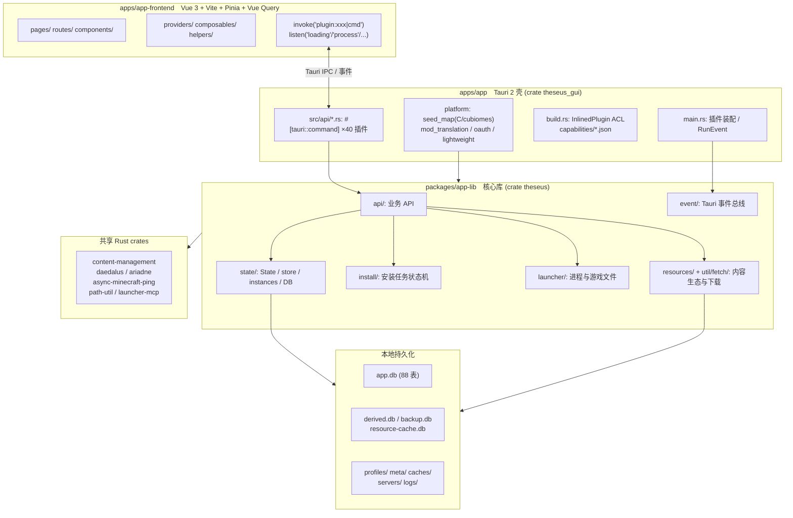

# Axolotl Launcher（美西螈启动器）v1.10.5 深度架构调研报告

> 面向二次开发的完整运行逻辑梳理
> 调研日期：2026-11-04　｜　基线：官方最新正式版 `v1.10.5`
> 本报告中所有 `路径:行号` 均相对于源码根目录（见 §0.2），且已在本地克隆的源码中逐项回查。

---

## 0. 调研基线、消歧与核验方法

### 0.1 同名项目消歧

检索中存在两个易混淆对象，已排除其一：

| 候选 | 实际身份 | 是否本次目标 |
| --- | --- | --- |
| `AxolotlClient/launcher` | AxolotlClient Launcher (v2)，2022 年的 Tauri/JS 项目，最后提交 2022-10-18，规模极小 | 否 |
| `Axolotl-Launcher/Axolotl` | **美西螈启动器 Axolotl Launcher**，官网 `axlmc.org`，Rust/Tauri/Vue，802 stars（调研时） | **是** |

确认依据：`README.md:53-59` 明确写明「Axolotl Launcher（美西螈启动器）…… 基于 Modrinth App 构建，移除了不适用于本项目的商业化模块」，并特别声明「与客户端项目 Axolotl Client 无任何关联」；`apps/app/tauri.conf.json:64,67` 的 `productName` 与 `identifier`（`red.ghs.axolotl`）与官网一致。

### 0.2 源码基线与版本选择

| 项目 | 值 |
| --- | --- |
| 仓库 | `https://github.com/Axolotl-Launcher/Axolotl` |
| 官网 | `https://axlmc.org` |
| 选定版本 | `v1.10.5`（GitHub Release `Axolotl Launcher v1.10.5`，`published_at = 2026-10-31T12:14:48Z`，`prerelease=false`, `draft=false`） |
| 已排除版本 | `v1.11.0-beta.1`（2026-11-01，`prerelease=true`） |
| Tag 对应 commit | `e9d1def79b35bcd2dceb20d83beb43bef0ba0182` |
| Commit 信息 | `chore: release 1.10.5 (force)`，2026-10-31 17:59:01 +0800 |
| 本地源码 | `C:\chang_tian_\WorkBuddy\默认工作区\axolotl-research\Axolotl-v1.10.5`（`--depth 1 --branch v1.10.5`，detached HEAD） |
| 受版本控制文件数 | 4674 |
| 主要语言分布 | `.ts` 1074、`.rs` 776、`.svg` 530、`.vue` 528、`.json` 506、`.png` 377、`.sql` 160、`.webp` 97 |
| 许可证 | GPL-3.0-only（`apps/app/Cargo.toml:8`；`COPYING.md`） |

**版本基线提示（对二次开发选基线很重要）**：该 tag 是被 force 更新过的（commit message 含 `force`），且 `packages/app-lib/migrations/` 中存在文件名日期晚于发布日期的迁移（如 `20261101120000_move-refresh-state-to-derived.sql`、`20261102120000_externalize-account-secrets.sql`）。因此建议以 commit hash 而非 tag 名称锁定基线，因为 force tag 未来仍可能移动。

### 0.3 核验方法

本报告不依赖二手资料，采用四层核验：

1. **源码逐行**：完整读取 `apps/app/src/main.rs`（1138 行）、`state/mod.rs` 的初始化段、`state/db.rs` 的数据库连接段、`state/dirs.rs`、`event/*`、前端 `main.js`/`App.vue` 关键段，以及全部配置文件。
2. **可执行验证**：用 Python `sqlite3` 按文件名顺序重放 `packages/app-lib/migrations/*.sql` 全部 145 个迁移，在内存库中重建 v1.10.5 的**最终 schema**（0 失败），得到 88 张表 / 6 视图 / 76 索引 / 17 触发器，而非从迁移历史推测。快照见附录 A 与同目录 `schema_v1.10.5.txt`，复现脚本 `build_schema_snapshot.py`。
3. **仓库内权威文档交叉**：`AGENTS.md`、`apps/app/AGENTS.md`、`packages/app-lib/AGENTS.md`、`apps/app-frontend/AGENTS.md`、`CONTRIBUTING.md`、`derived_migrations/README.md` 均作为架构约束的一手依据。
4. **五路专项交叉复核**：分派实例/启动、内容/下载、认证/联机/更新、前端、构建/目录五个独立专项并行调研，再由本报告逐条回查，冲突处已修正（见 §8.2）。

> **关于网络二手资料**：检索中出现的 CSDN「架构解析」类文章发布时间集中在 2026-10 月底至 11 月初，内容存在明显拼接痕迹（例如把 `git clone` 写成连写、把 `axolotl-release.yml` 描述简化）。本报告**未采用**其中任何未经源码证实的结论；对其中提到的数据库迁移、遥测默认值等，均回到 `packages/app-lib/migrations/` 与源码中独立验证。

---

## 1. 总览：分层架构与一次会话的时序

### 1.1 分层模型

Axolotl 是一个 **Rust workspace + pnpm/turbo workspace 的双栈 monorepo**，桌面端运行时为「Vue 3 前端 ↔ Tauri 2 壳 ↔ theseus 核心库」三层：



### 1.2 关键命名映射（二次开发最易踩的坑）

| 代码/包名 | 实际含义 |
| --- | --- |
| `theseus` | `packages/app-lib`，桌面核心库，**源自 Modrinth App 的 theseus**，不是第三方 crate |
| `theseus_gui` | `apps/app`，Tauri 可执行程序的 crate 名 |
| `@modrinth/app`、`@modrinth/app-frontend`、`@modrinth/ui` 等 | pnpm 包名沿用了上游命名空间，**不代表这是 Modrinth 官方产品** |
| `red.ghs.axolotl` | 应用标识符，同时是 Windows 数据目录名 |
| `config_dir` vs `settings_dir` | `settings_dir` 存放数据库/设置/日志（可用 `THESEUS_CONFIG_DIR` 整体迁移）；`config_dir` 存放实例/游戏文件（可由设置 `custom_dir` 改），见 `state/dirs.rs:25-30` |
| `profiles/` | **实例的磁盘目录名**（不是 `instances/`），来自 `dirs.rs:20` |

### 1.3 一次完整会话的极简时序

```
OS 启动进程
 └─ main()：便携模式 → 平台特例 → tokio runtime → logger → Tauri Builder（插件/ACL/setup）
     └─ builder.build() → app.run()
         ├─ WebView 加载 ../app-frontend/dist，Vue mount
         │   ├─ setup 同步发起 invoke('initialize_state')（不 await，返回 Promise）
         │   │   └─ Rust：EventState::init → State::init(DB/迁移/设置/后台任务) → 作用域放行
         │   ├─ onMounted → invoke('show_window')（窗口由 visible:false 转可见）
         │   └─ stateInitialization.then(...) → setupApp()：设置/主题/路由/事件订阅/deep-link 待办
         ├─ 用户操作 → invoke('plugin:<插件>|<命令>') → Rust 业务 → DB/磁盘/子进程
         └─ RunEvent::ExitRequested → flush 皮肤 / 联机 / MCP / 服务器 / State::shutdown
             RunEvent::Exit → 安装挂起更新 → finish_database_session（关闭 app.db 并记录干净退出）
```

关键设计结论：**Rust 侧构建 Tauri 应用并不初始化业务状态**。业务状态由前端在 setup 阶段通过 `initialize_state` 命令驱动；`State::get()` 为此提供 10 秒有界等待（`state/mod.rs:787-833`）。这是理解整个启动逻辑的第一要点。

---

## 2. 软件启动与初始化流程（要求 1）

### 2.1 进程入口 `main()`（`apps/app/src/main.rs:638-1137`）

按实际执行顺序：

| 序 | 行号 | 动作 | 说明 |
| --- | --- | --- | --- |
| 1 | 641 | `portable::init_portable_mode()` | 检查可执行文件同目录是否存在可写的 `.Axolotl` 文件夹；命中则 `set_var("THESEUS_CONFIG_DIR", 该目录)` 并置 `PORTABLE_MODE`（`portable.rs:3-45`）。**必须在任何线程启动前调用**，因为 `env::set_var` 非线程安全 |
| 2 | 645-646 | macOS `raise_file_descriptor_limit()` | 把 `RLIMIT_NOFILE` 软限提到 ≤10240，避免高下载并发（最多 128 并发×分段）触发 EMFILE（`main.rs:599-634`） |
| 3 | 648-651 | Windows `--memory-optimize` | 短命进程：执行 `theseus::memory::optimize_current_process_context()` 后直接 `exit` |
| 4 | 656-673 | Windows `--elevated-create-link` | 短命提权 helper：以管理员创建目录/文件链接，通过结果文件回报后退出。**主启动器进程永不提权** |
| 5 | 676-682 | Linux NVIDIA 兼容 | 检测到 `/proc/driver/nvidia/version` 且未设置 `__NV_DISABLE_EXPLICIT_SYNC` 时置 1，规避 WebKitGTK DMA-BUF 崩溃 |
| 6 | 703-717 | 自建 tokio runtime | `new_multi_thread().enable_all().thread_stack_size(16MB)`；`tauri::async_runtime::set(handle)`；`mem::forget(rt)` 使 worker 线程存活至进程结束。注释说明 Windows 深异步调用链（整合包导入）栈溢出问题 |
| 7 | 719 | `tauri::tauri_build_context!()` | 编译期生成的配置上下文 |
| 8 | 721 | `theseus::start_logger(&identifier)` | `logger.rs`：默认 `info`，`RUST_LOG` 优先；日志轮转 10MB / 5 文件 / 3 天，warn+error 单列 30MB（`logger.rs:25-39`）；第三方噪声固定 `h2/hyper/hyper_util=info, sqlx=warn`（`:46-47`） |
| 9 | 725-744 | 注册自定义协议 `axolotl-skin` | 从 `resources/blockbench-skin` 提供 Blockbench 皮肤编辑器静态资源；`dist/skin.bundle.js` 映射为 `.gz` 并解压；做路径穿越校验（`Component::Normal`）、Host/Origin/Referer 白名单校验（`main.rs:47-198`） |
| 10 | 746-759 | `tauri-plugin-updater` | 仅 `#[cfg(feature = "updater")]`；设置 `launcher_user_agent()` 请求头 |
| 11 | 762-804 | 系统插件链 | 见 §2.2 |
| 12 | 805-868 | `.setup(...)` | 见 §2.2 |
| 13 | 870-910 | 40 个业务插件 + `manage()` | 见 §2.2 |
| 14 | 912-946 | `invoke_handler(generate_handler![...])` | 应用级（非插件）命令注册 |
| 15 | 949 | `builder.build(tauri_context)` | |
| 16 | 953-1102 | `app.run(|app, event| ...)` | 生命周期事件循环，见 §2.8 |
| 17 | 1104-1136 | 构建失败处理 | Windows 专门识别 WebView2 损坏并给出修复提示，其余弹错误对话框后 panic |

### 2.2 Tauri Builder 装配细节

**系统插件链（`main.rs:761-804`）**，注册顺序即初始化顺序：

- `tauri_plugin_single_instance`（`:762-779`）：第二个实例把 `args[1]` 交给 `api::utils::handle_command`（deep link / `.mrpack` 路径），并调用 `lightweight_mode.exit()` 恢复主窗口；注释指出轻量模式下主窗口可能已销毁，仅 focus 不够。
- `http`、`os`、`dialog`、`deep-link`、`fs`、`opener`（`:780-785`）。
- `window-state`（`:786-804`）：状态文件 `app-window-state.json`，**只保存 POSITION | SIZE | MAXIMIZED**；不保存 VISIBLE，否则 `tauri.conf.json:91` 的 `visible:false` 会失效；便携模式下用 `THESEUS_CONFIG_DIR` 作为状态目录（`:798-801`）。

**`.setup()`（`main.rs:805-868`）**：

- `lightweight_mode::init(app.handle())`（`:806`）——安装托盘与轻量模式状态。
- macOS 红绿灯按钮定位（`:807-810`）。
- **4 秒兜底显示窗口**（`:813-820`）：若窗口仍不可见则 `show()`，防止初始化卡死导致白屏不可见。
- `deep-link://new-url` 监听（`:822-858`）：非 macOS 直接把 payload 交给 `handle_command`；macOS 用 `macos::deep_link::get_or_init_payload` 缓存首个 URL（因 WKWebView 启动时序），并监听 `RunEvent::Opened`（`:1079-1101`）处理文件打开。
- macOS 窗口阴影（`:860-865`）。

**业务插件与托管状态（`main.rs:870-911`）**：共注册 40 个 `api::*::init()`（ai / auth / mr_auth / import / install / instance / logs / jre / metadata / mcarchive / minecraft_skins / mod_translation / process / planet_minecraft / settings / mcp / storage / system_accent / seed_map / schematic_preview / shortcuts / tags / telemetry / translation / utils / cache / content_favorites / content_search / resources / curseforge / datapacks / drop / files / fonts / friends / worlds / terracotta / multiplayer / servers），并 `manage()` 注册 `StudioWatchers`（`:909`）、`PendingUpdateData`（`:911`）；`LightweightMode` 由 `lightweight_mode::init` 托管（`:92` 定义类型）。

**应用级命令（`main.rs:912-946`）**：`initialize_state`、`show_window`、`get/set_update_channel`、`get_current_app_database_path`、通道数据库复制/备份、更新检查与排队、`exit_app`/`restart_app`、`toggle_decorations`、`set_transparent_window_frame`、`lightweight_mode_*`、macOS 交通灯更新等约 36 个。

### 2.3 前端驱动的第二阶段初始化

`index.html:14` → `/src/main.js`。挂载顺序（`apps/app-frontend/src/main.js:17-33`）：

```
createPinia() → createApp(App) → installTelemetryHandlers()
→ use(VueQueryPlugin) → use(pinia) → use(router) → use(i18nPlugin) → use(i18nDebugPlugin)
→ 指令注册 → mount('#app') → initializeLocale()
```

`main.js:24` 的注释明确 **Pinia 必须先于 router**，因为路由守卫会调用 `useNavigationReturnStore()`。

`App.vue` 的 setup 同步段：

| 行号 | 动作 |
| --- | --- |
| 296-352 | 创建并 provide 通知管理器、`createDownloadManager`、`createContentSelection`、`TauriModrinthClient`、`providePageContext`、`provideModalBehavior` |
| **354** | `const stateInitialization = initialize_state()` —— 发起 IPC，**不 await** |
| 371 | `setupProviders(..., stateInitialization)` —— 把初始化 Promise 注入 provider 链 |
| 389-428 | 窗口外观控制器（`set_transparent_window_frame` IPC、系统强调色、模糊/透明） |
| 1791-1810 | `stateInitialization.then(...)` → 注册 watcher、`setupApp()`；失败置 `stateFailed` 并弹 `state_init` 错误 |
| 1447-1631 | `setupApp()`：读设置 → `queryClient.setQueryData` → `downloadManager.start()` → locale → 默认页 → OS/装饰 → 主题 → `startMcpStateSync()` → 三个 `listen` → `get_opening_command().then(handleCommand)` |
| **2319-2320** | `onMounted` 首行 `invoke('show_window')`，随后绑定各 modal ref、处理 `lightweight_mode_frontend_ready` 返回的待办崩溃与命令 |

`helpers/state.ts:38-40` 中 `initialize_state()` 即 `invoke<void>('initialize_state')`。

### 2.4 Rust 侧 `initialize_state` 命令（`main.rs:200-304`）

执行序（这是整个应用「真正开始」的地方）：

1. `EventState::init(app)`（`:205`）——把 `AppHandle` 与 `loading_bars: DashMap<Uuid, LoadingBar>` 存入全局 `EVENT_STATE`（`event/mod.rs:17-37`）。
2. `State::init(app.config().identifier.clone())`（`:208`）——见 §2.5。
3. `api::resources::initialize_content_refresh_events(&app)`（`:209`）——注册内容刷新事件转发。
4. `api::mcp::initialize(&app)`（`:210`）——按配置启动本机 MCP server。
5. 异步 `theseus::anti_piracy::check_region()`，结果 `emit("anti-piracy-status-changed")`（`:211-219`）——决定离线账户是否可用。
6. `BACKUP_STARTUP: OnceCell`（`:221-237`）：`recover_backup_repository()`；再 spawn 一个延迟 2 秒的任务执行 `state.maintain_database_backups()` 与 `instance::maintain_backup_repository()`。`OnceCell` 的注释说明「重建的 webview 不得二次恢复或打断备份操作」。
7. **日志级别二次应用**（`:239-279`）：logger 早于数据库启动，此时才能读取 `settings.log_level`；按当前更新通道计算 `log_level_for_channel`（Beta 强制 DEBUG/TRACE），必要时 `settings::patch` 回写；仅当未设置 `RUST_LOG` 时调用 `theseus::set_log_level`。
8. `State::get()`（`:281`）；`instance_groups::ensure_imported(&state)`（`:286`）——注释强调必须等旧 JSON 分组导入成功后才允许写入，否则 Favorites-only 回退会覆盖 SQLite 中仍存在的分组。
9. **动态放宽文件系统作用域**（`:288-301`）：把 `caches_dir()`、`caches_dir()/icons`、`instances_dir()`、`servers_dir()` 加入 `asset_protocol_scope`，把 `instances_dir()`、`servers_dir()` 加入 `fs_scope`。这是「自定义目录 / 外部 .minecraft」能工作的关键。

随后 `show_window`（`main.rs:470-486`）取得 `main` 窗口并 `show()` + `set_focus()`；失败则弹窗并 panic。

### 2.5 `State::init` 与 `initialize_state` 内部

**`State::init`（`packages/app-lib/src/state/mod.rs:687-768`）**：

```
LAUNCHER_STATE.get_or_try_init(Self::initialize_state)   // OnceCell<Arc<State>>，:107
→ recover_content_file_operations()                       // :693
→ install::recovery::recover_interrupted_jobs()            // :698
→ reconcile_persisted_curseforge_waiting_jobs()            // :703
→ spawn config_sync::run                                  // :713 实例配置同步循环
→ spawn run_auto_concurrency_controller                   // :721 下载自适应并发
→ telemetry::start(Arc<State>)                            // :729
→ spawn google_ip::preload                                // :731
→ spawn maintenance_task                                  // :736
     ├─ cleanup_stale_partial_downloads(meta/, caches/)
     ├─ watch_instances_init(file_watcher, dirs, pool)
     └─ try_join!(discord_rpc.clear_to_default,
                  refresh_all_instances,
                  Settings::migrate,
                  ModrinthCredentials::refresh_all)
```

`maintenance_task:762` 注释明确「Axolotl 不连接 Modrinth 的私有 friends socket」——去商业化的直接体现。

**私有 `initialize_state`（`state/mod.rs:1250-1424`）** 构造状态本体：

| 行号 | 动作 |
| --- | --- |
| 1257-1263 | 解析 `settings_dir`；`store::secrets::identify(&settings_dir)` —— **先确定密钥环命名空间**，再允许任何密钥读写 |
| 1266 | `db::connect(&app_identifier)`（见 §2.6） |
| 1267 | `store::Handle::new(pool.clone())` |
| 1270 | `legacy_converter::migrate_legacy_data` —— 旧 JSON/旧表数据转换 |
| 1272 | `store::secrets::externalize(&data)` —— 把账户密钥搬入系统凭据库（失败仅 warn，不阻断启动） |
| 1280-1286 | `Settings::get` → `installer_settings::apply_pending_installer_directory` |
| 1287-1296 | 依设置创建 `fetch_semaphore` / `download_semaphore` / `io_semaphore` / `api_semaphore` |
| 1298-1305 | CurseForge API key、代理设置、`DownloadClients::build(proxy, ignore_ssl_errors, doh_enabled)` |
| 1308-1315 | `DirectoryInfo::move_launcher_directory` —— 若用户改过自定义目录，迁移 `caches/`、`profiles/`、`meta/` 并重写数据库中的绝对路径 |
| 1318 | `DirectoryInfo::init(settings.custom_dir, ...)` |
| 1320-1335 | `documents::hand_over`；旧 Java 运行时记录迁移 |
| 1337-1343 | `DerivedDb::open(caches_dir()/derived.db)`；尽力导入旧缓存；`forget_removed_instances` |
| 1345-1352 | `DiscordGuard::init`、`init_watcher()`、`ProcessManager::new()`、`FriendsSocket::new()` |
| 1354-1423 | 组装 `State` 字段 |

`State` 主要字段（`state/mod.rs:151-245`）：目录信息、四个并发信号量、下载源 `AtomicU8`×4、自适应并发统计原子量、安装任务信号量/锁/取消令牌、`DiscordGuard`、`ProcessManager`、`MaintenanceGate`（轻量模式暂停后台循环，`110-141`）、`background_tasks`、`FriendsSocket`、`restart_after_pending_update`、`InstanceLockManager`（`:398-400`，防止删除实例与内容写入竞态）、`SqlitePool pool`、`store::Handle data`、`DerivedDb derived`、`resource_service: OnceCell`、`file_fingerprints`、`content_refresh`、CurseForge key、`DownloadClients`、`FileWatcher`、截图/同步选项锁等。

`State::get()`（`:787-833`）在未初始化时以 100ms 轮询、上限 **10 秒**，超时返回 `StateNotInitialized`；`get_if_initialized()`（`:1245-1247`）供退出路径等非阻塞场景使用。

### 2.6 数据库打开与迁移链（`state/db.rs`）

```
connect() :89-111
  settings_dir = THESEUS_CONFIG_DIR || dirs::data_dir()/app_data_dir_identifier()
  → create_dir_all
  → migrate_legacy_release_database()      // 旧版 <settings>/app.db → <settings>/release/app.db
  → reconcile_default_channel_database()   // 通道库对齐，带 .channel-reconcile(.lock) 跨进程标记
  → app_db_path() :249-252                 // settings_dir/{release|beta}/app.db
  → connect_app_db() :582-586
       ├─ db_backup::prepare_app_db               // 完整性/干净退出指纹检查
       ├─ db_backup::maybe_backup_existing_app_db
       └─ open_migrated_app_db() :588-617
            ├─ open_app_db_pool()（WAL、create_if_missing）
            ├─ stale_data_cleanup
            ├─ 9 个 reconcile_*():597-606        // 历史迁移 checksum/重复结构兼容（rebrand 后 LF/CRLF 差异等）
            ├─ MIGRATOR.run(&pool) :607          // sqlx::migrate!()，:13
            ├─ record_current_app_version
            └─ stale_data_cleanup
```

**更新通道**（`db.rs:343-358`）：`default_update_channel_for(version)` 由编译期 `CARGO_PKG_VERSION` 是否含 `-` 决定 `release`/`beta`；用户显式选择存于 `update-channel.json`（`:15`，`UpdateChannelState` 见 `:268-277`），仅接受 `release|beta`。通道决定 **app.db 的物理路径**，因此 release 与 beta 各有一份独立数据库；`main.rs:416-437` 提供 `copy_release_database_to_beta` / `copy_database_between_channels`（用 `VACUUM INTO` 复制到临时文件后原子 rename）。

**迁移实测结果**：`packages/app-lib/migrations/` 共 **145** 个 SQL，按序重放 0 失败，最终 **88 张表、6 视图、76 索引、17 触发器**。其中 `settings` 表 94 列（附录 A 给出列名）。迁移不可变规则见 `packages/app-lib/AGENTS.md:31-45` 与 `CONTRIBUTING.md:61-112`：新增迁移必须同步登记 `scripts/axolotl/downgrade-app-db.mjs` 的 `REVERTIBLE_SCHEMA`，并跑 `downgrade-app-db.test.mjs`。

### 2.7 窗口显示与首屏

`tauri.conf.json:79-95` 定义 `main` 窗口：`1280×800`、最小 `1100×700`、`decorations:false`、`transparent:true`、**`visible:false`**。因此窗口可见性完全由代码控制：`show_window`（Vue `onMounted`）为主路径，`main.rs:813-820` 的 4 秒兜底为异常路径。首屏渲染期间前端先展示 loading 界面，`stateInitialization.then()` 后才 `setupApp()` 拉取设置、主题与路由。

### 2.8 退出流程（`main.rs:953-1102`）

`RunEvent::ExitRequested`：

1. `minecraft_skins::flush_pending_skin_change()`（`:958-965`）；
2. `multiplayer::shutdown()`（`:967-975`）——`api/multiplayer.rs:280-283` 置 `SHUTTING_DOWN` 并 `stop()`；
3. `api::mcp::shutdown(app)`（`:979`）；
4. `servers::shutdown_all()`（`:980`）——超预算的专用服务器进程被强杀并记日志；
5. `State::shutdown()`（`:987`）——`state/mod.rs:1225-1232`：`content_refresh.shutdown()`、abort 所有 `background_tasks`、断开 Discord IPC、清理空闲日志缓冲。

`RunEvent::Exit`：

- `PendingUpdateData` 中若有排队更新（`:992-1071`）：Debian/APT 走 `install_apt_package`（校验 catalog 的 sha256+size）；其余走 `update.install(data)`。Windows 的 NSIS 更新器会以 `std::process::exit(0)` 直接结束进程，因此**先把「更新后显示变更日志」的标记写入 settings**（`:1032-1033`），成功路径在非 Windows 才执行。用户是否要求重启由 `State.restart_after_pending_update` 决定。
- `state.finish_database_session()`（`:1072-1077`）→ `state/mod.rs:265-271`：3 秒超时内 `pool.close()`，然后 `db_backup::mark_clean_shutdown` 写干净退出指纹；下次启动据此决定是否做完整完整性检查。

---

## 3. 核心运作流程及模块调用关系（要求 2）

### 3.1 IPC 四层注册链（最重要的扩展约束）

新增/改名一个 Tauri 命令必须同步四处，缺一即运行时报 ACL 错误。仓库规范见 `apps/app/AGENTS.md:11-24`：

| 层 | 位置 | 作用 |
| --- | --- | --- |
| ① 运行时 handler | `apps/app/src/api/<plugin>.rs` 的 `#[tauri::command]` + 该模块 `init()` 内的 `tauri::generate_handler!`；应用级命令用 `main.rs:912` | 绑定真实函数 |
| ② 构建期命令清单 | `apps/app/build.rs:320-1201` 的 `InlinedPlugin::new().commands(&[...]).default_permission(AllowAllCommands)` | 生成 ACL 白名单；`build.rs:316-319` 注释说明 Tauri 目前无法静态解析 `#[tauri::command]`（tauri issue #10075），**必须手工维护** |
| ③ 窗口权限 | `apps/app/capabilities/{core,plugins,updater}.json`，主配置 `tauri.conf.json:110` 引用 | 把 `<plugin>:default` 授予 `main` 窗口；`plugins.json:136-174` 列出全部插件默认权限 |
| ④ 前端调用 | `invoke('plugin:<插件>\|<命令>', args)`；应用级命令直接 `invoke('<命令>')` | 序列化参数名必须与 Rust 完全一致 |

仓库还带一致性回归测试：`apps/app/tests/instance_command_manifest_parity.rs`、`settings_command_manifest_parity.rs`（目前仅覆盖 instance 与 settings 插件）。`AGENTS.md` 明确：**前端 mock 或 `cargo check` 通过都不能证明运行时 ACL 可用**，需在重构建的应用中实测。

**命令清单规模**：`build.rs` 共注册约 31 个内联插件的命令清单（插件名见 `:324,355,463,475,498,512,525,553,590,635,674,699,840,904,918,931,953,968,976,997,1019,1038,1046,1064,1091,1113,1134,1169,1182` 等），而 `main.rs:870-910` 运行时挂载 40 个插件（部分为 app 级命令或不同权限模型）。

### 3.2 模块地图

| 层 | 目录 | 职责 |
| --- | --- | --- |
| 前端 | `apps/app-frontend/src/helpers/` | 无 UI 的 IPC 封装层，`invoke` 主要集中地 |
| 前端 | `src/providers/`、`src/composables/`、`src/store/` | 依赖注入、领域逻辑、Pinia 局部 UI 状态 |
| 壳 | `apps/app/src/api/` | 40 个 Tauri 插件，薄封装，参数校验与错误序列化 |
| 壳 | `apps/app/src/{seed_map,mod_translation,macos,window_frame,lightweight_mode,portable,updater_impl}.rs` | 壳内专属子系统（C 桥接、模组名翻译、平台 UI、轻量模式等） |
| 核心 | `packages/app-lib/src/api/` | 业务 API：`instance/`、`pack/`、`minecraft_auth*`、`process`、`terracotta`、`multiplayer`、`curseforge/`、`content_search`、`settings`、`jre`、`logs`、`mr_auth`、`ai` 等 |
| 核心 | `src/state/` | 全局 State、目录、DB、settings、进程、认证、皮肤、隧道、Discord、实例域 |
| 核心 | `src/install/` | 安装任务状态机与恢复 |
| 核心 | `src/launcher/` | 游戏文件、JVM 参数、natives、子进程启动、OptiFine/MultiMC 兼容 |
| 核心 | `src/resources/`、`src/storage/`、`src/util/fetch/` | 内容生态、存储清理、下载引擎 |
| 核心 | `src/event/` | Tauri 事件发出与进度条 |
| 共享 | `packages/content-management/` | 内容契约与依赖解析（`resolve_content`、`RESOURCE_CONTRACT_VERSION=1`） |
| 共享 | `packages/{daedalus,ariadne,async-minecraft-ping,path-util,launcher-mcp}/` | Minecraft 元数据、好友/隧道消息模型、服务器 ping、类型化路径、MCP server |

### 3.3 实例生命周期

**统一原则：创建/导入/整合包安装都走安装器 job，不是同步直建。**

```
前端 helpers/install.ts:364,371,388
 → apps/app/src/api/install.rs:97/117/129 (install_create_instance / install_create_modpack_instance / install_import_instance)
 → theseus::install::runner.rs:137/160/215
 → runner::start() :1225 → enqueue_with_content_plan() :1242
      ├─ InstallJobState::new + init::prepare_initial_instance
      ├─ install/store.rs:92 insert_with_content_plan() → install_jobs 表
      └─ lifecycle::spawn_job() :1228
 → install/runner/request.rs:10 按 InstallRequest 分派
      ├─ CreateInstance :16（含 CurseForge 分支 :43）
      ├─ CreateModpackInstance :136（.mrpack 解析 api/pack/install_from.rs:225）
      ├─ ImportInstance :169（api/pack/import/mod.rs:674，分派 mmc/pcl/hmcl/gdlauncher 等）
      └─ ExportResource :723（导出也是 install job）
```

- **实例记录落库**：`install/runner/init.rs:69` → `api/instance/lifecycle.rs:13` → `state/instances/commands/create_instance.rs:39`，事务写 `instances` / `instance_content_sets` / `instance_loader_components` / `instance_links`，初态 `install_stage=NotInstalled`（`:97`）。
- **导入预扫描**：`install/import_plan.rs:110` 状态机 `Resolving → Scanning → Done/Error`（`:55`），对应前端 `install_start_import_plan` 等命令。
- **编辑**：`instance_edit`（`apps/app/src/api/instance.rs:1941`）→ `lifecycle.rs:101`（先 `ensure_backup_eligible_edit`）→ `commands/edit_instance.rs:136` 事务 → 发 `InstancePayloadType::Edited`。
- **删除**：`instance_remove`（`instance.rs:813`）→ `lifecycle.rs:183` → `commands/remove_instance.rs`（`begin_instance_deletion:28`、删目录 `:118`、`delete_instance_by_id:122`、删备份 `:48`）。
- **导出整合包**：`plugin:resources|resource_export_*`（`apps/app/src/api/resources.rs:188-341`）→ `resources/export/`（scan/refresh/plan/writer）→ `runner/request.rs:723` → `install/runner/export.rs:9`。
- **直连外部版本**：`instance_create_direct_link`（`instance.rs:936`）→ `lifecycle.rs:65` → `commands/create_direct_link_instance.rs:40`，`install_stage=Installed`（`:82`），用于接管已有 `.minecraft`。

### 3.4 安装器状态机（`packages/app-lib/src/install/`）

- 状态与阶段：`install/model.rs` 中 `InstallJobStatus`（`:2355`：Queued / Running / Canceling / WaitingForUser / Succeeded / Failed / Interrupted / Canceled）、`InstallPhaseId`（`:2495`，19 个阶段含 RollingBack）、`InstallJobState`（`:226`）、`InstallRequest`（`:1902`）、`InstallJobEvent`（`:1768`）。
- 执行：`runner/lifecycle.rs:299 run_job` → `:325 run_owned_job`（Queued→Running CAS `:334`）→ `critical_section::run_cancelable`（`:389`）。`critical_section.rs:27/37` 保证取消时等待文件发布/回滚完成才释放 future，避免半成品落盘。
- 分派执行器：`runner/{request,init,admission,pack,upgrade,content_change,export,adjunct}.rs`。
- 持久化：`install/store.rs`（`insert:83`、`checkpoint_running_state:242`、`update_status_if:315`、`complete_running_job:361`、`list_interrupted_candidates:187`），DDL 在 `migrations/20260624120000_install-jobs.sql`。
- 进度：`install/events.rs:29 InstallProgressReporter`（节流、多轨并行）与 `:1293 emit_install_job`；诊断信息 `install/diagnostics.rs:21`（时间线/环境，凭据脱敏 `:677`）。
- **崩溃恢复**：`install/recovery.rs:24 recover_interrupted_jobs` —— 已提交则补记 Succeeded，否则标 Interrupted/Failed 并 `apply_cleanup:255` 回滚；入口在 `state/mod.rs:698`。注意与 `state/db_backup.rs:31` 的 app.db 损坏恢复是两回事。

### 3.5 游戏启动链路（点击「启动」）

```
plugin:instance|instance_run                       (前端 helpers/instance.ts:1005)
 → apps/app/src/api/instance.rs:1911
 → api/instance/run.rs:61 run_with_extra_launch_args_with_gc
    ├─ :85   备份操作锁（备份进行中禁止启动）
    ├─ :95   准备超时（默认 60s，:18）
    ├─ :?    get_instance_launch_context（commands/launch_context.rs:15）
    ├─ :107-121 凭据：Credentials::get_default_credential / 离线 get_offline_credential
    │           （state/minecraft_auth.rs:863/959，内部 refresh()；网络失败降级用旧凭据）
    │           anti_piracy::ensure_offline_allowed :124
    └─ :151 run_credentials
         ├─ :162   同步 game options
         ├─ :198-232 pre-launch hook
         ├─ :235-282 java_args / wrapper / memory / resolution / env / post_exit
         ├─ :297   Mojang session join（正版服务器联机校验）
         ├─ :365   自动内存
         └─ :395   launcher::launch_minecraft
              (launcher/mod.rs:2100)
              ├─ :2122-2136 要求 install_stage == Installed，否则提示先跑安装 job
              ├─ :2323      载入版本档案
              ├─ :2435/2462/2465 check_jre / find_java_for_version / find_compatible_java_for_version
              ├─ :2484       validate_loader_java_version
              ├─ :2503       jvm_args::resolve_gc_block（GC 参数）
              ├─ :2572       GPU 环境
              ├─ :2651       Command::new(java)（wrapper :2642）
              ├─ :2676       direct_ensure::ensure_direct_launch_dependencies
              ├─ :2721       natives::prepare_native_libraries
              ├─ :2732       download::download_libraries
              ├─ :2824/2832  args::get_linked_class_paths / get_class_paths
              ├─ :2842       args::get_jvm_arguments
              ├─ :2916       args::get_minecraft_arguments
              └─ :3054       insert_new_process
                   → state/process.rs:351
                     ├─ :372-374 管道 stdout/stderr
                     ├─ :382     mc_command.spawn()
                     ├─ :415     写 LAUNCHER_LOG_PATH
                     ├─ :447/468 输出解析任务（log4j XML + 行日志）
                     ├─ :490-518 15s 初始化窗口 / 提前退出处理
                     ├─ :527     crash-reports 快照
                     └─ :544     sequential_process_manager
```

**重要区分**：全量游戏文件下载发生在**安装期**（`launcher/mod.rs:1202 install_minecraft_with_reporter`）；启动期只做依赖补全、natives 与 classpath 准备，不做完整安装。

**进程收尾**（`state/process.rs:1206-1400`）：轮询 `try_wait`（`:1294`）、每 60s 记 `instance_daily_playtime`（`:1309`）、比对 crash-reports 判定 `clean_launch`（`:1330`）、写退出码（`:1363`）、成功时存模组快照（`:1372`）、`emit_process(Finished)`（`:1382`）、执行 post-exit hook 与 synced options 最终同步（`:1400`）。主动结束走 `instance_kill`（`instance.rs:1935` → `run.rs:451` → `process_manager.kill`）。

### 3.6 内容生态（Modrinth / CurseForge / MCArchive / Planet Minecraft）

**契约层在 `packages/content-management`**：`resources/mod.rs:3-5` 定义项目/发布/文件/已装项分离原则，`resources/identity.rs:9-71` 用 `identifier!` 宏产出 12 个强类型 ID，`SourceId::modrinth/curseforge/mcarchive/planet_minecraft`（`:73-89`），`SourceProjectRef`/`SourceReleaseRef`/`SourceArtifactRef`/`ResourceRef`（`:91-120`），`ArtifactIntegrity`（`:165`）。**provider-qualified identity** 贯穿显示、选择、持久化、安装与缓存：缓存键含 `source`（`resources/cache/mod.rs:38`）、收藏持 `SourceProjectRef`（`favorites.rs:17-18`）、迁移 `20260728100000_provider_qualified_content.sql` 完成历史数据改造。

**服务层 `packages/app-lib/src/resources/`**：

| 模块 | 职责（关键入口） |
| --- | --- |
| `service.rs` | `ResourceService:127`、`CachePolicy:30`、`query:296`/`query_many:312`、`Flight:63` 请求合并与取消、`validate_value:825`/`valid_artifact:932` |
| `providers/mod.rs` | `ResourceProvider` trait `:270-284`、`default_providers():286-294` 注册 4 个源并共享 `Arc<LauncherTransport>`、`ProviderQuery:28`、`batch_group:124`、`ttl:136`、`hashes:409`、`acquisition:392` |
| `providers/{modrinth,curseforge,mcarchive,planet_minecraft}.rs` | 各源实现；`transport.rs` 统一 `ProtocolTransport`/`LauncherTransport` |
| `catalog.rs` / `search.rs` | 展示信息、版本/变更日志；跨源缓冲去重分页（`SearchCursor:12`） |
| `installed.rs` / `fingerprints.rs` / `identity.rs` | 已装快照、文件指纹（读并发 2）、本地文件身份识别 |
| `plans.rs` | 生成操作计划：`build_operation*:1454-1481`、`prepare*:3365-3413`、`queue:3909` → `install::runner::queue_resource_plan`、`execute_frozen_plan:3918`、`recover_frozen_plan:3957` |
| `execution.rs` | 原子执行与回滚，见下 |
| `updates.rs` / `refresh.rs` / `history.rs` / `favorites.rs` / `packs.rs` / `naming.rs` / `write_access.rs` | 更新检查（按 SHA1）、刷新协调、历史、收藏、整合包、命名、写权限预检 |
| `export/` | 整合包导出（scan/refresh/plan/writer） |

> 核验修正：`resources/update_batches.rs` 与 `batch_duplicates.rs` **是纯测试文件**（`update_batches.rs:3` 即 `#[tokio::test]`），经 `tests.rs:148-152` 的 `#[path]` 引入，`mod.rs:5-25` 未声明，**不是运行时执行引擎**。

**原子执行**（`resources/execution.rs`）：使用 `JournalFile{path,previous_path,backup,old,target}`（`:111-119`）→ 开工先恢复旧日志（`:637-644`）→ 校验备份路径（`:720-757`）→ `ResourceExecutionJournals::save`（`:804-809`）→ `critical_section::enter()`（`:810`）→ rename 旧文件至 backup 并物化已校验下载（`:818-845`）→ `persist_plan` 单事务写历史（`:846-854, :997-1050`）→ 失败 `recover_files`（`:235-298`，校验字节身份后还原）并删日志 → 成功提交（`:900-905`）。`write_access.rs:22` 会先剔除不可写项。

**API 客户端分工（易误读）**：

- `packages/app-lib/src/api/content_search.rs` **不是 HTTP 客户端**，而是 MC百科中文索引 + `zhconv` 简繁转换 + 分词字典（`include_str!` 载入 `WikiEntries.txt`/`searcher_words.txt`），服务于中文搜索与命名（`naming.rs:72-73`）。
- Modrinth 请求走 `env!("MODRINTH_API_URL")` + `util::fetch::fetch_json`（`providers/transport.rs:125-160`），限流约 250ms/请求（`:94-99`）。
- CurseForge 走 `api/curseforge/` 独立层（`constants.rs:5` `https://api.curseforge.com`），`catalog.rs:412-427` → `transport::request_json_with_origin(MirrorFirst, Resource)`；凭据与镜像路由在 `transport.rs`，`:28` 用 SHA256 摘要避免明文密钥进缓存键。
- `packages/api-client`（TS，`@modrinth/api-client`）是跨平台 REST 客户端，提供 `platform/tauri.ts` 的 `TauriModrinthClient`（基于 `plugin-http`），由 `App.vue:321-335` 构造并注入。**它与 `plugin:*` IPC 是两条独立通道，不在 Rust 下载链上。**

### 3.7 下载子系统（`util/fetch/` 与 `util/download/`）

| 能力 | 实现 |
| --- | --- |
| 入口 | `util/fetch/request.rs:412 fetch_advanced`（`:442`）；落盘 `util/fetch/transfer.rs:68 download_to_path` |
| 分段并发 | `fetch/segmented.rs` + `segment.rs`（初始段数/自适应上限/剩余 Range）+ `tail.rs race_tail_candidates`；上限常量见 `util/download/constants.rs`：`MAX_SEGMENT_CONCURRENCY=64`(`:42`)、`MAX_GLOBAL_TAIL_HEDGES=8`(`:41`)、`ROUTE_PROBE_CONCURRENCY=2`(`:252`)、`FILE_VALIDATION_CONCURRENCY=8`(`:184`)；`.part` 断点续传（`transfer.rs:708`） |
| 路由与镜像 | `fetch/routes.rs:6-20` 按 `route_health.rs`(EWMA)/`route_policy.rs`/`retired_sources.rs`/`modrinth_cdn.rs` 选路；镜像常量 `constants.rs:360/362/377`（阿里云 Maven、`bmclapi2.bangbang93.com`、`mod.mcimirror.top`） |
| DoH | `util/download_dns.rs` 的 `DownloadDnsResolver`；3 个内置 DoH（`constants.rs:258-262`：doh.pub / doh.pysio.online / cloudflare-dns.com）；`DnsSource::System\|Doh`（`:62-66`），CNAME 校验与 host override |
| 完整性 | `util/download/integrity.rs:17 compute_file_integrity`（size + MD5/SHA1/SHA256/SHA512）、`:44 verify_computed_integrity` |
| 重试/进度 | `fetch/policy.rs:10-13 FETCH_RETRY_DELAYS` + jitter、`:31/42` 持久化路由健康；`FetchProgressFn`（`model.rs:365`）、`fetch/progress.rs`、Tauri Channel（`apps/app/src/api/resources.rs:372`） |
| 并发闸门 | 四个 `Semaphore` 在 `state/mod.rs:1289-1296` 由设置初始化；`single_flight.rs` 合并同(路径+integrity)请求；`util/file_lock.rs` 仅诊断占用进程，真互斥为 `fetch/file.rs destination_download_lock` |

> 核验修正：`util/download_manager.rs` 实为下载**测速器**（`DownloadSpeedTracker:41`），`downloads.rs` 是浏览器下载文件名匹配，`network.rs` 是 loopback/计费网络检测，均非下载核心。

### 3.8 账户认证、联机、遥测、MCP、自动更新

**认证**（详见 §5.6 与 §6.4，此处列链路）：

- 账户类型 `MinecraftAccountType{Microsoft,Offline,Yggdrasil}`（`state/minecraft_auth.rs:324-328`）。
- Microsoft：PKCE S256（`minecraft_auth.rs:122-148`）→ 浏览器回环 `127.0.0.1:53682/oauth/microsoft/callback`（常量 `:1159-1165`；`apps/app/src/api/oauth_utils/auth_code_reply.rs` 用 hyper 实现，遵循 RFC 6749/8252）或设备码（`:156-193`）→ XBL(`:1305`) → XSTS(`:1325`) → Minecraft token(`:1384`)；壳命令 `apps/app/src/api/auth.rs:106/254/316/322`。
- 离线：`validate_offline_username:434`、UUID 取 `md5("OfflinePlayer:{username}")`（`:489`）、空 refresh_token（`:509-511`）；受 `anti_piracy` 与 `official_login_proof` 约束。
- Yggdrasil（LittleSkin 预设 `https://littleskin.cn/api/yggdrasil`，`components/ui/AccountsCard.vue:529`）：`state/minecraft_auth/yggdrasil.rs:166` → `POST /authserver/authenticate`（`:190-195`）→ 多角色 `SelectProfile`（`:36-44`）→ `:268`。密码另存于 `keyring::Entry::new(BUNDLE_IDENTIFIER, "{api_root}\n{login}")`（`auth.rs:419-437`），**与下述 `secrets.rs` 命名空间不同**。
- Token 刷新统一在 `minecraft_auth.rs:561`（离线直接返回；MS 5 分钟余量；`CREDENTIAL_REFRESHES` 并发合并 `:573-608`，失败 30s 冷却），Yggdrasil 先 `/authserver/validate`，401/403 才 `/authserver/refresh`（`yggdrasil.rs:331-399`）。
- **凭据外部化**：迁移 `20261102120000_externalize-account-secrets.sql` 只给 `minecraft_users`/`minecraft_device_tokens`/`modrinth_users` 增加 `secrets_externalized` 位掩码列并注明「迁移无法访问 credential store，由 `state/store/secrets.rs` 启动时搬运」；`secrets.rs:291-299 externalize` 在 `state/mod.rs:1263/1272` 调用。`secrets.rs` 是唯一访问 `keyring` 的模块，`PREFIX="axolotl-account"`（`:33`），命名空间按数据目录 FNV-1a 指纹隔离（`:64-101`），因此**使用 `AXOLOTL_DATA_DIR_SUFFIX` 的构建拥有独立凭据**。

**联机**：`MultiplayerProvider{Terracotta, Hongshi}`（`api/multiplayer.rs:23-25`），全局 `ACTIVE_PROVIDER`（`:11`），`claim/release/switch/host/join/stop`（`:76/91/137/182/218/240`），`shutdown()` 在 `:280-283`。Terracotta 由 `api/terracotta.rs` 下载并管理外部二进制（`:323-324, :907`），本地 HTTP `/state`(`:774`)、`/meta`(`:883`)；红石 `api/hongshi.rs:22-31`（`hongshi.site`，控制端口 8080 / 数据端口 8000，`tokio::process::Child` + `LinesCodec` 行协议）。**澄清**：`packages/ariadne` 是好友/TCP 隧道消息模型（被 `state/friends.rs`、`state/tunnel.rs` 使用），`terracotta.rs`/`hongshi.rs` 中无 ariadne 引用，不是联机隧道协议本身。

**遥测**：默认关闭由迁移 `20260713000000_axolotl_privacy_defaults.sql:1-3` 写死（`telemetry=FALSE, personalized_ads=FALSE`）；`20260814120000_telemetry.sql` 增加 `telemetry_consent_version` 与 `telemetry_identity`/`telemetry_outbox`/`telemetry_error_daily` 表。`telemetry.rs:111-114` **双重门控** `settings.telemetry && telemetry_consent_version > 0`；端点 `https://telemetry.axlmc.org/v1/batch`（`:23`），60 秒循环（`:33-66`），按日心跳去重（`:158`），关闭时清空 outbox（`:68-78`）。同意流程 `api/settings.rs:140-172`；前端 `App.vue:1513` 判定 `privacyConsentPending`。服务端 `apps/telemetry-worker`（Cloudflare Worker，`POST /v1/batch`），看板 `apps/telemetry-dashboard`（D1）。

**MCP / AI**：`packages/launcher-mcp` 用 `rmcp 3.7.0` + axum，`server.rs:27-56` 以 Streamable HTTP 绑定 `127.0.0.1:5219/mcp`，`LocalSessionManager`；**仅暴露 3 个工具**（`tools.rs:10-19` 已核实）：`get_launcher_info`、`start_session`、`end_session`（明确「暂不提供截图/输入/控制工具」）。token 存 keyring `"Axolotl Launcher MCP"`（`apps/app/src/api/mcp/service.rs:56-75`），`start:49-116`、`initialize:124-150`（仅 enabled 时启动）、`shutdown:152-158`，退出钩子 `main.rs:977-979`。

**自动更新**：`apps/app/tauri-release.conf.json`（已核验）中 `build.features:["updater"]`、`capabilities` 增加 `updater`、minisign 公钥 `:15`、端点 `https://update.axlmc.org/latest` `:16`、Windows `installMode:"quiet"`。`tauri-updater.conf.json:3` 设 `createUpdaterArtifacts:"v1Compatible"`。`updater_impl.rs`：`PendingUpdateData:43`、`check_with_endpoints:212-226`（附带 `X-Axolotl-Channel/Platform/Version` 请求头）、`check_app_update:305`、`enqueue_update_for_installation:361`、Debian `.deb` 走 catalog 的 sha256+size 校验（`:380-384`）。**通道与数据库分离逻辑不在 updater_impl.rs**，而在 `db.rs` 与 `main.rs:311-355`；release 首次切 beta 时 `copy_release_database_to_beta`（`main.rs:416-420`）。

### 3.9 备份与恢复

- 实现集中在 `packages/app-lib/src/api/instance/backup.rs`（5031 行），`api/instance/mod.rs:27-49` 以 `recover_repository as recover_backup_repository`、`maintain_repository as maintain_backup_repository` 重导出。
- 独立 `backup.db`（`backup.rs:49`），默认仓库 `config_dir/Backups/instances`（`:293-299`），可被 `Settings.backup_repository_path` 覆盖；`open_repository_at:320` 用 WAL，`BACKUP_MIGRATOR`（`:35` = `migrate!("./backup_migrations")`）在 `:341` 执行。`backup_migrations/` 实测 **6 个** SQL，建 `repository_meta`/`backup_snapshots`/`backup_objects`/`snapshot_entries`/`object_gc_queue`/`backup_operations`/排除规则等表。
- `recover_repository`（`:2239`）先 `recover_interrupted_restores`（`:2341`），再把所有非终态操作置 `interrupted`；`maintain_repository`（`:2262`）做 GC、待删清理、`.staging` 重建。调用点在 `main.rs:224/232`（`OnceCell` + 2 秒延迟）。
- 内容去重存储：`store_blobs`/`store_instance_files`/`store_retained_refs`/`store_operations`（迁移 `20261004120001_shared-content-store.sql`）。

---

## 4. 内部文件与目录结构（要求 3）

### 4.1 仓库目录树及作用

```
Axolotl-v1.10.5/
├── .agents/、AGENTS.md、REVIEW.md         Agent 指令体系与交付流程规范（仓库自带架构索引）
├── .cargo/config.toml                      RUST_MIN_STACK、Windows rust-lld / /STACK
├── .github/workflows/                     13 个 CI/CD 工作流（见 §4.2）
├── .vscode/、.editorconfig、.gitattributes
├── apps/
│   ├── app/                                ★ Tauri 2 壳，crate `theseus_gui`，包 `@modrinth/app`
│   │   ├── src/main.rs                     进程入口、插件装配、RunEvent（1138 行）
│   │   ├── src/api/                       40 个 Tauri 插件 + mcp/ oauth_utils/ shortcuts/ 子模块
│   │   ├── src/{portable,lightweight_mode,window_frame,updater_impl*,error}.rs
│   │   ├── src/seed_map/                  种子地图：C 桥接 + cubiomes（.c/.h/.rs）
│   │   ├── src/mod_translation/           模组名翻译（jar/ledger/analyze/repair/writeback…）
│   │   ├── src/macos/                     交通灯定位与 deep-link 时序
│   │   ├── build.rs                       ★ 构建期 ACL（InlinedPlugin）+ 编译 cubiomes + 构建 Blockbench 皮肤编辑器
│   │   ├── capabilities/                  core.json / plugins.json / updater.json
│   │   ├── icons/、nsis/、App.entitlements、Info.plist
│   │   ├── tauri*.conf.json               主配置 + 7 个叠加配置
│   │   ├── resources/blockbench-skin/     构建期生成的皮肤编辑器资源（含 .gz bundle）
│   │   ├── vendor/cubiomes/               Git 子模块
│   │   ├── tests/                         命令清单一致性回归测试
│   │   └── Cargo.toml / package.json / turbo.jsonc
│   ├── app-frontend/                      ★ Vue 3 桌面前端 `@modrinth/app-frontend`
│   │   ├── src/main.js、App.vue（142KB 主编排）
│   │   ├── src/pages/、routes/、components/、providers/、composables/
│   │   ├── src/helpers/                   IPC 封装（instance.ts / install.ts / auth.js / events.js / state.ts…）
│   │   ├── src/store/、plugins/、features/、lab/、logagent/
│   │   ├── src/locales/                   33 种语言 ICU JSON（en-US 为提取源）
│   │   ├── src/assets/                   字体/图标/皮肤/加载动画/样式
│   │   ├── src/announcements/catalog.ts  版本公告目录
│   │   ├── e2e/、vitest.config.ts、wdio.browser.conf.ts、vite.config.ts
│   │   └── index.html、tailwind.config.ts
│   ├── installer-ui/                      Windows NSIS 安装器 UI（crate `axolotl-installer-ui`，embed-resource）
│   ├── telemetry-worker/                 遥测接收端 Cloudflare Worker（`@axolotl/telemetry-worker`）
│   ├── telemetry-dashboard/              遥测看板（Cloudflare Workers + D1，wrangler.toml）
│   └── website/                           Nuxt 3 官网 `@axolotl/website`
├── packages/
│   ├── app-lib/                           ★ 核心库 `theseus`（Rust）+ `@modrinth/app-lib`（TS 壳脚本）
│   │   ├── src/api/                       业务 API（instance/ pack/ minecraft_auth*/ curseforge/ content_search.rs …）
│   │   ├── src/state/                     State、dirs、db、settings、store/（60+ Collection）、instances/
│   │   ├── src/install/                   安装任务状态机与恢复
│   │   ├── src/launcher/                  游戏启动、natives、args、jvm_args、multimc、optifine
│   │   ├── src/resources/                 内容生态（service/providers/plans/execution/cache/export…）
│   │   ├── src/util/                      fetch/ download/ download_dns/ proxy/ io/ single_flight/ file_lock…
│   │   ├── src/event/、logger.rs、telemetry.rs、brand.rs、error.rs、storage/
│   │   ├── migrations/                    ★ 145 个 app.db 迁移（14 位时间戳）
│   │   ├── derived_migrations/            3 个 derived.db 迁移（0001~0003）
│   │   ├── backup_migrations/             6 个 backup.db 迁移
│   │   ├── .sqlx/                         254 个 query-*.json，SQLX_OFFLINE 编译期校验
│   │   ├── .env.local / .env.prod / .env.staging / .env.prod-with-staging-archon
│   │   ├── java/                          Gradle Java agent 源码
│   │   ├── build_support/java_cache.rs、.cargo/config.toml（SQLX_OFFLINE=true）
│   │   └── Cargo.toml / package.json / AGENTS.md
│   ├── content-management/                内容契约与依赖解析（Rust）
│   ├── daedalus/                          Minecraft 版本元数据查询/解析（Rust + TS 生成物）
│   ├── ariadne/                           好友与隧道消息模型（Rust）
│   ├── async-minecraft-ping/               ServerListPing 异步客户端（Rust，path 依赖）
│   ├── path-util/                         typed-path 类型化路径封装
│   ├── launcher-mcp/                      本地 MCP server（rmcp + axum，端口 5219）
│   ├── api-client/                        `@modrinth/api-client` 跨平台 REST 客户端（TS）
│   ├── ui/、assets/、utils/、server/、tooling-config/   共享前端包
├── scripts/                               run.mjs + scripts/axolotl/ 约 50 个构建/发布/校验脚本
├── standards/                             DEEP_LINKS.md、frontend/*、maintaining/*（DI、i18n、API 模块等规范）
├── nix/、flake.nix、flake.lock            Nix 打包与 home-manager 模块
├── third-party/blockbench/                Git 子模块（皮肤编辑器）、third-party/licenses/
├── tools/curseforge-mock.mjs、patches/     测试桩与 pnpm 补丁
├── Cargo.toml / Cargo.lock                 Rust workspace
├── package.json / pnpm-lock.yaml / pnpm-workspace.yaml / turbo.jsonc
├── rust-toolchain.toml（1.90.0）、rustfmt.toml、clippy.toml、tombi.toml、_typos.toml
├── crowdin.yml、.npmrc、.nvmrc、web-types.json
└── README.md / CONTRIBUTING.md / COPYING.md / CODE_OF_CONDUCT.md
```

### 4.2 配置文件清单及作用

| 文件 | 作用 |
| --- | --- |
| `apps/app/tauri.conf.json` | 主配置：`build`（devUrl `127.0.0.1:5201`、frontendDist `../app-frontend/dist`）、`bundle`（`resources/blockbench-skin`、5 个图标、NSIS `currentUser`+hooks、macOS entitlements、deb 依赖、`.mrpack` 文件关联）、`productName`、`identifier red.ghs.axolotl`、`deep-link axolotl`、`app.windows`（`visible:false`）、`security`（assetProtocol scope 与 CSP） |
| `tauri.windows.conf.json` | `targets:["nsis"]`、追加 `resources/seed-map`、NSIS 中英文 |
| `tauri.macos.conf.json` / `tauri.linux.conf.json` | Overlay 标题栏 / `mainBinaryName`；由 Tauri 按目标平台自动合并 |
| `tauri-release.conf.json` | **显式 `--config` 叠加**：`createUpdaterArtifacts:false`、`build.features:["updater"]`、`capabilities` 增加 `updater`、minisign 公钥、更新端点、Windows `quiet` |
| `tauri-updater.conf.json` | `createUpdaterArtifacts:"v1Compatible"` |
| `tauri-modern.conf.json` / `tauri-native.conf.json` | Windows 两种安装包变体（modern 改 `beforeBuildCommand` 与 NSIS 模板，native 关闭 updater 产物），由 `scripts/axolotl/package-windows.mjs:40-59` 循环选用 |
| `capabilities/core.json` | `core:default` + window/webview/app/menu/tray/event/path/resources 权限 |
| `capabilities/plugins.json` | 系统插件权限 + `http:default` 的 **URL 白名单**（`:22-74`）+ `fs:allow-*` 与 `fs:scope` 路径白名单（`:75-134`）+ 全部业务插件 `<name>:default`（`:136-174`） |
| `capabilities/updater.json` | 仅 `updater:default` |
| `Cargo.toml`（根） | workspace 8 members、edition 2024 / rust 1.90.0、`workspace.dependencies`（约 160 项）、`[patch.crates-io]` 把 `tauri-plugin-window-state` 换为 Lintern 的 v2 分支、dev/release/ci profile |
| `apps/app/Cargo.toml` | features：`default=["custom-protocol"]`、`custom-protocol`、`updater`（空 feature，仅条件编译；由 `tauri-release.conf.json:6` 启用）；tauri features `devtools/macos-private-api/protocol-asset/tray-icon/unstable` |
| `package.json`（根） | `@axolotl/monorepo`；scripts（`app:dev`、`app:build`、`website:*`、`prepr*`、品牌/i18n 守卫）；`packageManager pnpm@10.33.2`、Node ≥24.15.0；`pnpm.overrides` 与 `patchedDependencies` |
| `pnpm-workspace.yaml` / `turbo.jsonc` | workspace 为 `apps/*` + `packages/*`；turbo 任务图（build 依赖 `^build`；`@modrinth/app#dev/build` 关闭缓存并透传 `CARGO_*`/`TAURI_SIGNING_PRIVATE_KEY`/`CURSEFORGE_API_KEY`/`AXOLOTL_BUILD_RESOURCES` 等构建期变量） |
| `rust-toolchain.toml`、`.cargo/config.toml`、`packages/app-lib/.cargo/config.toml` | 工具链锁定、`RUST_MIN_STACK` 与 Windows 链接参数、`SQLX_OFFLINE=true` |
| `packages/app-lib/.env.*` | 编译时环境变量模板：`MODRINTH_URL`、`MODRINTH_API_BASE_URL`、`MODRINTH_API_URL(_V3)`、`MODRINTH_SOCKET_URL`、`MODRINTH_LAUNCHER_META_URL`、`MODRINTH_ARCHON_BASE_URL`，以及注释掉的 `DATABASE_URL`（供 `cargo sqlx database setup`） |
| `.gitmodules` | `apps/app/vendor/cubiomes`（xpple/cubiomes）、`third-party/blockbench`（Axolotl-Launcher/blockbench-skin-standalone，master） |
| `.github/workflows/*` | 13 个 yml：`axolotl-ci.yml`（增量判定、guardrails、frontend、resources、desktop、website、汇总门禁）、`axolotl-release.yml`（preflight → Linux/Windows/macOS 构建 → universal lipo → 校验发布 → Discord/更新服务器/官网）、`deploy-telemetry-worker.yml`、`deploy-website.yml`、`repo-check.yml`、`agent-pr-review.yml`、`sync-cnb-source.yml`、`prepare-*-cache.yml` 等 |
| `.github/release-notices.json(.schema.json)` | 按 tag 的中英文 Release notice，发布预检会校验格式 |
| `CONTRIBUTING.md` / `apps/app/AGENTS.md` / `packages/app-lib/AGENTS.md` | **开发约束的一手依据**：数据目录隔离、迁移不可变、Tauri 命令四层链、持久化层边界 |

**配置叠加的实际命令**（核验自脚本与 CI）：

- `apps/app/package.json:5`：`tauri build --config tauri-release.conf.json`
- `scripts/axolotl/build-desktop.mjs:44`：`tauri build --ci --no-bundle --config tauri-release.conf.json`
- `scripts/axolotl/package-windows.mjs:47-59`：循环 modern/native：`--config tauri-release.conf.json --config tauri-{variant}.conf.json`，modern 再加 `tauri-updater.conf.json`
- `.github/workflows/axolotl-release.yml:187` / `package-macos-universal.mjs:64-74`：`--config tauri-release.conf.json --config tauri-updater.conf.json`

### 4.3 资源文件

| 资源 | 作用 |
| --- | --- |
| `apps/app/icons/`（128x128.png、@2x、icns、ico、`AxolotlAssets.car`） | 各平台应用图标 |
| `apps/app/resources/blockbench-skin/` | **构建期生成**：`build.rs:79-121` 检查 `third-party/blockbench` 子模块 → `npm run build-skin` → 同步 `dist/skin.bundle.js.gz` 等；运行时由 `axolotl-skin://` 自定义协议提供，供皮肤编辑器 iframe 使用 |
| `apps/app/resources/seed-map/` | Windows modern 变体额外打包的 cubiomes DLL（`build.rs:216-263`，产物 `axolotl-cubiomes.dll`） |
| `apps/app/vendor/cubiomes`、`apps/app/src/seed_map/*.c/.h` | 种子地图/矿脉/古城布局的 C 计算引擎，`build.rs:176-279` 用 `cc::Build` 编译 |
| `third-party/blockbench/` | 皮肤编辑器子模块（缺失会导致 `build.rs:109-113` 断言失败） |
| `apps/app/nsis/{hooks.nsi,installer.nsi,assets/}` | Windows 安装/卸载钩子与位图 |
| `packages/app-lib/java/` | Gradle Java agent（游戏内桥接）；`build_support/java_cache.rs` 负责构建缓存 |
| `packages/app-lib/.sqlx/`（254 个 JSON） | sqlx 编译期查询校验缓存，使无数据库也能 `cargo check` |
| `migrations/` / `derived_migrations/` / `backup_migrations/` | 三套数据库的 SQL 迁移（`145 / 3 / 6`） |
| `apps/app-frontend/src/locales/`（33 语言） | ICU JSON 翻译；`crowdin.yml` 管理同步，en-US 为提取源 |
| `apps/app-frontend/src/assets/` | 字体、SVG/PNG/WebP 图标、皮肤、加载动画、全局 SCSS |
| `apps/app-frontend/src/announcements/catalog.ts` | 版本更新公告目录（`AGENTS.md:47` 规定只有明确要求才追加） |

### 4.4 运行时数据目录全图

`DirectoryInfo`（`state/dirs.rs:25-30`）区分 `settings_dir`（数据库/设置/日志）与 `config_dir`（实例/游戏文件，默认与 `settings_dir` 相同，可由 `Settings.custom_dir` 改）。

```
<settings_dir>                           Windows 默认 %APPDATA%\red.ghs.axolotl
├── update-channel.json                  用户选择的 release/beta 通道（db.rs:15,275）
├── release/app.db (+ -wal/-shm)         ★ 主状态库，145 迁移 → 88 表
├── beta/app.db                          Beta 通道独立主库
├── app.db                               旧版遗留路径（启动时 migrate_legacy_release_database）
├── launcher_logs/                       启动器自身日志（dirs.rs:19,284-293；轮转见 logger.rs:25-39）
├── settings/                            documents 目录（documents/mod.rs:30 DIR_NAME）
│   └── instance_groups.json             分组导入后的 JSON 存储（instance_groups.rs:22,129）
└── <config_dir 默认同上，或 custom_dir>
    ├── profiles/                        ★ 实例目录（dirs.rs:20,169-171），每实例一子目录
    │   └── <instance>/{mods,saves,resourcepacks,shaderpacks,config,logs,crash-reports,...}
    ├── servers/                         托管专用服务器（dirs.rs:21,175-183，含路径穿越校验）
    ├── meta/                            共享游戏元数据
    │   ├── versions/  libraries/  assets/{indexes,objects/<前两位hash>/<hash>}
    │   ├── java_versions/  natives/<version>/  log_configs/  resources/
    ├── icons/                           实例图标
    ├── caches/
    │   ├── derived.db                   ★ 可重建派生库（3 迁移，7 表）
    │   ├── content-store/              内容寻址共享存储（dirs.rs:315-317）
    │   ├── resources/{release|beta}/resource-cache.db   ★ 资源缓存库（dirs.rs:301-313）
    │   ├── icons/  minecraft-natives/  mcarchive-core/
    │   └── launcher-storage.cbor        存储快照（storage/mod.rs:15）
    ├── install-rollbacks/               安装回滚文件（dirs.rs:22,186-188）
    ├── synced-options/                  跨设备游戏选项同步（dirs.rs:33-35）
    └── Backups/instances/               ★ 备份仓库（可由 backup_repository_path 覆盖）
        ├── backup.db (+ WAL)            6 迁移
        ├── objects/  .staging/  restore.json ...
```

**路径与环境变量**：

| 变量 | 作用 | 定义位置 |
| --- | --- | --- |
| `THESEUS_CONFIG_DIR` | 运行时把**整个** `settings_dir` 搬到指定路径；便携模式与开发隔离都靠它 | `dirs.rs:46-53`；`portable.rs:35`；`main.rs:798`（窗口状态） |
| `AXOLOTL_DATA_DIR_SUFFIX` | **构建期** `option_env!`，把目录名变为 `red.ghs.axolotl-<后缀>`，使本地构建与已安装正式版数据隔离 | `brand.rs:16-57`（已核验），`packages/app-lib/build.rs` 校验 |
| `RUST_LOG` | 覆盖初始日志过滤级别 | `logger.rs:72-85`、`main.rs:270` |
| `CARGO_PROFILE_RELEASE_LTO` | 打 tag 发布时开启 fat LTO | 根 `Cargo.toml:239-247` |
| `AXOLOTL_BUILD_RESOURCES` / `AXOLOTL_SKIP_BLOCKBENCH_BUILD` | 构建期资源目录 / 跳过皮肤编辑器构建 | `apps/app/build.rs:80-107` |
| `SQLX_OFFLINE` | 无数据库编译期校验 | `packages/app-lib/.cargo/config.toml:2` |

> **二次开发第一风险**：本地 dev 构建与已安装正式版**默认共用同一个 app.db**；迁移是单向的，较新构建写入迁移后，旧构建（含已装正式版）会因 sqlx 拒绝打开而无法启动。`CONTRIBUTING.md:61-112` 要求开发时始终使用上述两种隔离手段之一，并提供了 `scripts/axolotl/downgrade-app-db.mjs` 作为回退工具（默认演练、执行前自动备份）。

### 4.5 四套数据库对比（实测）

| 库 | 路径 | 迁移 | 内容 | 特性 |
| --- | --- | --- | --- | --- |
| `app.db` | `settings_dir/{release\|beta}/app.db` | `migrations/` **145** 个 | 设置、实例域、账户、安装任务、资源计划/历史、遥测 outbox 等 **88 表** | WAL；迁移不可变；有备份/干净退出指纹/历史 checksum 兼容逻辑 |
| `derived.db` | `caches_dir()/derived.db` | `derived_migrations/` **3** 个（0001~0003） | 7 张可重建表：`cache`、`crash_analysis_mod_snapshots`、`discovered_javas`、`google_translate_ip_cache`、`translation_cache`、`content_refresh_packs`、`content_refresh_scan_failures` | **打不开即禁用并退化为内存库**，不阻断启动（`derived_db.rs:1-23,52-60`）；不纳入 downgrade 脚本（README.md:19-29） |
| `backup.db` | 备份仓库根 `Backups/instances/backup.db` | `backup_migrations/` **6** 个 | 备份仓库元数据、快照、对象、GC 队列、操作 | WAL；`BACKUP_MIGRATOR`（`backup.rs:35,341`） |
| `resource-cache.db` | `caches_dir()/resources/{channel}/resource-cache.db` | `resources/cache/` 自建版本化池 | 资源查询缓存 | 独立 WAL + `resource-cache.lock`；**不与 app.db 做 join/事务**（`cache/mod.rs:1`）；按通道隔离 |

---

## 5. 数据流向与状态管理机制（要求 4）

### 5.1 状态容器全景

| 作用域 | 容器 | 定义 | 生命周期 |
| --- | --- | --- | --- |
| Rust 业务全局 | `LAUNCHER_STATE: OnceCell<Arc<State>>` | `state/mod.rs:107` | 进程内单例，`initialize_state` 时创建，`shutdown` 不销毁 |
| Rust 事件全局 | `EVENT_STATE: OnceCell<Arc<EventState>>` | `event/mod.rs:17-37` | 持有 `AppHandle` 与 `loading_bars: DashMap<Uuid, LoadingBar>` |
| Tauri 托管状态 | `StudioWatchers`、`PendingUpdateData`、`LightweightMode` | `main.rs:909,911`；`lightweight_mode.rs:92` | 应用级，通过 `app.state::<T>()` 访问 |
| 插件内/静态 | `BACKUP_STARTUP: OnceCell`、`MIGRATOR`、`REPOSITORY_LOCK`、`ACTIVE_PROVIDER`、`CREDENTIAL_REFRESHES` 等 | 各模块 | 进程级 |
| 前端 UI 状态 | Pinia（`themeStore`、`errorsStore`、`breadcrumbs`、`navigation-return`、`modTranslation`） | `src/store/*` | 渲染进程 |
| 前端远端数据 | Vue Query（`queryClient`，约 30 处 `useQuery`） | `main.js:23`；`helpers/settings.ts:296-307` | 缓存 + 失效重取 |
| 前端能力注入 | `createContext` 的 provide/inject（平台契约 + app 自建 context） | `providers/*`；`packages/ui/src/providers/index.ts:23,184` | 组件树 |
| 轻量模式 | `LightweightMode(Mutex<LightweightModeState>)` | `lightweight_mode.rs:57-92` | 主窗口销毁后仍持有托盘、路由、待办崩溃/命令 |

**轻量模式**是本软件一个特殊状态机制：游戏运行时可销毁主窗口、保留托盘与一个 `lightweight-host` 窗口，把 `pending_crashes` / `pending_commands` 排队，恢复时经 `lightweight_mode_frontend_ready` 交还前端（`main.rs:941-943`、`App.vue:2338-2357`）。同时 `State::pause_background_services()` / `resume_background_services()` 通过 `MaintenanceGate`（`state/mod.rs:110-141`）暂停只服务 UI 的后台循环。

### 5.2 持久化层的「双半」边界

`packages/app-lib/AGENTS.md:7-29` 规定了硬性架构约束，已核验代码一致：

```
业务模块  ──不得直接使用 sqlx / 不得写 SQL──┐
                                            ├─→ state/store/           （运行时自身记录：settings、cache、bookkeeping）
                                            │    Handle (mod.rs:89-108)
                                            │    Collection trait (mod.rs:158-181)
                                            │      Key / Scope / Record
                                            │      read / write / read_all / replace_all / read_scoped / replace_scoped
                                            │    Atom (mod.rs:112-125) + atom() (mod.rs:146-150, BEGIN IMMEDIATE)
                                            │    统一动词：get/set/get_all/set_all/get_scoped/set_scoped
                                            │              atom_get/atom_set/...（事务内）
                                            └─→ state/instances/adapters/sqlite/  （实例域：instances、content sets、entries、
                                                 provider refs、pack members、files、playtime、升级提示）
                                                 逐步 step 函数；写步骤接 &mut Transaction 但不 commit；
                                                 读步骤接泛型 Executor，可并入已打开的事务
```

设计意图：存储实现可替换、业务代码不感知表；`Handle::pool` 仅对 store 半层可见（`mod.rs:99-101`）；签名统一返回 crate 自身的 `Result`，不泄漏 `sqlx::Error`。错误 `SQLITE_CONSTRAINT_FOREIGNKEY`(787) 由 `names_a_missing_row`（`:132-138`）识别，供调用方丢弃悬空引用。

### 5.3 事件总线（Rust → 前端）

`event/emit.rs` 统一通过 `EventState::get()?.app.emit(...)` 推送，事件名（已核验）：

| 事件 | 行号 | 载荷 |
| --- | --- | --- |
| `loading` | `:159` | 进度条创建/更新/销毁（`LoadingBarType` 见 `event/mod.rs:138`） |
| `warning` | `:193, :218` | 一般警告 / Minecraft 崩溃警告 |
| `java_discovery_update` | `:241` | Java 运行时发现数量 |
| `instance_bulk_update_progress` | `:297` | 批量更新进度 |
| `instance_backup_progress` | `:312` | 备份进度 |
| `command` | `:328` | deep link / 打开文件转发的命令 |
| `process` | `:357` | 游戏进程状态（含 Finished） |
| `instance` | `:387` | 实例增删改 |
| `server` | `:410` | 专用服务器状态 |
| `friend` | `:428` | 好友状态 |
| `instance_groups_changed` | `:444` | 分组变更 |
| `notification` | `:462` | 通用通知 |

前端订阅清单在 `apps/app-frontend/src/helpers/events.js:23-175`（另含 `install_job`、`import_plan`、`drop_classify_progress`、`download_request`、`java_download_confirmation`、`log` 等）；`App.vue:1603/1615/1618/2363` 直接 `listen`，`logagent/backend.ts:25-28` 使用 Tauri `Channel` 做流式传输。

**反向流（前端 → Rust）**只有两条：`invoke`（命令/请求-响应）与 `invoke` 触发的 `Channel`（流式）。

### 5.4 并发与一致性控制

| 机制 | 位置 | 用途 |
| --- | --- | --- |
| `fetch_semaphore` / `download_semaphore` / `io_semaphore` / `api_semaphore` | `state/mod.rs:156-164, 1289-1296` | 分离元数据/文件传输/磁盘写/API 请求，避免安装阻塞 UI |
| 自适应并发控制器 | `state/mod.rs:721-727, 364-684` | 依据吞吐/错误/限速采样动态调整并发目标 |
| `install_job_semaphore`、`install_db_semaphore`（单写者）、`install_admission_locks`、`install_execution_locks`、`install_job_cancellations` | `state/mod.rs:183-189, 1395-1400, 1452-1473` | 安装任务并发准入、单写事务、可取消 |
| `InstanceLockManager`（任务内可重入） | `state/mod.rs:388-400, 1428-1480` | 串行化「内容写入 vs 实例删除」，避免外键 787 |
| `MaintenanceGate`（watch channel） | `state/mod.rs:110-141` | 轻量模式暂停/恢复后台循环 |
| `single_flight` | `util/single_flight.rs` | 合并同(路径+integrity)的并发下载 |
| `destination_download_lock` | `util/fetch/file.rs` | 目标文件写互斥 |
| `critical_section` | `install/critical_section.rs:27,37` | 取消时等待文件发布/回滚完成 |
| `atom()` + `BEGIN IMMEDIATE` | `state/store/mod.rs:146-150` | 一组写入原子落地；未 commit 的 `Atom` 丢弃即回滚 |
| `JournalFile` 执行日志 | `resources/execution.rs:111-119,637-905` | 内容安装的文件级回滚 |

### 5.5 典型数据流（端到端）

**A. 修改一项设置**

```
UI → helpers/settings.ts → invoke('plugin:settings|settings_set', {...})
 → apps/app/src/api/settings.rs → theseus::settings::patch(json)
 → state/store/settings.rs（Collection::write，单事务）
 → app.db.settings（94 列单行）
 → 返回 + 必要时 emit 事件 / 触发副作用（如 set_log_level、DownloadClients 重建、telemetry.set_enabled）
 → Vue Query 缓存更新（queryClient.setQueryData）
```

**B. 安装一个模组**

```
UI → plugin:resources|resource_* → ResourceService.query/prepare → providers/{modrinth,curseforge}.fetch_many
 → util/fetch：路由选择（镜像/官方/DoH）→ 分段并发下载 → integrity 校验 → .part 合并
 → plans.rs build_operation* 生成动作图 → execution.rs 写 JournalFile
 → critical_section → rename 旧文件至 backup → 物化新文件 → persist_plan 单事务写 app.db
 → emit('loading'/'install_job'...) → 前端进度条；失败 recover_files 回滚
```

**C. 启动游戏**（见 §3.5）额外叠加：`minecraft_users` 凭据读取（部分已外置到系统密钥环）→ `keyring` → token 刷新 → 启动参数 → 子进程 → `processes`/`instance_daily_playtime` 写回 → `emit('process')`。

### 5.6 配置与凭据的数据流分工

| 数据 | 存放 | 说明 |
| --- | --- | --- |
| 用户设置 | `app.db.settings`（94 列，附录 A 列全） | 通过 `Settings::get/patch` 与 `state/store/settings.rs` 读写 |
| 更新通道 | `update-channel.json` | 独立于数据库，启动时先读，决定打开哪个 app.db |
| 窗口位置/大小 | `app-window-state.json` | window-state 插件；便携模式下置于 `THESEUS_CONFIG_DIR` |
| 实例分组 | `settings/instance_groups.json` + SQLite | `ensure_imported` 完成旧 JSON → DB 迁移后才允许写入 |
| 账户 token | 系统密钥环（部分）+ `minecraft_users` 等表 | 迁移 `20261102120000...` 加 `secrets_externalized` 位掩码；`store/secrets.rs` 启动时搬运，命名空间按数据目录指纹隔离 |
| Yggdrasil 密码 / MCP token | 系统密钥环（另一命名空间） | `auth.rs:419-437`、`api/mcp/service.rs:56-75` |
| CurseForge API key | `app.db`（`curseforge_settings`）/ 环境 / 构建期 | `state/mod.rs:1298,1414`；用户设置优先 |
| 可重建缓存 | `derived.db` / `resource-cache.db` / `caches/` | 可删、可重建；`storage/cache.rs` 只清可重建下载，不动已装内容与备份 |

### 5.7 崩溃恢复与一致性策略（汇总）

1. **安装任务**：`install/recovery.rs:24`（`State::init:698`）——补记成功或标中断并回滚。
2. **内容文件操作**：`instances/commands/recover_content_file_operations`（`State::init:693`）。
3. **资源执行计划**：`resources/execution.rs:922 recover_plan` + `recover_frozen_plan`（`plans.rs:3957`）。
4. **备份仓库**：`main.rs:224` → `backup.rs:2239` 恢复中断的 restore 并标记非终态操作。
5. **app.db 完整性**：`state/db_backup.rs` 的干净退出指纹 + `prepare_app_db` + `maybe_backup_existing_app_db`；`main.rs:1072-1077` 关闭连接池并写指纹。
6. **迁移兼容**：`db.rs:597-606` 的 9 个 reconcile 处理 rebrand 后已发布迁移的 checksum 差异（LF/CRLF）与历史重复结构；未知 checksum 仍必须失败。
7. **版本回退**：`scripts/axolotl/downgrade-app-db.mjs` 依赖 `REVERTIBLE_SCHEMA` 登记每个迁移新增的表/列，未登记则拒绝执行。

---

## 6. 关键组件及依赖项协作方式（要求 5）

### 6.1 Rust workspace 依赖图（实测）

根 `Cargo.toml:3-12` 的 members 为 8 个：`apps/app`、`apps/installer-ui`、`packages/{app-lib,ariadne,content-management,daedalus,launcher-mcp,path-util}`。`async-minecraft-ping` 未显式列入 members，但在 `Cargo.toml:21` 以 path 依赖声明，位于 workspace 目录内因而由 Cargo 纳入。

```
apps/app (theseus_gui)
 ├─→ theseus (= packages/app-lib, features=["tauri"])     apps/app/Cargo.toml:46
 ├─→ daedalus                                             :14
 ├─→ launcher-mcp                                         :25
 ├─→ tauri 2.8.5 + 10 个 tauri-plugin-*                  :36-44,58-66
 └─→ hyper/axum 生态、native-dialog、notify、objc2( macOS)、windows(Windows)

packages/app-lib (theseus)  ← 依赖最重的 crate
 ├─→ ariadne                        packages/app-lib/Cargo.toml:8
 ├─→ async-minecraft-ping (srv)     :9
 ├─→ content-management             :33
 ├─→ daedalus                       :35
 ├─→ path-util                      :67
 ├─→ sqlx 0.8.6 / tokio / reqwest+rustls / tracing
 └─→ rayon? 否；以 tokio + semaphores 为主

packages/path-util ─→ typed-path 0.12（外部）
packages/launcher-mcp ─→ rmcp 3.7.0 + axum 0.8 + tokio
packages/content-management ─→ daedalus / serde 等（纯领域模型与依赖解析）
```

协作要点：**shell 不直接访问数据库**，所有业务经 `theseus`；`content-management` 提供与 UI/存储解耦的内容契约；`daedalus` 负责 Minecraft 版本元数据解析；`ariadne` 负责好友/隧道消息模型；`launcher-mcp` 只被 shell 引用，作为可选本机服务。

### 6.2 前端 workspace 与任务编排

- `pnpm-workspace.yaml`：`apps/*`、`packages/*`，`minimumReleaseAge: 10080`（依赖发布满 7 天才允许）。
- 包名分两代：`@modrinth/*`（上游沿用的桌面/UI/api-client 等）与 `@axolotl/*`（新增的 monorepo/website/telemetry-worker）。
- `turbo.jsonc`：`build` 依赖 `^build`；`@modrinth/app#dev` 与 `#build` 明确 **关闭缓存**（Rust 产物不在 turbo 缓存范围，`CONTRIBUTING.md:48-59`）；`prepr` 依赖 `^prepr` + `fix` + `intl:extract` + `intl:prune-local`。
- 前端构建产物落到 `apps/app-frontend/dist`，由 `tauri.conf.json:6` 的 `frontendDist` 嵌入。

### 6.3 关键第三方依赖及用途（根 `Cargo.toml:19-182`）

| 依赖 | 版本 | 用途 |
| --- | --- | --- |
| `tauri` / `tauri-build` | 2.8.5 / 2.4.1 | 桌面壳、ACL、打包 |
| `tauri-plugin-updater` | modrinth/plugins-workspace 固定 rev | 签名自动更新；`rustls-tls` + `zip`（`:141-144`） |
| `tauri-plugin-window-state` | 2.4.0，被 `[patch.crates-io]` 覆盖 | 窗口状态（`:223`） |
| `sqlx` | 0.8.6 | SQLite 连接池、编译期查询校验、三套 migrator |
| `tokio` / `tokio-util` / `futures` | 1.47 / 0.7 | 异步运行时与流式 IO |
| `reqwest` + `rustls` + `hickory-resolver` | 0.12 / 0.23 / 0.26 | HTTP（纯 Rust TLS）、DoH 解析 |
| `hyper` / `axum` / `h2` | 1.7 / 0.8 / 0.4 | OAuth 回环服务器、MCP Streamable HTTP、分段下载 HTTP/2 |
| `keyring` / `jsonwebtoken` / `p256` / `sha2` | 4.1 / 10.3 / 0.13 / 0.10 | 系统凭据库、JWT、设备码/PKCE、完整性 |
| `rmcp` | 3.7.0 | MCP server（server + streamable-http-server features） |
| `daedalus` / `quartz_nbt` / `zip` / `async_zip` / `tar` / `xz2` | — | 版本元数据、NBT、整合包与 natives 解包 |
| `notify` / `notify-debouncer-mini` / `file_lock(fs4)` | — | 实例目录文件监听、文件占用诊断 |
| `discord-rich-presence` / `sysinfo` / `local-ip-address` / `zbus` | — | Discord RPC、内存/磁盘检测、LAN、Linux D-Bus |
| `image` / `fontdb` / `png` / `bytemuck` | — | 图标、字体、皮肤、GPU 相关 |
| `windows` / `windows-core` / `winreg` / `objc2-*` / `cidre` | 锁定 0.61.x | 平台原生能力；`Cargo.toml:168-169` 注释说明因 WebView2 兼容锁定版本 |
| `cc` / `libc` / `libloading` | — | cubiomes C 编译、平台 FFI、动态加载 |

前端关键依赖：`vue 3`、`vite`、`pinia`、`@tanstack/vue-query`、`vue-router`、`vue-i18n`、`tailwindcss 3`、`@tauri-apps/api`、`@modrinth/ui`、`overlayscrollbars`；测试 `vitest` + `playwright`/`wdio`。

### 6.4 外部服务端点（CSP 白名单可作为权威清单）

`tauri.conf.json:113,124` 的 `connect-src` 与 `capabilities/plugins.json:22-74` 的 `http:default` 白名单共同限定了可访问域：

- Modrinth：`modrinth.com`、`*.modrinth.com`、`*.nodes.modrinth.com`、`cdn-raw.modrinth.com`（字体）
- Mojang / Minecraft：`piston-meta.mojang.com`、`launchermeta.mojang.com`、`textures.minecraft.net`
- 加载器/服务端：`meta.fabricmc.net`、`files/maven.minecraftforge.net`、`fill/api.papermc.io`、`api.purpurmc.org`
- 日志与镜像：`api.mclo.gs`、`mod.mcimirror.top`、`bmclapi2.bangbang93.com`、阿里云 Maven
- Axolotl 自有：`update.axlmc.org`（更新清单 + minisign）、`telemetry.axlmc.org/v1/batch`、`admin.axlmc.org`、`ppa.axlmc.org`（APT 源，README.md:96）
- CurseForge：`api.curseforge.com`（`api/curseforge/constants.rs:5`）
- 其他：MCArchive GraphQL（`mcarchive.net/api/v1`）、Planet Minecraft、红石联机 `hongshi.site`、LittleSkin `littleskin.cn/api/yggdrasil`、DoH（doh.pub / doh.pysio.online / cloudflare-dns.com）、OAuth `login.live.com` / `login.microsoftonline.com`

**安全模型**：`withGlobalTauri=false`（`tauri.conf.json:77`）、CSP 严格限制 `script-src`、assetProtocol 仅在 `initialize_state` 中按实际数据目录动态放行（`main.rs:288-301`）、`plugin-http` 使用 URL 白名单、更新包用固化在客户端的 minisign 公钥校验（`tauri-release.conf.json:15`）。

### 6.5 平台特定组件协作

| 平台 | 组件 |
| --- | --- |
| Windows | NSIS 安装器 + `installer-ui` crate + `hooks.nsi`；`--elevated-create-link` 提权 helper、`--memory-optimize` 内存优化进程；WebView2 损坏检测（`main.rs:1107-1123`）；`axolotl-cubiomes.dll` 外置；`junction`/`winreg`/`windows` crate |
| macOS | `macos/traffic_lights.rs`（无边框窗口按钮）、`macos/deep_link.rs`（启动时序）、`App.entitlements`、`macOSPrivateApi=true`、RLIMIT_NOFILE 提升、universal 二进制 lipo 合并 |
| Linux | WebKitGTK 4.1（deb depends）、`__NV_DISABLE_EXPLICIT_SYNC` 规避、APT 更新路径（`.deb` 用 catalog 校验而非 minisign）、`zbus`、`ashpd`、AppImage/deb/rpm、Nix flake/home-manager |

---

## 7. 二次开发实操指引（附加）

### 7.1 环境准备（按 `CONTRIBUTING.md:9-27`）

```
Node ≥ 24.15.0（.nvmrc） / pnpm 10.33.2（packageManager） / Rust 1.90.0（rust-toolchain.toml）
Tauri v2 系统依赖（Windows WebView2；Linux libwebkit2gtk-4.1 等）
git submodule update --init --recursive     # cubiomes + blockbench，缺失会导致 Rust 编译失败
corepack enable && pnpm install --frozen-lockfile
$env:THESEUS_CONFIG_DIR = "$PWD\.dev-data"  # ★ 必须先做数据隔离
pnpm app:dev
```

### 7.2 高频改动的完整检查清单

**新增/改名 Tauri 命令**（`apps/app/AGENTS.md:11-24`）：

1. `src/api/<plugin>.rs` 定义 `#[tauri::command]` 并加入该插件 `init()` 的 `generate_handler!`（应用级命令用 `main.rs:912`）。
2. `build.rs` 对应 `InlinedPlugin::commands` 加入**完全一致的**命令名。
3. 检查 `capabilities/*.json` 是否覆盖目标窗口与插件默认权限。
4. 前端 `invoke('plugin:<插件>|<命令>')` 的参数名与序列化格式对齐。
5. 参照 `tests/instance_command_manifest_parity.rs` 扩展一致性测试；重构建后从真实窗口实测（mock / `cargo check` 不能证明 ACL 可用）。

**新增数据库迁移**（`packages/app-lib/AGENTS.md:31-45`）：

1. 新建 14 位时间戳 `.sql`，**绝不修改已应用的迁移**；先查 `_sqlx_migrations` 确认版本。
2. 迁移不得访问网络，缓存数据视为不可信。
3. 同步在 `scripts/axolotl/downgrade-app-db.mjs` 的 `REVERTIBLE_SCHEMA` 登记新增表/列/索引/触发器（表按依赖逆序），纯数据迁移也登记 `{}`。
4. 测试须覆盖「全新库」与「含上一版精确表结构、索引、外键、代表性数据、畸形 provider 数据、缺失可选数据的升级库」，并跑 `PRAGMA foreign_key_check`。
5. 跑 `node scripts/axolotl/downgrade-app-db.test.mjs`；SQLite 表重命名不会释放全局索引名，重建型迁移需先删/改名旧索引。
6. `derived_migrations/` 用连续整数版本且独立命名规则；不纳入 downgrade 脚本（`derived_migrations/README.md:7-29`）。

**持久化代码**：`sqlx` 只能出现在 `src/state/store/` 与 `src/state/instances/adapters/sqlite/`；业务模块通过 `State::data` 的 `get/set/*_scoped/atom_*` 动词访问，新增 collection 需在 `store/` 下声明 `Key/Scope/Record` 并实现六个语句。

**提交前检查**（`CONTRIBUTING.md:29-46`）：`pnpm axolotl:brand-guard`、`pnpm axolotl:check-agents`、`pnpm axolotl:i18n-check`、`pnpm prepr:frontend:app`、`cargo fmt --all --check`、`cargo check --package theseus_gui --features updater`；提交信息使用 Conventional Commits（`AGENTS.md:35-37`）。

### 7.3 建议的修改切入点（按需求反查）

| 想改什么 | 优先看哪里 |
| --- | --- |
| 启动流程 / 生命周期 | `apps/app/src/main.rs`、`apps/app-frontend/src/App.vue:354,1791,2319` |
| 新增设置项 | `state/store/settings.rs` + 迁移 + `apps/app/src/api/settings.rs` + 前端 `helpers/settings.ts` + settings 页面 |
| 新增内容源 | `packages/content-management/src/resources/identity.rs` + `app-lib/src/resources/providers/` 新 provider + `default_providers()` + 迁移（provider-qualified）+ CSP 白名单 |
| 下载/镜像策略 | `app-lib/src/util/fetch/{routes,policy,segmented}.rs`、`util/download/constants.rs`、`state/mod.rs` 并发字段 |
| 游戏启动参数 | `app-lib/src/launcher/{args,jvm_args,mod}.rs`、`state/instances/commands/launch_context.rs` |
| 外观/主题 | `apps/app-frontend/src/store/theme.ts`、`App.vue` 的 `createWindowAppearanceController`、`window_frame.rs` |
| 新增实验室工具 | `apps/app-frontend/src/lab/`、`standards/frontend/*`；需要原生计算时参考 `seed_map/` 的 C 桥接模式 |
| 打包/发布 | `scripts/axolotl/`、`apps/app/tauri*.conf.json`、`.github/workflows/axolotl-release.yml` |

### 7.4 风险清单（按影响排序）

1. **数据目录污染**：未隔离的 dev 构建会升级已装正式版的 app.db，且迁移单向不可逆 → 务必设 `THESEUS_CONFIG_DIR` 或构建期 `AXOLOTL_DATA_DIR_SUFFIX`。
2. **IPC 四层不同步**：漏改 `build.rs` 命令清单或 capabilities 会在运行时被 ACL 拒绝，且前端 mock 测不出来。
3. **迁移 checksum**：rebrand 已造成历史迁移 checksum 分歧，代码里靠 9 个 `reconcile_*` 兼容；不要「顺手」改旧迁移文件或 `_sqlx_migrations`。
4. **凭据命名空间**：`store/secrets.rs` 与 `auth.rs` 的 Yggdrasil 密码 / `mcp/service.rs` 的 MCP token 是**三套不同 keyring 键**；数据目录指纹还会改变 `secrets.rs` 命名空间，切换后缀后需重新登录。
5. **release/beta 双库**：改设置或实例后若切通道，看到的是另一份 app.db；复制用 `VACUUM INTO` + 原子 rename，不要手工拷文件。
6. **备份进行中禁止退出/重启/启动游戏**：`main.rs:524-555`、`exit_app`/`restart_app` 与 `run.rs:85` 都有检查，二次开发勿绕过。
7. **Windows NSIS 更新不返回**：`update.install()` 会 `process::exit(0)`，任何「更新成功后」的逻辑必须写到 Exit 之前（`main.rs:1027-1033`）。
8. **GPL-3.0-only**：`apps/app/Cargo.toml:8`；二次开发分发时需遵守许可证与品牌守卫（`pnpm axolotl:brand-guard`）。
9. **包名混淆**：`@modrinth/*` 是历史命名空间，不要据此判断代码归属或引入上游私有服务（仓库明确不含 Labrinth/Modrinth 运营服务，`CONTRIBUTING.md:114-123`）。
10. **基线漂移**：`v1.10.5` 是 force tag，且包含 11 月日期的迁移；协作时锁定 commit `e9d1def…`。

---

## 8. 核验记录、修正与不确定性

### 8.1 已核验项

| 核验动作 | 结果 |
| --- | --- |
| GitHub releases API | `v1.10.5` 为唯一最新正式版；`v1.11.0-beta.1` 为 prerelease，已排除 |
| 本地克隆 | tag `v1.10.5` → commit `e9d1def…`；4674 文件；detached HEAD |
| `main.rs` 全文 | 1138 行逐行读取，启动/退出链路已还原 |
| `State::init` / `initialize_state` / `db::connect` / `dirs.rs` / `event/*` | 关键段落逐行读取并互相印证 |
| 前端入口 | `index.html:14` → `main.js:17-33` → `App.vue:354,1791-1810,2319-2320` → `helpers/state.ts:38-40` 全链已回查 |
| 迁移重放 | Python `sqlite3` 顺序执行 145 个迁移，**0 失败**，产出 88 表 / 6 视图 / 76 索引 / 17 触发器 |
| 四套数据库 | `app.db`(`db.rs:13`)、`derived.db`(`derived_db.rs:38-40` 已读原文)、`backup.db`(`backup.rs:35,49` 已读原文)、`resource-cache.db`(`dirs.rs:301-313`) |
| 配置与权限 | `tauri.conf.json`、`tauri-release.conf.json`、`capabilities/plugins.json`、`build.rs:320-352` 已读原文 |
| 关键专项断言抽查 | `instance.rs:1911 instance_run`、`launcher-mcp/tools.rs:10-19`（3 个工具）、`resources/update_batches.rs:3`（纯测试）、`brand.rs:16-57`（后缀隔离）、`db.rs:343-358`（通道判定）均已回查 |
| 内部依赖图 | 以各 `Cargo.toml` 的 `workspace = true` 引用实测，非推断 |

### 8.2 交叉复核中的冲突修正

| 冲突项 | 修正后结论（以本报告实测为准） |
| --- | --- |
| app.db 迁移数量 | 专项报告曾写「≥39 个」，实测 `ls -1 *.sql \| wc -l` = **145** |
| backup_migrations 数量 | 专项报告曾写「5 个」，实测 **6** |
| `.github/workflows/` 工作流数 | 目录 15 项，其中 `COPYING.md`、`LICENSE` 非 yml → **13 个 yml** |
| `resources/update_batches.rs` | 不是执行引擎，是 `#[tokio::test]` 测试文件（`:3` 已核实） |
| `api/content_search.rs` | 不是 HTTP 客户端，是中文索引 + 简繁转换 + 分词字典 |
| `packages/api-client` | 不在 Rust 下载链上，是基于 `plugin-http` 的独立 REST 通道 |
| `packages/ariadne` | 是好友/隧道消息模型，`terracotta.rs`/`hongshi.rs` 未引用它，不是联机隧道协议本身 |
| `util/download_manager.rs` | 是测速器，不是下载管理器 |
| `frontend/src/store/state.js` | 仅 barrel 重导出，不是独立 Pinia store |
| 凭据迁移 | `20261102120000_externalize-account-secrets.sql` 只加位掩码列，真正搬运在 `store/secrets.rs`（启动时） |

### 8.3 明确未核实 / 边界项（诚实标注）

以下内容本次**未逐行核实**，引用时请自行复查：

1. `api/pack/import/` 下各外部启动器子模块（mmc / pcl / hmcl / gdlauncher 等）的逐字段转换细节，仅核实到分派入口 `api/pack/import/mod.rs:674`。
2. `resources/export/formats/` 中 Modrinth `.mrpack` 与 CurseForge manifest 的字段级差异。
3. `api/curseforge/transport.rs` 中 `MirrorPolicy` 全部变体与完整镜像表、`fetch/routes.rs` 选路的完整优先级顺序。
4. Terracotta 二进制内部的 P2P/打洞与隧道加密细节（属外部仓库 `burningtnt/Terracotta`，本仓库仅见本地 HTTP 控制接口）。
5. `telemetry-worker` 的部署域名与鉴权（`wrangler.toml`）细节；`telemetry-dashboard` 是否为 pnpm workspace 包（目录下无 package.json）。
6. `tauri.{windows,macos,linux}.conf.json` 由 Tauri 按平台自动合并属框架约定，仓库脚本/CI 中未显式 `--config` 引用，未找到显式选用语句。
7. `apps/app/resources/` 构建期产物的实际文件内容（源码树中该目录由 `build.rs` 生成）。
8. `apps/app/src/api/oauth_utils/mod.rs` 仅确认是模块声明，未逐行读取。
9. 前端是否运行时实例化 `@modrinth/api-client`（检索到 `import type` 与 `App.vue:321-335` 的构造，未做运行时验证）。

### 8.4 交付物说明

| 文件 | 内容 |
| --- | --- |
| `Axolotl-Launcher-v1.10.5-深度架构调研报告.md` | 本报告（§0-§8 + 附录） |
| `schema_v1.10.5.txt` | 145 个迁移重放后的最终 schema：88 张表的表名、列数、完整列名，6 视图，索引/触发器计数 |
| `build_schema_snapshot.py` | 上述快照的复现脚本（只读源码，内存库，不改仓库） |
| `Axolotl-v1.10.5/` | 官方 `v1.10.5` 源码浅克隆（committed baseline，未做任何修改） |

---

## 附录 A：app.db 最终 Schema（v1.10.5，实测 88 表 / 6 视图）

**按域分组（以下 13 组合计恰好 88 张，均来自重放后的 `sqlite_master`，未包含已退役表，也未混入 derived.db 的表）**：

| 域 | 数量 | 表名 |
| --- | ---: | --- |
| 设置与元数据 | 6 | `settings`(94 列)、`app_metadata`、`cache`、`log_share_settings`、`shared_logs`、`sync_feature_settings` |
| 账户与凭据 | 9 | `minecraft_users`(13)、`minecraft_device_tokens`(10)、`modrinth_users`(5)、`official_login_proof`、`custom_minecraft_skins`、`custom_minecraft_skin_textures`、`offline_minecraft_skins`、`attached_world_data`、`join_log` |
| Java | 2 | `java_versions`、`java_default_versions` |
| 实例核心 | 8 | `instances`(22)、`instance_links`(16)、`instance_groups`、`instance_launch_overrides`、`instance_loader_components`、`instance_daily_playtime`、`instance_config_sync_state`、`instance_post_upgrade_notices` |
| 实例内容域 | 10 | `instance_content_sets`(12)、`instance_content_set_remote_refs`、`instance_content_set_sync_state`、`instance_content_entries`(14)、`instance_content_provider_refs`、`instance_content_dependencies`、`instance_content_update_checks`、`instance_files`(12)、`instance_pack_members`(18)、`instance_pending_manual_downloads`(20) |
| 安装任务 | 2 | `install_jobs`(15)、`install_job_items`(17) |
| 内容文件与更新作业 | 2 | `content_file_operations`、`content_update_jobs` |
| 刷新与指纹 | 3 | `content_file_fingerprints`、`content_refresh_checks`、`content_refresh_presentations` |
| 资源生态 | 15 | `resources`、`resource_source_projects`、`resource_source_types`、`resource_aliases`、`resource_identity_evidence`、`resource_preferences`、`resource_favorites`、`resource_operation_plans`(8)、`resource_installed_artifacts`、`resource_history`、`resource_history_cleanup_plans`、`resource_execution_journals`、`resource_entry_graphs`、`resource_pack_unlinks`、`resource_legacy_rollback_journals` |
| 共享内容存储 | 4 | `store_blobs`、`store_instance_files`、`store_retained_refs`、`store_operations` |
| 同步 / 截图 / 服务器 | 19 | `instance_sync_preferences`、`instance_sync_checkpoints`、`synced_game_option_state`、`synced_game_option_values`、`synced_game_option_preferences`、`game_option_locale_origins`、`instance_game_option_pack_bases`、`instance_game_option_update_state`、`synced_hotbar_state`、`synced_server_state`、`synced_servers`、`synced_pack_catalog`、`synced_pack_instances`、`instance_servers`、`instance_server_projection_entries`、`instance_server_pack_state`、`screenshots`、`screenshot_groups`、`screenshot_group_memberships` |
| AI / 翻译 / 崩溃分析 | 5 | `ai_settings`、`ai_provider_configs`、`ai_provider_models`、`crash_analysis_ai_settings`、`translation_settings`(16) |
| 遥测 / 备份清理 | 3 | `telemetry_identity`、`telemetry_outbox`(9)、`pending_backup_repository_cleanups` |

合计：6+9+2+8+10+2+2+3+15+4+19+5+3 = **88**。

**6 个视图**：`resource_entry_links`、`resource_favorite_links`、`resource_instance_pack_links`、`resource_instance_pack_projects`、`resource_legacy_projects`、`resource_pack_links`。

**derived.db 的 7 张表（不在这 88 张内，来自 `derived_migrations/` 的 3 个迁移）**：`cache`、`crash_analysis_mod_snapshots`、`discovered_javas`、`google_translate_ip_cache`、`translation_cache`、`content_refresh_packs`、`content_refresh_scan_failures`。

**已在迁移历史中出现、但最终 schema 中不存在（被 DROP/退役）的表**（举例）：`profiles`、`processes`、`default_minecraft_capes`、`content_favorites`、`telemetry_error_daily`、`crash_analysis_mod_snapshots`（主库旧表）、`translation_cache`（主库旧表）、`discovered_javas`（主库旧表）、`instance_backup_configs` 等；其中一部分迁往 derived.db 或 backup.db。`20261031120000_retire-legacy-tables.sql`、`20261029120000_move-derived-records.sql`、`20261101120000_move-refresh-state-to-derived.sql` 是主要的退役/外迁迁移。**切勿按迁移文件名推断当前表结构**。

**`settings` 表 94 列**（完整列名，二次开发改设置时对照）：
`id, max_concurrent_downloads, max_concurrent_writes, theme, default_page, collapsed_navigation, advanced_rendering, native_decorations, telemetry, discord_rpc, developer_mode, onboarded, extra_launch_args, custom_env_vars, mc_memory_max, mc_force_fullscreen, mc_game_resolution_x, mc_game_resolution_y, hide_on_process_start, hook_pre_launch, hook_wrapper, hook_post_exit, custom_dir, prev_custom_dir, migrated, personalized_ads, toggle_sidebar, feature_flags, hide_nametag_skins_page, skipped_update, pending_update_toast_for_version, auto_download_updates, version, locale, accent_color, custom_background_path, custom_background_blur, custom_background_opacity, use_minecraft_mirror, use_modrinth_mirror, use_curseforge_mirror, auto_concurrent_downloads, minecraft_metadata_source, minecraft_file_source, modrinth_source, curseforge_source, onboarding_version, onboarding_instance_tour_completed, sidebar_instance_count, mc_memory_auto, mc_memory_optimize, auto_set_java_high_performance_mode, transparent_background, transparent_background_opacity, transparent_background_blur, home_layout, minimal_home_instance_id, auto_hide_downloads_button, home_widgets, mojang_auth_source, terracotta_public_nodes, telemetry_consent_version, download_engine, bypass_curseforge_download_restrictions, proxy_mode, proxy_url, proxy_username, proxy_password, enter_lightweight_mode_on_game_launch, close_behavior, mc_maximize_window, log_level, sync_features_across_devices, show_files_tab_in_instances, show_worlds_tab_in_instances, show_screenshots_tab_in_instances, show_skin_selector_in_sidebar, ignore_ssl_errors, home_widget_background_opacity, hidden_nav_items, custom_window_title_enabled, default_window_title, custom_background_component_opacity, ui_font, mono_font, backup_repository_path, allow_external_scheme, allow_privileged_scheme, doh_enabled, doh_server, resource_chinese_filenames, resource_preserve_filenames, curseforge_api_key, nametag_uses_app_font`

> 完整列名按表列出见 `schema_v1.10.5.txt`。注意「某迁移创建过的表」不等于「最终存在的表」——多个迁移做过 DROP/RENAME（如 `20261031120000_retire-legacy-tables.sql`），本附录基于重放后的 `sqlite_master`，已剔除被退役的表。

## 附录 B：IPC 命名与插件清单速查

```
应用级：invoke('initialize_state') / 'show_window' / 'exit_app' / 'restart_app'
        / 'set_update_channel' / 'get_update_channel' / 'check_app_update' ...
插件级：invoke('plugin:<plugin>|<command>')
        例：plugin:instance|instance_run、plugin:install|install_create_instance、
            plugin:utils|progress_bars_list、plugin:resources|resource_export_plan、
            plugin:settings|settings_set、plugin:logs|logs_logagent_*
```

`main.rs:870-910` 运行时插件清单（40 个）：`ai, auth, mr_auth, import, install, instance, logs, jre, metadata, mcarchive, minecraft_skins, mod_translation, process, planet_minecraft, settings, mcp, storage, system_accent, seed_map, schematic_preview, shortcuts, tags, telemetry, translation, utils, cache, content_favorites, content_search, resources, curseforge, datapacks, drop, files, fonts, friends, worlds, terracotta, multiplayer, servers`。

`capabilities/plugins.json:136-174` 对应的 `<plugin>:default` 权限项使用连字符命名（如 `axolotl-resources`、`content-search`、`minecraft-skins`、`planet-minecraft`），**与 Rust 模块名不同**，改名时须一并核对 `build.rs` 的插件名。

## 附录 C：报告适用边界

本报告描述的是 **v1.10.5 静态源码所定义的行为**，未运行安装包或做端到端动态验证；因此凡涉及运行时时序（如 WebView 与 deep-link 的竞态）、用户体验细节（如首次启动引导顺序）之处，均以源码注释与代码顺序为依据，可能与实际运行存在实现库版本相关的细微差异。涉及网络服务端（Modrinth、CurseForge、更新服务器、遥测 Worker）的行为只覆盖**客户端侧**调用逻辑，服务端实现不在本仓库范围内（`CONTRIBUTING.md:114-123`）。

